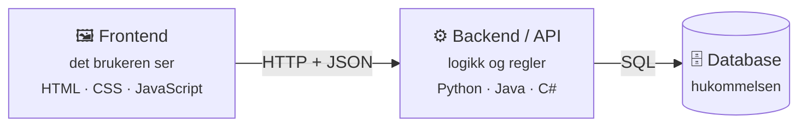
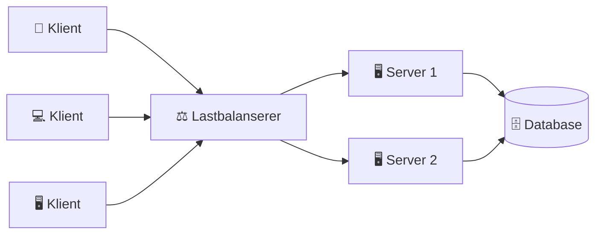
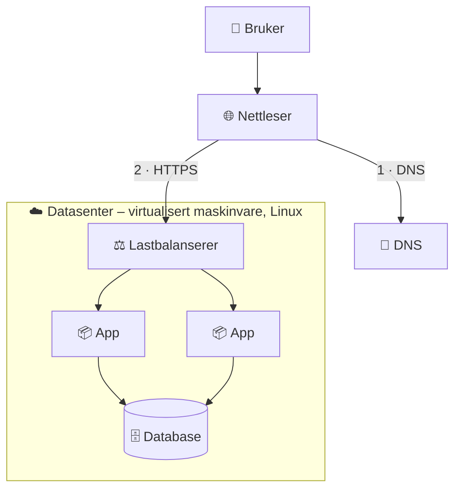

# 1 · Forstå IT fra bunnen

```vis
type: cards
title: Kapittelet på én side
cols: 4
items:
  - {icon: "🧠", title: "Datamaskinen", text: "CPU, RAM og lagring jobber sammen", color: blue}
  - {icon: "⚙️", title: "Operativsystem", text: "Sjefen som fordeler maskinvaren", color: teal}
  - {icon: "🖥️", title: "Server", text: "En maskin som leverer tjenester til andre", color: purple}
  - {icon: "🧩", title: "Applikasjon", text: "Frontend + backend + database", color: orange}
  - {icon: "🌍", title: "Internett", text: "Nettverk av nettverk som sender pakker", color: green}
  - {icon: "📖", title: "DNS og HTTP", text: "Navn → IP, og språket for web", color: pink}
  - {icon: "🤝", title: "API", text: "Avtalt måte for programmer å snakke på", color: navy}
  - {icon: "🏢", title: "Virtualisering", text: "Én fysisk maskin blir mange", color: red}
```

## Hvordan fungerer en datamaskin?

⚡ **Kort sagt:** En datamaskin tar imot data, behandler dem, lagrer dem og gir et resultat.

```vis
type: cards
title: De fire viktigste delene
cols: 4
items:
  - {icon: "🧠", title: "CPU", text: "Hjernen. Utfører milliarder av instruksjoner i sekundet. Flere kjerner = flere oppgaver samtidig.", color: blue}
  - {icon: "🪑", title: "RAM", text: "Arbeidsbenken. Superrask, men tømmes når strømmen går.", color: teal}
  - {icon: "🗄️", title: "SSD / disk", text: "Lageret. Beholder alt når maskinen er av, men er tregere enn RAM.", color: purple}
  - {icon: "🌐", title: "Nettverkskort", text: "Døren ut til andre maskiner og internett.", color: orange}
```

```vis
type: analogy
left: {icon: "👨‍🍳", title: "Restaurantkjøkkenet", text: "Kokken lager mat på benken med varer fra kjølerommet", color: orange}
right: {icon: "💻", title: "Datamaskinen", text: "CPU-en jobber med data i RAM, hentet fra disken", color: blue}
map: [["Kokk", "CPU"], ["Flere kokker", "Flere kjerner"], ["Benken", "RAM"], ["Kjølerommet", "SSD / disk"]]
```

```vis
type: layers
title: Raskest øverst – størst og billigst nederst
items:
  - {icon: "⚡", title: "CPU-cache", text: "nanosekunder · noen MB", color: red}
  - {icon: "🪑", title: "RAM", text: "~100 nanosekunder · GB", color: orange}
  - {icon: "🚀", title: "NVMe SSD", text: "mikrosekunder · hundrevis av GB", color: green}
  - {icon: "💿", title: "Harddisk (HDD)", text: "millisekunder · TB", color: teal}
  - {icon: "☁️", title: "Nettverk / sky-lagring", text: "millisekunder og mer · nesten ubegrenset", color: blue}
```

> 🏢 **Fra arbeidslivet:** Når du lager en VM i Azure, velger du antall **vCPU** og GB **RAM**. Går en server tom for RAM, blir den treg – eller programmet drepes (`OOMKilled`).

## Operativsystemet

⚡ **Kort sagt:** Operativsystemet (OS) er sjefen som lar programmene dele maskinvaren trygt.

```vis
type: layers
title: Lagene i en datamaskin
items:
  - {icon: "📱", title: "Applikasjoner", text: "nettleser · Python · nginx · database", color: blue}
  - {icon: "⚙️", title: "Operativsystem (kjerne)", text: "prosesser · minne · filer · nettverk · sikkerhet", color: teal}
  - {icon: "🔩", title: "Maskinvare", text: "CPU · RAM · SSD · nettverkskort", color: gray}
```

- Eksempler: **Linux** (de fleste servere), Windows, macOS.
- **Kjernen** (*kernel*) er hjertet i OS-et. Linux er egentlig navnet på en kjerne.

## Server vs. vanlig PC

⚡ **Kort sagt:** En server er en *rolle* – en maskin som leverer tjenester til andre over nettverket.

```vis
type: compare
vs: true
columns:
  - icon: "💻"
    title: "Vanlig PC"
    sub: "én bruker"
    color: gray
    points: ["Slås av om kvelden", "Skjerm og tastatur", "Windows / macOS", "Forbrukerdeler"]
  - icon: "🖥️"
    title: "Server"
    sub: "mange brukere"
    color: blue
    points: ["Går 24/7 i årevis", "Ingen skjerm – styres via SSH", "Oftest Linux", "Ekstra strømforsyning, RAID, ECC-RAM"]
```

```vis
type: cards
title: Vanlige typer servere
cols: 3
items:
  - {icon: "🌐", title: "Webserver", text: "Leverer nettsider (nginx, Apache)", color: blue}
  - {icon: "⚙️", title: "Applikasjonsserver", text: "Kjører forretningslogikken (Python, Java)", color: teal}
  - {icon: "🗄️", title: "Databaseserver", text: "Lagrer data (PostgreSQL, SQL Server)", color: purple}
  - {icon: "📖", title: "DNS-server", text: "Oversetter navn til IP-adresser", color: orange}
  - {icon: "📁", title: "Filserver", text: "Deler filer i nettverket", color: green}
  - {icon: "✉️", title: "E-postserver", text: "Sender og mottar e-post", color: pink}
```

## Applikasjonen: frontend, backend og database



```vis
type: analogy
left: {icon: "🍽️", title: "Restauranten", text: "Gjesten ser bare spisesalen – resten skjer bak kulissene", color: orange}
right: {icon: "🧩", title: "Applikasjonen", text: "Brukeren ser bare frontend – resten skjer på serverne", color: blue}
map: [["Spisesal og meny", "Frontend"], ["Servitør", "API"], ["Kjøkken", "Backend"], ["Lager", "Database"]]
```

## Databaser

⚡ **Kort sagt:** En database lagrer og henter data trygt og raskt – også når tusenvis skriver samtidig.

```vis
type: compare
columns:
  - icon: "📋"
    title: "SQL (relasjonell)"
    sub: "tabeller med faste kolonner"
    color: blue
    points: ["Bank, ordre, regnskap", "Sterk konsistens og transaksjoner", "PostgreSQL · SQL Server · Azure SQL"]
  - icon: "🧾"
    title: "NoSQL"
    sub: "fleksible dokumenter / nøkkel–verdi"
    color: teal
    points: ["Cache, sesjoner, kataloger, IoT", "Skalerer lett, fleksibelt skjema", "MongoDB · Redis · Cosmos DB"]
```

```sql
-- Hent navn og beløp for alle ordrer over 1000 kroner
SELECT kunder.navn, ordrer.beløp
FROM ordrer JOIN kunder ON kunder.id = ordrer.kunde_id
WHERE ordrer.beløp > 1000;
```

> 💡 **Husk:** En server kan bygges på nytt på minutter. Tapte data er ofte borte for alltid. **Backup – og test at du kan gjenopprette.**

## Internett, IP og DNS

⚡ **Kort sagt:** Data deles i små **pakker** med avsender- og mottakeradresse (IP). Rutere sender dem videre som postterminaler.

```vis
type: analogy
left: {icon: "📮", title: "Posten", text: "En bok sendes som nummererte postkort som kan ta ulike ruter", color: orange}
right: {icon: "📦", title: "Pakkesvitsjing", text: "Data deles i pakker som settes sammen igjen hos mottakeren", color: blue}
map: [["Adresse", "IP-adresse"], ["Postterminal", "Ruter"], ["Telefonkatalog", "DNS"], ["Kvittering", "TCP"]]
```

```vis
type: cards
title: Protokollene du møter i hele boken
cols: 4
items:
  - {icon: "🏷️", title: "IP", text: "Adresse og ruting av pakker", color: blue}
  - {icon: "✅", title: "TCP", text: "Pålitelig – alt kommer frem i riktig rekkefølge", color: teal}
  - {icon: "⚡", title: "UDP", text: "Raskt, men uten garanti", color: orange}
  - {icon: "📖", title: "DNS", text: "Navn → IP-adresse", color: purple}
  - {icon: "📨", title: "HTTP", text: "Språket for web og API-er", color: green}
  - {icon: "🔒", title: "TLS / HTTPS", text: "Krypterer forbindelsen", color: red}
  - {icon: "🔑", title: "SSH", text: "Sikker fjernstyring av servere", color: navy}
  - {icon: "⏱️", title: "NTP", text: "Synkroniserer klokken", color: gray}
```

## HTTP og API

⚡ **Kort sagt:** Klienten sender en **forespørsel**, serveren svarer med en **statuskode** og data.

```vis
type: cards
title: HTTP-metoder
cols: 4
items:
  - {icon: "📥", title: "GET", text: "Hent data", color: blue}
  - {icon: "➕", title: "POST", text: "Opprett noe nytt", color: green}
  - {icon: "✏️", title: "PUT / PATCH", text: "Oppdater", color: orange}
  - {icon: "🗑️", title: "DELETE", text: "Slett", color: red}
```

```vis
type: analogy
left: {icon: "🧑‍🍳", title: "Servitøren", text: "Du bestiller fra menyen uten å gå inn på kjøkkenet", color: orange}
right: {icon: "🤝", title: "API-et", text: "Programmet sender forespørsler uten å vite hvordan serveren er bygget", color: blue}
map: [["Meny", "API-dokumentasjon"], ["Bestilling", "Request"], ["Maten", "Response (JSON)"], ["Kjøkkenet", "Serveren"]]
```

```bash
$ curl https://api.github.com/users/octocat
{ "login": "octocat", "name": "The Octocat", "public_repos": 8, ... }
```

> 🏢 **Fra arbeidslivet:** Alt i skyen er API-kall. Klikker du «Create» i Azure Portal, sender portalen et API-kall. Derfor kan **alt** i skyen automatiseres.

## Hva skjer når du åpner en nettside?

Et klassisk intervjuspørsmål. Lær denne figuren utenat:

```vis
type: flow
title: Fra Enter til ferdig side
steps:
  - {icon: "⌨️", title: "URL", text: "https://www.example.com"}
  - {icon: "📖", title: "DNS", text: "Slå opp navn → IP"}
  - {icon: "🤝", title: "TCP", text: "Håndtrykk mot port 443"}
  - {icon: "🔒", title: "TLS", text: "Sjekk sertifikat, avtal nøkler"}
  - {icon: "📨", title: "HTTP", text: "GET / → 200 OK + HTML"}
  - {icon: "🖼️", title: "Tegn siden", text: "Hent CSS, JS og bilder"}
loop: "hvert steg kan feile – og hvert steg har sitt feilsøkingsverktøy"
```

```vis
type: cards
title: Feilsøkingsverktøy per steg
cols: 5
items:
  - {icon: "📖", title: "DNS", text: "nslookup · dig", color: purple}
  - {icon: "🛣️", title: "Nettverk", text: "ping · traceroute", color: teal}
  - {icon: "🚪", title: "Port", text: "nc -zv", color: orange}
  - {icon: "🔒", title: "TLS", text: "openssl s_client", color: red}
  - {icon: "📨", title: "HTTP", text: "curl -v", color: blue}
```

## Klient–server og arkitekturer



```vis
type: cards
title: Fra enkelt til avansert
cols: 3
items:
  - {icon: "🧱", title: "Monolitt", text: "Alt i ett program. Enkelt å starte.", color: blue}
  - {icon: "🍰", title: "Tre lag", text: "Presentasjon · logikk · data", color: teal}
  - {icon: "🧩", title: "Mikrotjenester", text: "Mange små tjenester via API. Fleksibelt, men mer å drifte – her skinner Docker og Kubernetes.", color: purple}
```

## Virtualisering

⚡ **Kort sagt:** En **hypervisor** deler én fysisk server i mange **virtuelle maskiner** (VM-er), hver med eget operativsystem.

```vis
type: layers
title: Virtualisering
items:
  - {icon: "🧩", title: "VM 1 · VM 2 · VM 3", text: "hver med egen app og eget OS (Ubuntu, Windows, Red Hat)", color: blue}
  - {icon: "🎛️", title: "Hypervisor", text: "Hyper-V · KVM · VMware ESXi – fordeler ressursene", color: teal}
  - {icon: "🔩", title: "Fysisk server", text: "CPU · RAM · disk · nettverk", color: gray}
```

```vis
type: analogy
left: {icon: "🏢", title: "Leilighetsbygg", text: "Ett stort bygg delt i leiligheter med egne dører og låser", color: orange}
right: {icon: "🖥️", title: "Virtualisert server", text: "Én fysisk server delt i VM-er med egne OS", color: blue}
map: [["Bygningen", "Fysisk server"], ["Leilighet", "VM"], ["Vaktmester", "Hypervisor"], ["Strøm og vann", "CPU og RAM"]]
```

> 🏢 **Fra arbeidslivet:** Hele Azure er bygget på virtualisering. En Azure-VM er en virtuell maskin på en fysisk server i et Microsoft-datasenter.

## Slik henger alt sammen



## Test deg selv

1. Hva er forskjellen på RAM og SSD? → *RAM er raskt korttidsminne som tømmes; SSD beholder data, men er tregere.*
2. Hva gjør DNS? → *Oversetter navn til IP-adresser.*
3. Hva betyr statuskode 404? → *Ressursen finnes ikke.*
4. Hva er et API? → *En avtalt måte for programmer å snakke sammen – som en servitør.*
5. Hva er en hypervisor? → *Programvaren som kjører virtuelle maskiner på en fysisk server.*
6. Hvorfor kan alt i skyen automatiseres? → *Fordi alt – også klikk i portalen – er API-kall.*

**Prøv selv:** `nslookup www.noroff.no` · `curl -I https://www.noroff.no` · installer Ubuntu i VirtualBox eller WSL.
