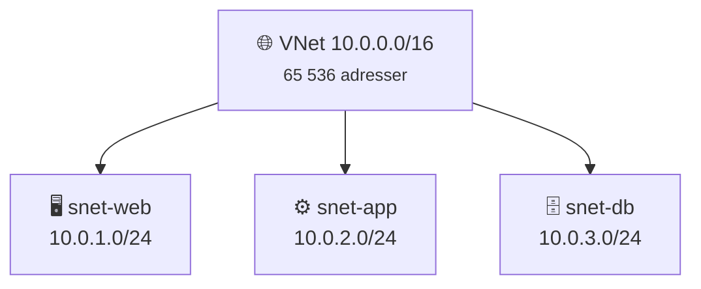
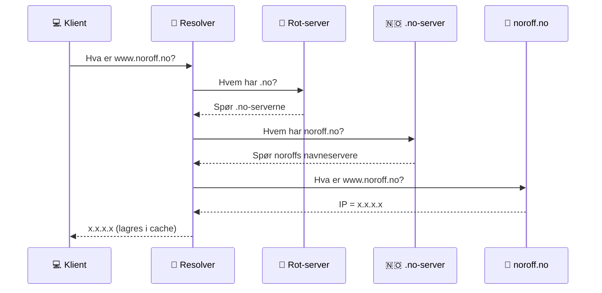
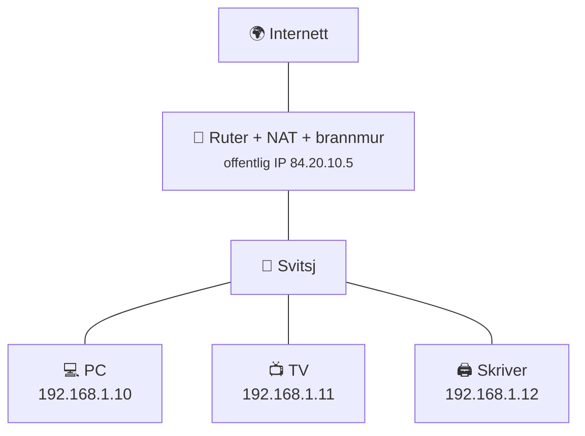
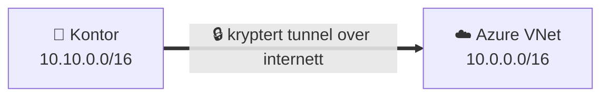
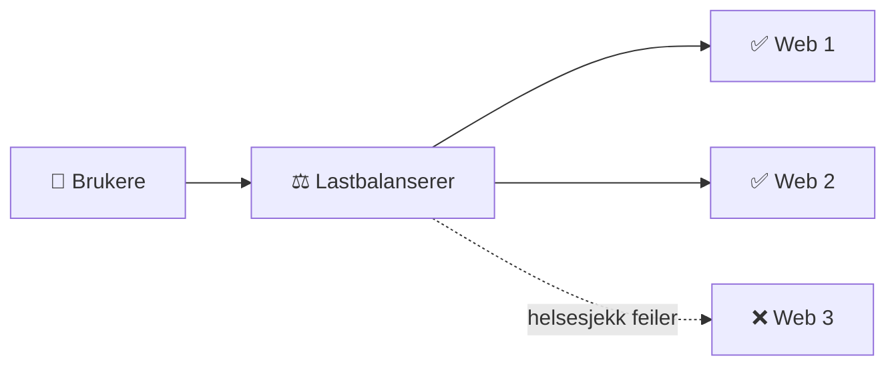
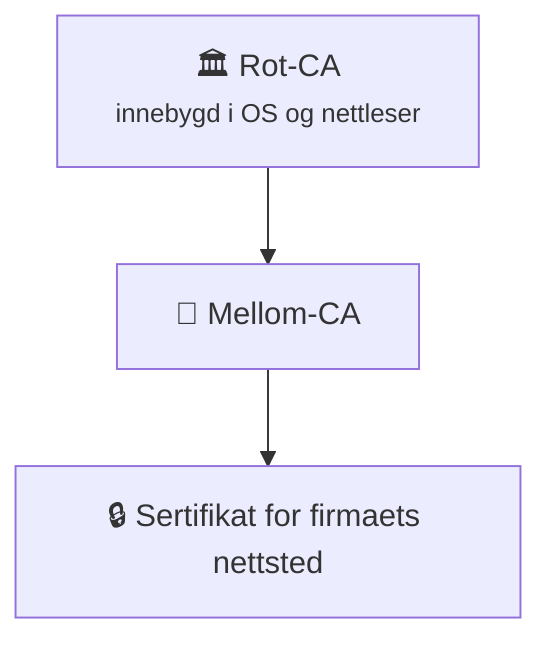
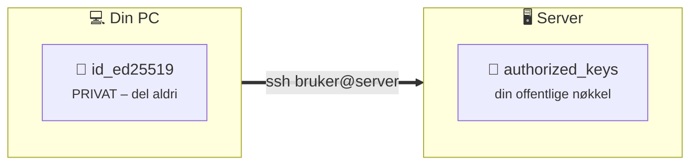

# 2 · Nettverk for DevOps

```vis
type: cards
title: Kapittelet på én side
cols: 4
items:
  - {icon: "🗂️", title: "Lagmodellen", text: "Feilsøk nedenfra og opp", color: blue}
  - {icon: "🏷️", title: "IP og CIDR", text: "Adresser og subnett – regn med 2^(32−prefiks)", color: teal}
  - {icon: "📖", title: "DNS og DHCP", text: "Navn → IP, og automatiske adresser", color: purple}
  - {icon: "🚪", title: "TCP, UDP, porter", text: "Hvordan data leveres, og til hvilken tjeneste", color: orange}
  - {icon: "🧱", title: "Brannmur og NAT", text: "Hva slipper inn, og hvem deler adresse", color: red}
  - {icon: "⚖️", title: "Lastbalansering", text: "Fordel trafikk og tål feil", color: green}
  - {icon: "🔒", title: "TLS og SSH", text: "Kryptering og sikker innlogging", color: navy}
  - {icon: "🔍", title: "Feilsøking", text: "Systematisk, ett lag om gangen", color: pink}
```

> 🏢 **Hvorfor dette er viktig:** «Det virker ikke» betyr veldig ofte at noe i nettverket er feil – en brannmurregel, DNS, en port, et subnett. I Azure designer du dette selv.

## Lagmodellen (OSI / TCP-IP)

```vis
type: layers
title: Nettverket i lag – hvert lag har én jobb
items:
  - {icon: "📨", title: "7 · Applikasjon", text: "HTTP · DNS · SSH · TLS · JSON", color: blue}
  - {icon: "🚚", title: "4 · Transport", text: "TCP · UDP · porter", color: teal}
  - {icon: "🗺️", title: "3 · Nettverk", text: "IP-adresser · ruting · ping (ICMP)", color: purple}
  - {icon: "🔌", title: "2 · Datalink", text: "Ethernet · MAC-adresser · svitsj", color: orange}
  - {icon: "〰️", title: "1 · Fysisk", text: "kabel · fiber · Wi-Fi", color: gray}
```

```vis
type: analogy
left: {icon: "✉️", title: "Å sende et brev", text: "Innhold, sidenummer, adresse, postbil og vei", color: orange}
right: {icon: "🗂️", title: "Nettverkslagene", text: "Hver del av jobben har sitt eget lag", color: blue}
map: [["Brevets innhold", "Lag 7 – HTTP"], ["Nummererte sider", "Lag 4 – TCP"], ["Adressen", "Lag 3 – IP"], ["Postbil og vei", "Lag 2 og 1"]]
```

> 🏢 **Fra arbeidslivet:** «Lag 4-lastbalanserer» = ser bare IP og port (Azure Load Balancer). «Lag 7» = forstår HTTP og URL-er (Application Gateway).

## IP-adresser

```vis
type: compare
columns:
  - icon: "4️⃣"
    title: "IPv4"
    sub: "32 bit · 192.168.1.25"
    color: blue
    points: ["Fire tall fra 0 til 255", "~4,3 milliarder adresser – nesten brukt opp", "Fortsatt mest brukt internt og i skyen"]
  - icon: "6️⃣"
    title: "IPv6"
    sub: "128 bit · 2001:db8::1"
    color: teal
    points: ["Åtte grupper heksadesimale tall", "Nesten uendelig mange adresser", "Kjører ofte side om side med IPv4"]
```

```vis
type: cards
title: Private adresser (brukes inne i nett – rutes aldri på internett)
cols: 3
items:
  - {icon: "🏢", title: "10.0.0.0/8", text: "~16,7 mill. adresser · bedrifter og Azure VNets", color: blue}
  - {icon: "🐳", title: "172.16.0.0/12", text: "~1 mill. · bedrifter og Docker", color: teal}
  - {icon: "🏠", title: "192.168.0.0/16", text: "65 536 · hjemmenettverk", color: orange}
  - {icon: "🔁", title: "127.0.0.1", text: "localhost – maskinen selv", color: purple}
  - {icon: "🌍", title: "0.0.0.0", text: "«alle adresser» når en app lytter", color: green}
  - {icon: "⚠️", title: "169.254.x.x", text: "DHCP feilet (i Azure: 169.254.169.254 = metadata)", color: red}
```

```vis
type: analogy
left: {icon: "🏢", title: "Kontorbygg", text: "Posten kjenner bare gateadressen – resepsjonen vet hvilket rom", color: orange}
right: {icon: "🌐", title: "Nettverk", text: "Internett ser én offentlig IP – ruteren vet hvilken PC", color: blue}
map: [["Gateadresse", "Offentlig IP"], ["Romnummer", "Privat IP"], ["Resepsjon", "Ruter med NAT"]]
```

## Subnetting og CIDR

⚡ **Kort sagt:** Tallet etter `/` sier hvor mange bit som er nettverksdelen. Resten er til maskiner.

```vis
type: stats
title: "Formelen du må kunne:  antall adresser = 2^(32 − prefiks)"
cols: 5
items:
  - {value: "/16", label: "65 536 adresser · et helt VNet", color: navy}
  - {value: "/24", label: "256 · vanlig subnett", color: blue}
  - {value: "/26", label: "64 · lite subnett", color: teal}
  - {value: "/28", label: "16 · veldig lite", color: orange}
  - {value: "/29", label: "8 · minste i Azure", color: red}
note: "Mindre tall = større nett. +1 på prefikset halverer antall adresser."
```



```vis
type: cards
title: Azure reserverer 5 adresser i hvert subnett (eksempel 10.0.1.0/24)
cols: 5
items:
  - {icon: "0️⃣", title: ".0", text: "Nettverksadresse", color: gray}
  - {icon: "🚪", title: ".1", text: "Standard gateway", color: blue}
  - {icon: "📖", title: ".2 og .3", text: "Azure DNS", color: purple}
  - {icon: "📢", title: ".255", text: "Broadcast", color: gray}
  - {icon: "✅", title: "251", text: "brukbare adresser igjen", color: green}
```

> ⚠️ **Vanlig feil:** VNets som overlapper (f.eks. `10.0.0.0/16` og `10.0.128.0/17`) kan ikke kobles sammen. Planlegg adresser romslig fra start – særlig for Kubernetes.

## DNS – internettets telefonkatalog



```vis
type: cards
title: De viktigste DNS-postene
cols: 4
items:
  - {icon: "🅰️", title: "A / AAAA", text: "Navn → IPv4 / IPv6", color: blue}
  - {icon: "🔗", title: "CNAME", text: "Navn → annet navn (alias)", color: teal}
  - {icon: "✉️", title: "MX", text: "E-postserver for domenet", color: orange}
  - {icon: "📝", title: "TXT", text: "Tekst – ofte verifisering", color: purple}
```

```bash
$ dig +short www.example.com      # bare svaret
$ dig example.com MX              # hvilken e-postserver?
```

> ⚠️ **Vanlig feil:** «Jeg endret DNS, men ingenting skjer!» – gamle svar lever i cache til **TTL** går ut. «It's always DNS» er et ekte ordtak.

## DHCP – automatiske adresser

```vis
type: flow
title: "DHCP på fire steg – husk DORA"
steps:
  - {icon: "📣", title: "Discover", text: "«Er det en DHCP-server her?»"}
  - {icon: "🎁", title: "Offer", text: "«Du kan få 192.168.1.50»"}
  - {icon: "🙋", title: "Request", text: "«Jeg tar den!»"}
  - {icon: "✅", title: "Ack", text: "«Bekreftet – leid i 24 timer»"}
```

> 🍕 **Hverdagsanalogi:** Hotellresepsjonen gir deg et rom (adresse) for et visst antall netter (*lease*).

## TCP, UDP og porter

```vis
type: compare
vs: true
columns:
  - icon: "📬"
    title: "TCP"
    sub: "rekommandert post med kvittering"
    color: blue
    points: ["+ Alt kommer frem, i riktig rekkefølge", "Tre-veis håndtrykk: SYN → SYN-ACK → ACK", "Web, SSH, e-post, databaser"]
  - icon: "📢"
    title: "UDP"
    sub: "rope gjennom vinduet"
    color: orange
    points: ["+ Raskt, lite overhead", "- Ingen garanti", "DNS, video, spill, VoIP"]
```

```vis
type: cards
title: Porter du bør kunne utenat
cols: 5
items:
  - {icon: "🔑", title: "22", text: "SSH", color: navy}
  - {icon: "📖", title: "53", text: "DNS", color: purple}
  - {icon: "🌐", title: "80", text: "HTTP", color: blue}
  - {icon: "🔒", title: "443", text: "HTTPS", color: green}
  - {icon: "🪟", title: "3389", text: "RDP (Windows)", color: gray}
  - {icon: "🗄️", title: "1433", text: "SQL Server / Azure SQL", color: red}
  - {icon: "🐘", title: "5432", text: "PostgreSQL", color: teal}
  - {icon: "⚡", title: "6379", text: "Redis", color: orange}
  - {icon: "☸️", title: "6443", text: "Kubernetes API", color: pink}
  - {icon: "🔧", title: "8080", text: "Alternativ HTTP", color: yellow}
```

> 🍕 **Hverdagsanalogi:** IP-adressen er **bygget**, porten er **døren**.

> ⚠️ **Vanlig feil:** En app som lytter på `127.0.0.1:8080` kan bare nås fra maskinen selv. Den må lytte på `0.0.0.0:8080` for å nås utenfra – klassiker i Docker.

## Ruter, svitsj, brannmur og NAT



```vis
type: cards
cols: 4
items:
  - {icon: "🔀", title: "Svitsj (lag 2)", text: "Kobler enheter i samme nett via MAC-adresser", color: teal}
  - {icon: "📡", title: "Ruter (lag 3)", text: "Kobler ulike nettverk og velger vei for pakkene", color: orange}
  - {icon: "🧱", title: "Brannmur", text: "Tillater eller avviser trafikk etter regler. Avvis alt – åpne det som trengs.", color: red}
  - {icon: "🔄", title: "NAT", text: "Mange private adresser deler én offentlig", color: purple}
```

```vis
type: layers
title: "Brannmurregler leses ovenfra – første treff vinner"
items:
  - {icon: "✅", title: "100 · Tillat 443", text: "fra Internett", color: green}
  - {icon: "✅", title: "110 · Tillat 22", text: "bare fra kontorets IP 84.20.10.5/32", color: green}
  - {icon: "⛔", title: "4096 · Avvis alt", text: "alt annet stoppes", color: red}
```

> 💰 **Sikkerhet:** Åpne **aldri** SSH (22) eller RDP (3389) mot hele internett. Roboter prøver å bryte seg inn hele døgnet.

## VPN



- **Site-to-site:** hele kontoret ↔ Azure (Azure VPN Gateway).
- **Point-to-site:** én PC ↔ nettverket.
- **ExpressRoute:** privat linje til Azure – ikke over internett.

## Lastbalansering og reverse proxy



```vis
type: compare
columns:
  - icon: "4️⃣"
    title: "Lag 4"
    sub: "ser IP og port"
    color: teal
    points: ["Rask fordeling av TCP/UDP", "Azure Load Balancer"]
  - icon: "7️⃣"
    title: "Lag 7"
    sub: "forstår HTTP"
    color: purple
    points: ["Ruting på URL og vertsnavn", "TLS og WAF", "Application Gateway · Front Door"]
```

```vis
type: compare
vs: true
columns:
  - icon: "🙋"
    title: "Forward proxy"
    sub: "står foran klientene"
    color: blue
    points: ["Sender forespørsler ut for dem", "Filtrering og logging i bedrifter"]
  - icon: "🛡️"
    title: "Reverse proxy"
    sub: "står foran serverne"
    color: green
    points: ["Tar imot for dem: TLS, ruting, cache", "nginx · Traefik · Application Gateway · Ingress"]
```

## TLS og sertifikater

```vis
type: cards
title: TLS gir tre ting
cols: 3
items:
  - {icon: "🙈", title: "Konfidensialitet", text: "Ingen kan lese trafikken", color: blue}
  - {icon: "🧾", title: "Integritet", text: "Ingen kan endre den i det skjulte", color: teal}
  - {icon: "🪪", title: "Autentisering", text: "Sertifikatet beviser at det er riktig server", color: purple}
```



> ⚠️ **Vanlig feil:** **Utløpte sertifikater** er en av de vanligste årsakene til nedetid. Automatiser fornyelse og overvåk utløpsdatoer.

## HTTP-statuskoder

```vis
type: cards
title: Første siffer forteller hvem som har feilen
cols: 4
items:
  - {icon: "✅", title: "2xx – OK", text: "200 OK · 201 Created · 204 No Content", color: green}
  - {icon: "↪️", title: "3xx – Videre", text: "301 flyttet · 302/307 midlertidig · 304 bruk cache", color: blue}
  - {icon: "🙋", title: "4xx – Klientfeil", text: "400 feil format · 401 logg inn · 403 ikke lov · 404 finnes ikke · 429 for mange", color: orange}
  - {icon: "🔥", title: "5xx – Serverfeil", text: "500 krasj · 502 backend svarer ikke · 503 overbelastet · 504 timeout", color: red}
```

> 💡 **Husk:** **401** = «hvem er du?» · **403** = «jeg vet hvem du er, men nei». **502** fra en proxy = appen *bak* svarer ikke.

## SSH med nøkler



```bash
$ ssh-keygen -t ed25519 -C "student@noroff"   # lag nøkkelpar
$ ssh-copy-id student@203.0.113.10             # legg offentlig nøkkel på serveren
$ ssh student@203.0.113.10                     # logg inn
```

## Feilsøking – nedenfra og opp

```vis
type: vflow
title: Test ett lag om gangen
steps:
  - {icon: "🔌", title: "Har jeg IP?", text: "ip addr / ipconfig"}
  - {icon: "🚪", title: "Når jeg gatewayen og internett?", text: "ping 192.168.1.1 · ping 1.1.1.1"}
  - {icon: "📖", title: "Virker DNS?", text: "dig minside.no"}
  - {icon: "🔢", title: "Er porten åpen?", text: "nc -zv minside.no 443"}
  - {icon: "🔒", title: "Virker TLS?", text: "openssl s_client -connect minside.no:443"}
  - {icon: "📨", title: "Hva svarer HTTP?", text: "curl -v https://minside.no"}
  - {icon: "📜", title: "Hva sier serveren?", text: "ss -tlnp · journalctl · nginx-loggen"}
```

```vis
type: compare
columns:
  - icon: "⏳"
    title: "Timeout / henger"
    sub: "pakkene kommer ikke frem"
    color: orange
    points: ["Sjekk brannmur / NSG", "Sjekk ruting"]
  - icon: "🚫"
    title: "Connection refused"
    sub: "maskinen svarte nei"
    color: red
    points: ["Ingen tjeneste lytter på porten", "Sjekk at appen kjører og lytter på 0.0.0.0"]
```

## Test deg selv

1. Hvor mange adresser er det i `/26`? → *2⁶ = 64 (59 brukbare i Azure).*
2. Er `172.32.0.1` privat? → *Nei – 172.16.0.0/12 slutter på 172.31.255.255.*
3. A-post vs. CNAME? → *A peker til IP; CNAME peker til et annet navn.*
4. Hvilke porter bruker HTTPS, SSH og PostgreSQL? → *443, 22, 5432.*
5. «Refused» vs. «timeout»? → *Refused: ingen lytter. Timeout: blokkert/droppet.*
6. Kan `10.0.0.0/16` og `10.0.128.0/17` peeres? → *Nei – de overlapper.*

**Prøv selv:** `dig noroff.no NS` · `traceroute vg.no` · `ss -tlnp` · lag et SSH-nøkkelpar.
