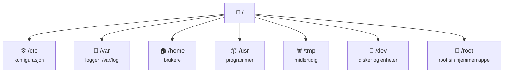

# 3 · Linux

```vis
type: cards
title: Kapittelet på én side
cols: 4
items:
  - {icon: "🐧", title: "Hva og hvorfor", text: "Nesten hele skyen kjører Linux", color: blue}
  - {icon: "🌳", title: "Filsystemet", text: "Ett tre som starter i /", color: teal}
  - {icon: "⌨️", title: "Kommandoer", text: "ls, cd, grep, find og pipes", color: purple}
  - {icon: "🔐", title: "Rettigheter", text: "Eier · gruppe · andre × r w x", color: orange}
  - {icon: "⚙️", title: "Prosesser og tjenester", text: "ps, top, systemctl", color: green}
  - {icon: "📦", title: "Pakker", text: "apt og dnf installerer programvare", color: pink}
  - {icon: "📜", title: "Bash og cron", text: "Skript og planlagte jobber", color: navy}
  - {icon: "🛡️", title: "Sikkerhet og feilsøking", text: "Oppdater, nøkler, brannmur, logger", color: red}
```

## Hvorfor Linux?

```vis
type: cards
cols: 4
items:
  - {icon: "☁️", title: "Skyen", text: "De fleste servere og sky-VM-er kjører Linux", color: blue}
  - {icon: "🐳", title: "Containere", text: "Docker og Kubernetes er bygget på Linux-kjernen", color: teal}
  - {icon: "🤖", title: "Automatiserbart", text: "Alt kan gjøres og skriptes fra terminalen", color: purple}
  - {icon: "🆓", title: "Gratis og åpent", text: "Stabilt, sikkert og godt dokumentert", color: green}
```

```vis
type: cards
title: Vanlige distribusjoner
cols: 4
items:
  - {icon: "🟠", title: "Ubuntu LTS", text: "apt · populær i sky – start her", color: orange}
  - {icon: "🔴", title: "RHEL / Rocky / Alma", text: "dnf · store bedrifter", color: red}
  - {icon: "🏔️", title: "Alpine", text: "apk · bittesmå container-images", color: blue}
  - {icon: "🪟", title: "Azure Linux", text: "Microsofts distro, bl.a. på AKS-noder", color: teal}
```

> 💡 **Øv gratis:** WSL på Windows (`wsl --install`), en VM i VirtualBox, eller **Azure Cloud Shell** i nettleseren.

## Terminalen

```vis
type: cards
title: "Anatomien til en kommando:  ls -la /var/log"
cols: 3
items:
  - {icon: "▶️", title: "ls", text: "kommandoen – hva skal gjøres", color: blue}
  - {icon: "🎚️", title: "-la", text: "flagg – endrer oppførselen (l = lang liste, a = alle)", color: orange}
  - {icon: "🎯", title: "/var/log", text: "argument – hva kommandoen jobber med", color: teal}
```

```vis
type: cards
title: Overlevelsestaster
cols: 4
items:
  - {icon: "⇥", title: "Tab", text: "Fullfør navn – bruk hele tiden!", color: green}
  - {icon: "⬆️", title: "Pil opp", text: "Forrige kommando", color: blue}
  - {icon: "🛑", title: "Ctrl + C", text: "Avbryt", color: red}
  - {icon: "🔎", title: "Ctrl + R", text: "Søk i historikken", color: purple}
```

## Filsystemet



> 💡 **Husk tre mapper:** `/etc` = konfigurasjon · `/var/log` = logger · `/home` = brukerfiler.

## Kommandoene du må kunne

```vis
type: cards
cols: 4
items:
  - {icon: "📍", title: "pwd", text: "Hvor er jeg?", color: blue}
  - {icon: "📋", title: "ls -la", text: "Hva ligger her (også skjulte filer)?", color: blue}
  - {icon: "🚶", title: "cd mappe", text: "Gå inn · cd .. = opp · cd ~ = hjem", color: blue}
  - {icon: "📁", title: "mkdir -p a/b", text: "Lag mapper", color: teal}
  - {icon: "📄", title: "cat · less", text: "Les en fil", color: teal}
  - {icon: "👀", title: "tail -f", text: "Følg en logg live", color: teal}
  - {icon: "📑", title: "cp · mv", text: "Kopier · flytt / gi nytt navn", color: orange}
  - {icon: "🗑️", title: "rm -r", text: "Slett – ingen papirkurv!", color: red}
  - {icon: "🔎", title: "grep -rin", text: "Søk etter tekst i filer", color: purple}
  - {icon: "🧭", title: "find", text: "Finn filer etter navn, størrelse, alder", color: purple}
  - {icon: "📊", title: "df -h · du -sh", text: "Diskplass", color: green}
  - {icon: "🧠", title: "free -h", text: "Minne", color: green}
```

### Pipes – superkraften

```vis
type: flow
title: "Topp 5 IP-er i webloggen – små verktøy satt sammen med |"
arrow: "|"
steps:
  - {icon: "📄", title: "cat", text: "access.log"}
  - {icon: "✂️", title: "awk", text: "plukk ut IP-kolonnen"}
  - {icon: "🔤", title: "sort", text: "sorter"}
  - {icon: "🔢", title: "uniq -c", text: "tell like"}
  - {icon: "🏆", title: "sort -rn | head -5", text: "flest først, vis 5"}
```

```bash
$ cat access.log | awk '{print $1}' | sort | uniq -c | sort -rn | head -5
$ echo "hei" > fil.txt        # > overskriver
$ echo "mer" >> fil.txt       # >> legger til
$ kommando > logg.txt 2>&1    # både utskrift og feil til fil
```

> ⚠️ **Vanlig feil:** `rm -rf` med en tom variabel kan slette alt. Dobbeltsjekk alltid stien.

## Brukere og rettigheter

```vis
type: cards
title: "Les rettighetene:  -rwxr-xr--  student  utviklere  deploy.sh"
cols: 4
items:
  - {icon: "📄", title: "-", text: "filtype (d = mappe)", color: gray}
  - {icon: "👤", title: "rwx – eier", text: "lese, skrive, kjøre", color: blue}
  - {icon: "👥", title: "r-x – gruppe", text: "lese og kjøre", color: teal}
  - {icon: "🌍", title: "r-- – andre", text: "bare lese", color: orange}
```

```vis
type: stats
title: "Tallene: r = 4 · w = 2 · x = 1 – legg sammen per gruppe"
cols: 4
items:
  - {value: "755", label: "skript og mapper", color: blue}
  - {value: "644", label: "vanlige filer", color: teal}
  - {value: "600", label: "SSH-nøkler og hemmeligheter", color: green}
  - {value: "777", label: "nesten aldri riktig!", color: red}
```

```bash
$ chmod +x deploy.sh                      # gjør kjørbar
$ chmod 600 ~/.ssh/id_ed25519             # bare eier
$ sudo chown www-data:www-data -R /var/www/side
$ sudo useradd -m -s /bin/bash kari       # ny bruker
$ sudo usermod -aG sudo kari              # legg i gruppe (husk -a!)
```

> 💡 **Husk:** Bruk en vanlig bruker + `sudo`, ikke root. Og aldri `chmod 777` for å «få det til å virke».

## Prosesser og tjenester

```vis
type: compare
columns:
  - icon: "🏃"
    title: "Prosesser"
    sub: "programmer som kjører nå"
    color: blue
    points: ["ps aux – list alle", "top / htop – live oversikt", "kill PID – avslutt pent", "kill -9 PID – tving (siste utvei)"]
  - icon: "⚙️"
    title: "Tjenester (systemd)"
    sub: "kjører i bakgrunnen hele tiden"
    color: teal
    points: ["systemctl status nginx", "systemctl start · stop · restart", "systemctl enable – start ved oppstart", "journalctl -u nginx -f – loggen"]
```

> ⚠️ **Vanlig feil:** `start` uten `enable` – tjenesten forsvinner ved neste omstart. Bruk `systemctl enable --now`.

## Pakkehåndtering

```vis
type: analogy
left: {icon: "📱", title: "App Store", text: "Du sier hva du vil ha – butikken henter det og alt det trenger", color: orange}
right: {icon: "📦", title: "apt / dnf", text: "Pakkehåndtereren henter programmet og avhengighetene fra trygge kilder", color: blue}
```

```bash
$ sudo apt update                 # oppdater pakkelisten (glem ikke!)
$ sudo apt install -y nginx       # installer
$ sudo apt upgrade                # oppgrader alt
```

## Miljøvariabler

```bash
$ export APP_ENV=production       # sett
$ echo $APP_ENV                   # les
$ echo $PATH                      # mappene shellet leter etter programmer i
```

> 🏢 **Fra arbeidslivet:** Samme app kjører i test og produksjon – bare med forskjellige miljøvariabler. Hemmeligheter skal **ikke** ligge i `.bashrc` eller Git.

## Bash-skript

```vis
type: cards
title: Byggesteinene i et skript
cols: 3
items:
  - {icon: "#️⃣", title: "#!/usr/bin/env bash", text: "Første linje: hvem kjører skriptet", color: navy}
  - {icon: "🛟", title: "set -euo pipefail", text: "Stopp ved feil og udefinerte variabler", color: red}
  - {icon: "📦", title: "navn=\"verdi\"", text: "Variabel – ingen mellomrom rundt =", color: blue}
  - {icon: "🔀", title: "if [[ -d mappe ]]", text: "Betingelse", color: orange}
  - {icon: "🔁", title: "for f in *.log", text: "Løkke", color: teal}
  - {icon: "🚦", title: "exit 0 / exit 1", text: "0 = suksess, alt annet = feil", color: green}
```

```bash
#!/usr/bin/env bash
set -euo pipefail
MAL="/var/backups/side"
mkdir -p "$MAL"
tar -czf "$MAL/side-$(date +%F).tar.gz" /var/www/side     # lag backup
find "$MAL" -name "*.tar.gz" -mtime +7 -delete            # slett eldre enn 7 dager
```

> 💡 **Husk:** Alltid `"$variabel"` med anførselstegn – og kjør **ShellCheck** på skriptene dine.

## Cron – planlagte jobber

```vis
type: cards
title: "30 2 * * *  /opt/backup.sh  =  hver dag kl. 02:30"
cols: 5
items:
  - {icon: "⏱️", title: "30", text: "minutt", color: blue}
  - {icon: "🕑", title: "2", text: "time", color: teal}
  - {icon: "📅", title: "*", text: "dag i måneden", color: purple}
  - {icon: "🗓️", title: "*", text: "måned", color: orange}
  - {icon: "📆", title: "*", text: "ukedag", color: green}
```

```vis
type: cards
cols: 4
items:
  - {icon: "🔄", title: "*/15 * * * *", text: "hvert 15. minutt", color: blue}
  - {icon: "💼", title: "0 9 * * 1-5", text: "kl. 9 på hverdager", color: teal}
  - {icon: "🌙", title: "0 0 1 * *", text: "midnatt den 1. hver måned", color: purple}
  - {icon: "🚀", title: "@reboot", text: "ved oppstart", color: orange}
```

> 🏢 **Fra arbeidslivet:** Samme syntaks brukes i GitHub Actions, Kubernetes CronJobs og Azure Functions.

## Logger og overvåking

```vis
type: cards
title: Hvor er loggene?
cols: 4
items:
  - {icon: "📒", title: "journalctl -u nginx", text: "Loggen til én tjeneste", color: blue}
  - {icon: "📜", title: "/var/log/syslog", text: "Generelle systemmeldinger", color: teal}
  - {icon: "🔑", title: "/var/log/auth.log", text: "Innlogginger og sudo", color: red}
  - {icon: "🌐", title: "/var/log/nginx/", text: "Webserverens access og error", color: purple}
```

## Sikkerhet på 6 punkter

```vis
type: cards
cols: 3
items:
  - {icon: "🔄", title: "Oppdater", text: "apt upgrade + unattended-upgrades", color: blue}
  - {icon: "🔑", title: "Bare SSH-nøkler", text: "PasswordAuthentication no · PermitRootLogin no", color: navy}
  - {icon: "🧱", title: "Brannmur", text: "ufw allow OpenSSH → ufw enable", color: red}
  - {icon: "🤏", title: "Minste privilegium", text: "Tjenester kjører som egne brukere", color: green}
  - {icon: "🚫", title: "Fail2ban", text: "Blokkerer passordgjettere", color: orange}
  - {icon: "👀", title: "Overvåk loggene", text: "auth.log viser hvem som prøver", color: purple}
```

## Feilsøking

```vis
type: vflow
title: Fra symptom til løsning
steps:
  - {icon: "🩺", title: "Symptom", text: "«Nettsiden gir 502»"}
  - {icon: "⚙️", title: "Kjører tjenesten?", text: "systemctl status nginx"}
  - {icon: "📜", title: "Hva sier loggene?", text: "journalctl -u nginx -n 100"}
  - {icon: "📊", title: "Ressurser?", text: "df -h · free -h · top"}
  - {icon: "🚪", title: "Porter?", text: "ss -tlnp · curl localhost:8000"}
  - {icon: "🔐", title: "Rettigheter?", text: "ls -l · id bruker"}
  - {icon: "🕵️", title: "Hva er endret?", text: "deploy? konfig? oppdatering?"}
```

## Test deg selv

1. Hvor ligger konfig og logger? → */etc og /var/log.*
2. Hva betyr `chmod 640`? → *Eier rw, gruppe r, andre ingenting.*
3. `>` vs. `>>`? → *Overskriv vs. legg til.*
4. `start` vs. `enable`? → *Nå vs. ved oppstart.*
5. Hva betyr `0 */6 * * *`? → *Hver sjette time.*
6. Hva betyr returkode 0? → *Suksess.*

**Prøv selv:** Installer nginx, start og enable den, og skriv et backup-skript som kjører med cron.
