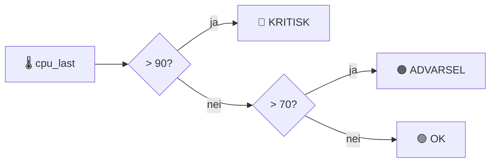
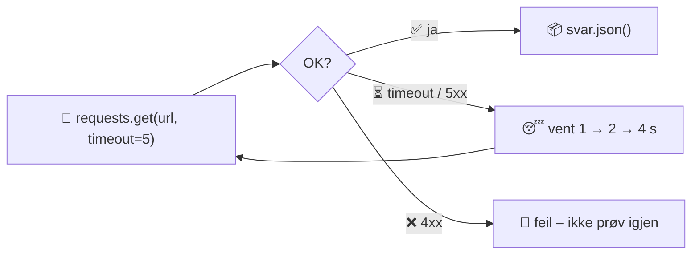
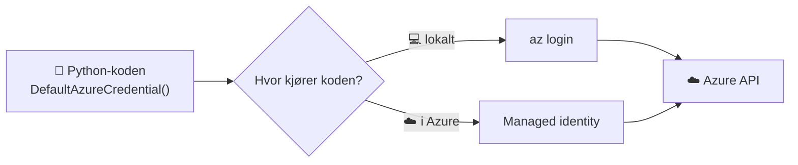

# 4 · Programmering for DevOps

```vis
type: cards
title: Kapittelet på én side
cols: 4
items:
  - {icon: "🤖", title: "Hva er koding?", text: "Presise oppskrifter for en robot", color: blue}
  - {icon: "📦", title: "Variabler og typer", text: "Navn som peker på verdier", color: teal}
  - {icon: "🔀", title: "if og løkker", text: "Velg og gjenta", color: purple}
  - {icon: "🧩", title: "Funksjoner", text: "Gjenbrukbare byggeklosser", color: orange}
  - {icon: "🗂️", title: "Lister og ordbøker", text: "Slik ser JSON ut i Python", color: green}
  - {icon: "📝", title: "JSON og YAML", text: "Dataformatene i hele DevOps", color: pink}
  - {icon: "🌐", title: "API-kall", text: "requests med timeout", color: navy}
  - {icon: "🛟", title: "Feil og logging", text: "try/except og logging", color: red}
```

## Hva er programmering?

```vis
type: analogy
left: {icon: "🤖", title: "Robotkokken", text: "«Stek til gyllen» holder ikke. Roboten trenger: platen på 6, vent 180 sekunder, snu.", color: orange}
right: {icon: "💻", title: "Datamaskinen", text: "Gjør nøyaktig det du skriver – ikke det du mente", color: blue}
```

```vis
type: cards
title: Hvorfor en DevOps Engineer koder
cols: 4
items:
  - {icon: "🔁", title: "Automatisere", text: "Rutiner, opprydding, rapporter", color: blue}
  - {icon: "📄", title: "Skrive konfig", text: "YAML, Terraform, pipelines", color: teal}
  - {icon: "🌐", title: "Bruke API-er", text: "Azure, GitHub, Slack", color: purple}
  - {icon: "🔍", title: "Feilsøke", text: "Lese andres kode og logger", color: orange}
```

> 💡 **Start med Python + Bash.** Senere: Go (Docker, Kubernetes og Terraform er skrevet i Go) og PowerShell.

## Kom i gang

```bash
$ python3 --version
$ python3 -m venv .venv && source .venv/bin/activate   # eget miljø per prosjekt
(.venv) $ pip install requests
(.venv) $ pip freeze > requirements.txt                 # lagre pakkelisten
```

## Variabler og datatyper

```vis
type: cards
cols: 4
items:
  - {icon: "🔤", title: "str", text: "\"nginx\" – tekst", color: blue}
  - {icon: "🔢", title: "int / float", text: "443 · 99.9 – tall", color: teal}
  - {icon: "✅", title: "bool", text: "True / False", color: green}
  - {icon: "🕳️", title: "None", text: "ingen verdi", color: gray}
  - {icon: "📋", title: "list", text: "[\"web-01\", \"web-02\"] – ordnet liste", color: orange}
  - {icon: "🗂️", title: "dict", text: "{\"navn\": \"web-01\", \"cpu\": 4}", color: purple}
```

```python
servernavn = "web-01"                          # tekst
antall_cpu = 4                                 # heltall
print(f"{servernavn} har {antall_cpu} CPU-er") # f-streng setter inn verdier
port = int("8080")                             # tekst → tall
```

> ⚠️ **Vanlig feil:** Verdier fra miljøvariabler og filer er alltid **tekst**. `"5" + 5` gir feil – bruk `int("5")`.

## Betingelser og løkker



```python
if cpu_last > 90:
    print("KRITISK")            # innrykk på 4 mellomrom = hører til if
elif cpu_last > 70:
    print("ADVARSEL")
else:
    print("OK")

for server in ["web-01", "web-02", "db-01"]:   # gjør noe for hver
    print(f"Sjekker {server}")
```

## Funksjoner

```vis
type: flow
title: En funksjon er en maskin – inn, behandling, ut
steps:
  - {icon: "📥", title: "Parametere", text: "cpu_prosent=95"}
  - {icon: "⚙️", title: "def status_for_last()", text: "logikken"}
  - {icon: "📤", title: "return", text: "\"HØY\""}
```

```python
def status_for_last(cpu_prosent: float, grense: float = 80.0) -> str:
    """Returnerer HØY eller NORMAL."""
    return "HØY" if cpu_prosent >= grense else "NORMAL"
```

## Lister, ordbøker og JSON

```vis
type: compare
columns:
  - icon: "📋"
    title: "Liste"
    sub: "porter[0] → 22"
    color: orange
    points: ["porter = [22, 80, 443]", "porter.append(8080)", "Indeks starter på 0!"]
  - icon: "🗂️"
    title: "Ordbok (dict)"
    sub: "vm[\"navn\"] → web-01"
    color: purple
    points: ["vm = {\"navn\": \"web-01\"}", "vm.get(\"ip\", \"ingen\") – trygt", "JSON fra API-er blir ordbøker"]
```

```vis
type: compare
vs: true
columns:
  - icon: "🧾"
    title: "JSON"
    sub: "API-er"
    color: blue
    points: ["{\"porter\": [80, 443]}", "Doble anførselstegn", "Ingen kommentarer"]
  - icon: "📐"
    title: "YAML"
    sub: "konfigurasjon"
    color: teal
    points: ["porter:\n  - 80\n  - 443", "Innrykk med MELLOMROM", "Kubernetes · Actions · Compose"]
```

```python
import json, yaml
data = json.loads('{"porter": [80, 443]}')     # tekst → dict
config = yaml.safe_load(open("config.yaml"))   # aldri yaml.load på ukjente filer
```

> ⚠️ **Vanlig feil:** Tab i YAML. Bruk alltid mellomrom – og sett tekst som `"1.10"` i anførselstegn.

## API-kall, feil og logging



```python
import logging, os, requests
logging.basicConfig(level=logging.INFO, format="%(asctime)s %(levelname)s %(message)s")
log = logging.getLogger("app")

token = os.environ["GITHUB_TOKEN"]                       # hemmelighet fra miljøet – aldri i koden
try:
    svar = requests.get("https://api.github.com/user",
                        headers={"Authorization": f"Bearer {token}"}, timeout=10)
    svar.raise_for_status()                              # kast feil ved 4xx/5xx
    log.info("Hei, %s", svar.json()["login"])
except requests.exceptions.RequestException as e:
    log.error("API-kall feilet: %s", e)
```

```vis
type: layers
title: Loggnivåer
items:
  - {icon: "🔥", title: "CRITICAL", text: "programmet kan ikke fortsette", color: red}
  - {icon: "❌", title: "ERROR", text: "en operasjon feilet", color: orange}
  - {icon: "⚠️", title: "WARNING", text: "noe uventet, men vi fortsetter", color: yellow}
  - {icon: "ℹ️", title: "INFO", text: "normale hendelser", color: blue}
  - {icon: "🔬", title: "DEBUG", text: "detaljer for feilsøking", color: gray}
```

## Python eller Bash?

```vis
type: compare
columns:
  - icon: "🐚"
    title: "Bash"
    color: teal
    points: ["Lime sammen Linux-kommandoer", "Korte skript", "Installere, kopiere, starte"]
  - icon: "🐍"
    title: "Python"
    color: blue
    points: ["Logikk og datastrukturer", "JSON og API-er", "Feilhåndtering og tester", "Skal vedlikeholdes over tid"]
```

## Python mot Azure



```python
from azure.identity import DefaultAzureCredential
from azure.mgmt.resource import ResourceManagementClient
klient = ResourceManagementClient(DefaultAzureCredential(), "<subscription-id>")
for rg in klient.resource_groups.list():
    print(rg.name, rg.location, rg.tags)
```

## Profesjonelle vaner

```vis
type: cards
cols: 4
items:
  - {icon: "🎛️", title: "argparse", text: "Argumenter i stedet for hardkoding", color: blue}
  - {icon: "⏱️", title: "timeout", text: "Alltid på nettverkskall", color: orange}
  - {icon: "🚦", title: "Returkode", text: "0 = ok – CI og cron leser den", color: green}
  - {icon: "🧪", title: "pytest", text: "Test logikken din", color: purple}
  - {icon: "🧹", title: "ruff / shellcheck", text: "Linting og formatering", color: teal}
  - {icon: "🔐", title: "Ingen hemmeligheter", text: "Miljøvariabler eller Key Vault", color: red}
  - {icon: "📜", title: "logging", text: "Ikke bare print", color: navy}
  - {icon: "📦", title: "venv + requirements.txt", text: "Reproduserbart miljø", color: pink}
```

## Test deg selv

1. Liste vs. ordbok? → *Liste: indeks. Ordbok: nøkkel → verdi.*
2. `["a","b","c"][1]`? → *"b".*
3. Hva er galt med tab i YAML? → *YAML tillater bare mellomrom.*
4. Hvorfor timeout? → *Ellers kan skriptet henge for alltid.*
5. Hvorfor er `except: pass` dumt? → *Skjuler alle feil.*
6. Hvor skal et token ligge? → *Miljøvariabel eller hemmelighetshvelv.*

**Prøv selv:** Skriv et skript som sjekker om en liste nettsider svarer, og skriver en JSON-rapport (mal i fullversjonen).
