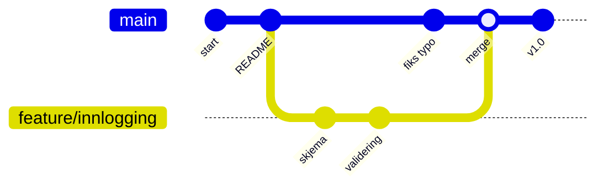
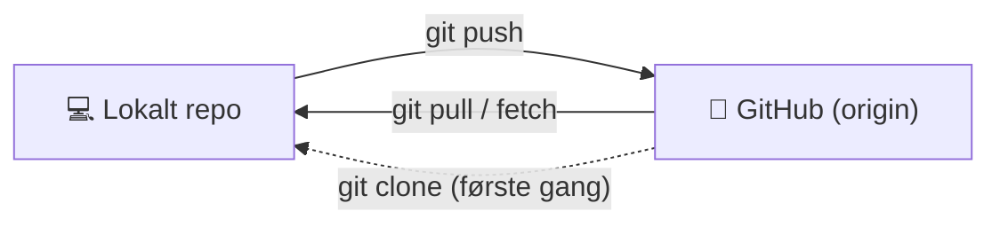
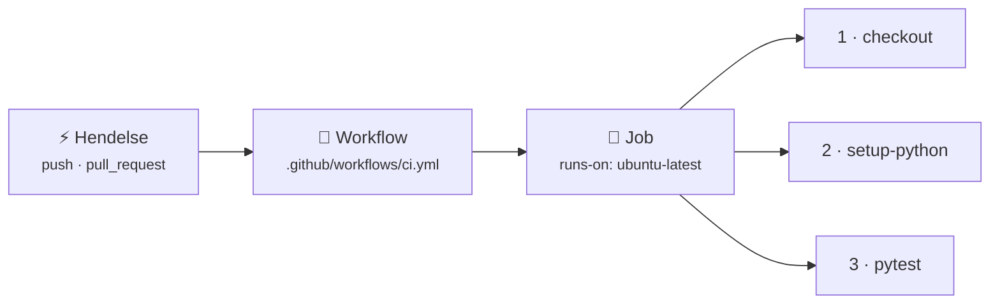

# 5 · Git og GitHub

```vis
type: cards
title: Kapittelet på én side
cols: 4
items:
  - {icon: "💾", title: "Versjonskontroll", text: "Husker alle endringer", color: blue}
  - {icon: "📸", title: "Commit", text: "Et øyeblikksbilde med melding", color: teal}
  - {icon: "🌿", title: "Branch", text: "En parallell linje", color: green}
  - {icon: "🔀", title: "Merge og konflikter", text: "Slå sammen – og løs uenighet", color: orange}
  - {icon: "☁️", title: "GitHub", text: "Dele, samarbeide, push og pull", color: purple}
  - {icon: "👀", title: "Pull request", text: "Gjennomgang før merge", color: pink}
  - {icon: "🛤️", title: "Arbeidsflyter", text: "GitHub Flow og trunk-based", color: navy}
  - {icon: "⚙️", title: "GitHub Actions", text: "Automatisering ved hver push", color: red}
```

## Hvorfor versjonskontroll?

```vis
type: compare
vs: true
columns:
  - icon: "😵"
    title: "Uten Git"
    color: red
    mark: "❌"
    points: ["rapport_v2_FINAL_ekte_final.docx", "Hvem endret hva?", "Overskriver hverandre", "Kan ikke angre"]
  - icon: "😌"
    title: "Med Git"
    color: green
    points: ["Full historikk – hvem, hva, hvorfor", "Mange jobber samtidig", "Gå tilbake til enhver versjon", "Finn endringen som laget feilen"]
```

```vis
type: analogy
left: {icon: "🎮", title: "Lagringspunkter i spill", text: "Lagre før det farlige området – last inn hvis det går galt", color: orange}
right: {icon: "💾", title: "Git", text: "Commit før endringer – gå tilbake hvis noe brekker", color: blue}
map: [["Lagringspunkt", "Commit"], ["Prøve en annen vei", "Branch"]]
```

```vis
type: compare
columns:
  - icon: "🔧"
    title: "Git"
    sub: "verktøyet – lokalt"
    color: orange
    points: ["Commits, branches, historikk", "Laget av Linus Torvalds (2005)"]
  - icon: "🐙"
    title: "GitHub"
    sub: "nettjenesten – i skyen"
    color: navy
    points: ["Deling og samarbeid", "Pull requests, issues, Actions", "Alternativer: GitLab, Azure Repos"]
```

## De tre områdene – det viktigste å forstå

```vis
type: flow
title: Fra endring til lagret historikk
steps:
  - {icon: "📝", title: "Arbeidsmappe", text: "filene du endrer", color: blue}
  - {icon: "📦", title: "Staging", text: "det som skal med i neste commit", color: orange}
  - {icon: "🏛️", title: "Repository", text: "lagrede øyeblikksbilder", color: green}
arrow: "➜"
note: "git add flytter til staging  ·  git commit lagrer i historikken"
```

```vis
type: analogy
left: {icon: "📦", title: "Flyttekassen", text: "Velg hva som skal oppi kassen, teip igjen og skriv etikett", color: orange}
right: {icon: "📸", title: "Commit", text: "git add velger, git commit lagrer med melding", color: blue}
```

```bash
$ git init
$ git add README.md                     # legg i staging
$ git commit -m "Legg til README"       # lagre
$ git status · git diff · git log --oneline --graph
```

```vis
type: compare
vs: true
columns:
  - icon: "👎"
    title: "Dårlige meldinger"
    color: red
    mark: "❌"
    points: ["fix", "endringer", "asdf"]
  - icon: "👍"
    title: "Gode meldinger"
    color: green
    points: ["fix: rett nullpeker ved tomt passord", "feat: legg til /health-endepunkt", "Sier hva OG hvorfor"]
```

> ⚠️ **Vanlig feil:** `.env` med passord havner i Git. Bruk `.gitignore` – og har det skjedd: **bytt passordet først**.

## Branch og merge



```bash
$ git switch -c feature/innlogging    # ny branch
$ git switch main && git merge feature/innlogging
```

### Merge-konflikter

```vis
type: vflow
title: Slik løser du en konflikt
steps:
  - {icon: "💥", title: "Git stopper", text: "CONFLICT in style.css – samme linje endret to steder", color: red}
  - {icon: "👀", title: "Åpne filen", text: "<<<<<<< din versjon  ======= deres versjon >>>>>>>", color: orange}
  - {icon: "✍️", title: "Velg riktig innhold", text: "Fjern markørene", color: blue}
  - {icon: "✅", title: "git add + git commit", text: "Ferdig – konflikter er normalt!", color: green}
```

## GitHub: clone, push og pull



> ⚠️ **Vanlig feil:** `git push --force` på en delt branch sletter kollegaers arbeid. Hent først med `git pull`.

## Pull requests

```vis
type: flow
title: Livet til en pull request
steps:
  - {icon: "🌿", title: "Branch", text: "feature/x"}
  - {icon: "⬆️", title: "Push", text: "commits til GitHub"}
  - {icon: "📬", title: "Åpne PR", text: "hva, hvorfor, testet"}
  - {icon: "🤖", title: "CI", text: "tester kjører"}
  - {icon: "👀", title: "Review", text: "kollega kommenterer"}
  - {icon: "🔀", title: "Merge", text: "inn i main"}
```

> 💡 **Husk:** Små PR-er som gjør én ting. `Closes #12` lukker issue 12 automatisk ved merge. Beskytt `main` med rulesets: krev PR og grønne tester.

## Angre trygt

```vis
type: cards
cols: 3
items:
  - {icon: "↩️", title: "git restore fil", text: "Forkast endringer i en fil", color: blue}
  - {icon: "📤", title: "git restore --staged", text: "Ta ut av staging", color: teal}
  - {icon: "🔁", title: "git revert HASH", text: "Ny commit som opphever – trygt på delte brancher", color: green}
  - {icon: "⚠️", title: "git reset --hard", text: "Skriver om historikk – bare lokalt", color: red}
  - {icon: "📥", title: "git stash", text: "Legg arbeid til side", color: purple}
  - {icon: "🕵️", title: "git reflog", text: "Finn «tapte» commits", color: orange}
```

## Arbeidsflyter

```vis
type: compare
columns:
  - icon: "🌊"
    title: "GitHub Flow"
    sub: "anbefalt"
    color: green
    points: ["main er alltid deploybar", "Kortlevde brancher + PR", "Merge → deploy"]
  - icon: "🌲"
    title: "Trunk-based"
    sub: "høytytende team"
    color: teal
    points: ["Integrer til main minst daglig", "Feature flags skjuler uferdig kode"]
  - icon: "🌳"
    title: "Git Flow"
    sub: "eldre, tyngre"
    color: gray
    points: ["develop, release, hotfix …", "Passer planlagte versjoner"]
```

## GitHub Actions – første smakebit



```yaml
name: CI
on: [push, pull_request]
jobs:
  test:
    runs-on: ubuntu-latest
    steps:
      - uses: actions/checkout@v4
      - uses: actions/setup-python@v5
        with: { python-version: "3.12" }
      - run: pip install -r requirements.txt && pytest -q
```

## Test deg selv

1. Git vs. GitHub? → *Verktøyet vs. nettjenesten.*
2. Hva er staging? → *Det som skal med i neste commit.*
3. Når oppstår konflikt? → *Samme linjer endret i to brancher.*
4. fetch vs. pull? → *pull = fetch + merge.*
5. Passord pushet – første steg? → *Bytt passordet.*
6. revert vs. reset? → *revert er trygt på delte brancher.*

**Prøv selv:** Lag et repo, fremprovoser en konflikt, løs den, og legg til en workflow med en grønn ✓.
