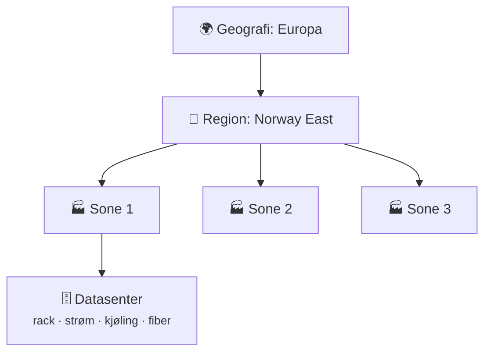

# 6 · Cloud Computing

```vis
type: cards
title: Kapittelet på én side
cols: 4
items:
  - {icon: "☁️", title: "Hva er skyen?", text: "Lei IT-ressurser over internett, betal for bruk", color: blue}
  - {icon: "🏭", title: "Datasentre", text: "Regioner og tilgjengelighetssoner", color: teal}
  - {icon: "🍕", title: "IaaS · PaaS · SaaS", text: "Hvor mye drifter du selv?", color: orange}
  - {icon: "🔀", title: "Public · private · hybrid", text: "Hvem eier maskinvaren?", color: purple}
  - {icon: "📈", title: "Skalering", text: "Opp, ut og automatisk", color: green}
  - {icon: "🛟", title: "HA og DR", text: "Tål feil – og katastrofer", color: red}
  - {icon: "🤝", title: "Delt ansvar", text: "Leverandøren sikrer skyen, du sikrer innholdet", color: navy}
  - {icon: "💰", title: "Kostnader", text: "Betal for bruk – og rydd opp", color: yellow}
```

## Hva er skyen?

```vis
type: analogy
left: {icon: "🔌", title: "Strømnettet", text: "Ingen fabrikk har egen generator lenger – du betaler for kWh", color: orange}
right: {icon: "☁️", title: "Skyen", text: "Du eier ikke serverne – du betaler for timene og gigabytene du bruker", color: blue}
```

```vis
type: compare
vs: true
columns:
  - icon: "🏢"
    title: "Eget datasenter (on-prem)"
    color: gray
    points: ["- Kjøpe maskinvare på forhånd (CapEx)", "- Uker å få ny server", "- Må kjøpe for toppen (julehandel)", "+ Full kontroll"]
  - icon: "☁️"
    title: "Sky"
    color: blue
    points: ["+ Betal løpende for bruk (OpEx)", "+ Ny server på minutter", "+ Skaler opp og ned", "- Kostnader må styres aktivt"]
```

```vis
type: cards
title: De fem kjennetegnene (NIST)
cols: 5
items:
  - {icon: "🙋", title: "Selvbetjening", text: "Opprett selv, når som helst", color: blue}
  - {icon: "🌐", title: "Nettverkstilgang", text: "Fra alle enheter", color: teal}
  - {icon: "🏊", title: "Delte ressurser", text: "Stor felles pool", color: purple}
  - {icon: "📈", title: "Elastisitet", text: "Opp og ned raskt", color: green}
  - {icon: "📏", title: "Målt bruk", text: "Betal for det du bruker", color: orange}
```

## Slik ser skyen ut fysisk



> 🏢 **Fra arbeidslivet:** Norske virksomheter bruker ofte **Norway East** (Oslo-området) for lav forsinkelse og data i Norge. Ikke alle tjenester finnes i alle regioner – sjekk først.

## IaaS, PaaS og SaaS

```vis
type: layers
title: Hvem drifter hva? (blått = du · grått = leverandøren)
items:
  - {icon: "🏗️", title: "On-premises", text: "DU: alt – fra strøm og maskinvare til app og data", color: blue}
  - {icon: "🖥️", title: "IaaS", text: "DU: OS, runtime, app, data   ·   LEVERANDØR: maskinvare, nettverk, virtualisering", color: teal}
  - {icon: "🧰", title: "PaaS", text: "DU: app og data   ·   LEVERANDØR: alt under, inkl. OS og patching", color: purple}
  - {icon: "📧", title: "SaaS", text: "DU: data og brukere   ·   LEVERANDØR: hele programvaren", color: gray}
```

```vis
type: cards
title: "Pizza som tjeneste 🍕"
cols: 4
items:
  - {icon: "🏠", title: "On-prem", text: "Lag pizza hjemme fra bunnen – kjøp ovn, lag deig", color: blue}
  - {icon: "🏪", title: "IaaS", text: "Lei et kjøkken med ovn – ta med ingrediensene selv", color: teal}
  - {icon: "🛵", title: "PaaS", text: "Bestill levert – du dekker bordet", color: purple}
  - {icon: "🍽️", title: "SaaS", text: "Gå på restaurant – bare spis", color: orange}
```

```vis
type: cards
title: Eksempler i Azure
cols: 3
items:
  - {icon: "🖥️", title: "IaaS", text: "Virtual Machines · VNet · Managed Disks", color: teal}
  - {icon: "🧰", title: "PaaS", text: "App Service · Azure SQL · Functions · Container Apps", color: purple}
  - {icon: "📧", title: "SaaS", text: "Microsoft 365 · GitHub · Salesforce", color: orange}
```

> 💡 **Husk:** Velg det høyeste nivået som dekker behovet. «Hvorfor trenger vi en VM, når App Service kunne gjort jobben?»

## Public, private og hybrid

```vis
type: cards
cols: 4
items:
  - {icon: "🌐", title: "Public cloud", text: "Azure, AWS, Google – delt maskinvare, logisk isolert", color: blue}
  - {icon: "🏰", title: "Private cloud", text: "Skyteknologi bare for én organisasjon", color: gray}
  - {icon: "🔗", title: "Hybrid", text: "Eget datasenter + sky, koblet med VPN/ExpressRoute", color: teal}
  - {icon: "🧩", title: "Multi-cloud", text: "Flere offentlige skyer samtidig", color: purple}
```

## Skalering

```vis
type: compare
columns:
  - icon: "⬆️"
    title: "Vertikal (scale up)"
    sub: "større maskin"
    color: blue
    points: ["+ Enkelt", "- Har et tak", "- Krever ofte omstart"]
  - icon: "↔️"
    title: "Horisontal (scale out)"
    sub: "flere maskiner"
    color: green
    points: ["+ Nesten ubegrenset", "+ Tåler at én dør", "- Appen må tåle flere kopier (stateless)"]
```

```vis
type: timeline
title: "Elastisitet – automatisk opp og ned (nettbutikk)"
items:
  - {when: "Vanlig dag", icon: "🛒", title: "2 instanser", text: "Lav trafikk", color: blue}
  - {when: "Black Friday", icon: "🔥", title: "20 instanser", text: "Autoskalering slår inn", color: red}
  - {when: "Natten etter", icon: "🌙", title: "2 instanser", text: "Skalerer ned – betaler bare for toppen mens den varte", color: green}
```

## Høy tilgjengelighet og katastrofer

```vis
type: stats
title: "Hva betyr «niere»? Maks nedetid per år"
cols: 4
items:
  - {value: "99 %", label: "3,65 dager", color: red}
  - {value: "99,9 %", label: "8,8 timer", color: orange}
  - {value: "99,99 %", label: "53 minutter", color: teal}
  - {value: "99,999 %", label: "5 minutter", color: green}
note: "Avhengigheter i serie senker totalen: 3 × 99,9 % ≈ 99,7 %"
```

```vis
type: flow
title: "RPO og RTO – to tall som styrer katastrofeplanen"
steps:
  - {icon: "💾", title: "Siste backup", text: "", color: blue}
  - {icon: "📉", title: "RPO", text: "hvor mye DATA vi tåler å miste", color: orange}
  - {icon: "💥", title: "Katastrofe", text: "", color: red}
  - {icon: "⏳", title: "RTO", text: "hvor lang TID gjenopprettingen får ta", color: purple}
  - {icon: "✅", title: "Tilbake i drift", text: "", color: green}
```

```vis
type: layers
title: DR-strategier – fra billig og treg til dyr og rask
items:
  - {icon: "💾", title: "Backup & restore", text: "RTO: timer–dager", color: gray}
  - {icon: "🕯️", title: "Pilot light", text: "kjernen kjører i reserve – RTO: timer", color: blue}
  - {icon: "♨️", title: "Warm standby", text: "nedskalert kopi kjører – RTO: minutter", color: orange}
  - {icon: "🔁", title: "Active-active", text: "full drift i flere regioner – RTO: nær null", color: green}
```

> 💡 **Husk:** En backup du aldri har gjenopprettet, er ikke en backup – det er et håp.

## Skytjenestene i kategorier

```vis
type: cards
cols: 4
items:
  - {icon: "🖥️", title: "Compute", text: "VM · containere · App Service · Functions", color: blue}
  - {icon: "🗄️", title: "Lagring", text: "Blokk (disk) · fil (delte mapper) · objekt (Blob)", color: teal}
  - {icon: "🌐", title: "Nettverk", text: "VNet · brannmur · lastbalanserer · DNS · VPN", color: purple}
  - {icon: "📊", title: "Databaser", text: "Azure SQL · PostgreSQL · Cosmos DB · Redis", color: orange}
```

```vis
type: compare
columns:
  - icon: "⚡"
    title: "Serverless"
    sub: "kode som kjører ved hendelser"
    color: purple
    points: ["+ Null serverdrift", "+ Skalerer til null – billig ved lav bruk", "- Kaldstart", "- Begrenset kjøretid"]
```

## Delt ansvar

```vis
type: compare
columns:
  - icon: "🏢"
    title: "Leverandøren sikrer SKYEN"
    color: gray
    points: ["Fysiske datasentre", "Maskinvare og nettverk", "Hypervisor", "(PaaS/SaaS: også OS og plattform)"]
  - icon: "🙋"
    title: "Du sikrer det du legger I skyen"
    color: red
    mark: "❗"
    points: ["DATA – alltid", "Brukere, tilganger, MFA – alltid", "Enhetene som brukes – alltid", "Konfigurasjon (IaaS: også OS og patching)"]
```

> ⚠️ **Vanlig feil:** De fleste sikkerhetsbrudd i skyen skyldes **kundens** feilkonfigurasjon – åpne lagringskontoer, svake passord, manglende MFA.

## Kostnader

```vis
type: cards
title: Hva koster penger?
cols: 4
items:
  - {icon: "⏱️", title: "Compute", text: "Per sekund en VM kjører", color: blue}
  - {icon: "🗄️", title: "Lagring", text: "Per GB per måned + transaksjoner", color: teal}
  - {icon: "📤", title: "Trafikk ut", text: "Data UT av skyen koster ofte", color: orange}
  - {icon: "🧱", title: "Tjenester som står på", text: "Gatewayer, brannmurer, offentlige IP-er", color: red}
```

```vis
type: cards
title: Spar penger – sjekkliste
cols: 4
items:
  - {icon: "🧹", title: "Slett ubrukt", text: "Den vanligste lekkasjen", color: red}
  - {icon: "📏", title: "Riktig størrelse", text: "Ikke 16 kjerner på 5 % CPU", color: blue}
  - {icon: "🌙", title: "Slå av om natten", text: "Dev og test", color: navy}
  - {icon: "🏷️", title: "Tags", text: "eier, prosjekt, miljø", color: teal}
  - {icon: "🔔", title: "Budsjettvarsler", text: "Varsel før det blir dyrt", color: orange}
  - {icon: "📆", title: "Reservasjoner", text: "1–3 år binding gir rabatt", color: purple}
  - {icon: "🎰", title: "Spot", text: "Billig ledig kapasitet – kan avbrytes", color: green}
  - {icon: "🧰", title: "PaaS / serverless", text: "Ikke betal for ledig kapasitet", color: pink}
```

> 💰 **Kostnad:** «Jeg rydder opp i morgen» er den dyreste setningen for en student. Slett ressursgruppen **samme dag**.

## Azure, AWS og Google Cloud

```vis
type: compare
columns:
  - icon: "🟦"
    title: "Microsoft Azure"
    color: blue
    points: ["VM · Blob Storage · VNet", "Azure SQL · Cosmos DB", "Functions · AKS · Entra ID", "Sterk i Microsoft-bedrifter og i Norge"]
  - icon: "🟧"
    title: "AWS"
    color: orange
    points: ["EC2 · S3 · VPC", "RDS · DynamoDB", "Lambda · EKS · IAM", "Størst og bredest"]
  - icon: "🟩"
    title: "Google Cloud"
    color: green
    points: ["Compute Engine · Cloud Storage · VPC", "Cloud SQL · Firestore", "Cloud Run · GKE · Cloud IAM", "Sterk på data, Kubernetes og AI"]
```

```vis
type: cards
title: "Well-Architected – fem søyler å sjekke alt mot"
cols: 5
items:
  - {icon: "🛟", title: "Pålitelighet", text: "Tåler den feil?", color: green}
  - {icon: "🛡️", title: "Sikkerhet", text: "Er data og tilgang beskyttet?", color: red}
  - {icon: "💰", title: "Kostnad", text: "Verdi for pengene?", color: yellow}
  - {icon: "⚙️", title: "Drift", text: "Automatisert og overvåket?", color: blue}
  - {icon: "🚀", title: "Ytelse", text: "Skalerer den riktig?", color: purple}
```

## Test deg selv

1. CapEx vs. OpEx? → *Investering på forhånd vs. løpende utgift.*
2. Hva er en tilgjengelighetssone? → *Fysisk adskilt datasenter-lokasjon i en region.*
3. Hvem patcher OS-et i PaaS? → *Leverandøren.*
4. Hva er du alltid ansvarlig for? → *Data, identiteter, enheter.*
5. RPO vs. RTO? → *Tåler å miste data vs. tid til gjenoppretting.*
6. Blob Storage heter … hos AWS? → *S3.*
