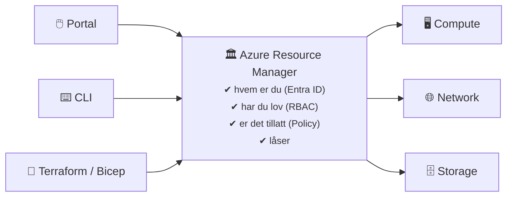
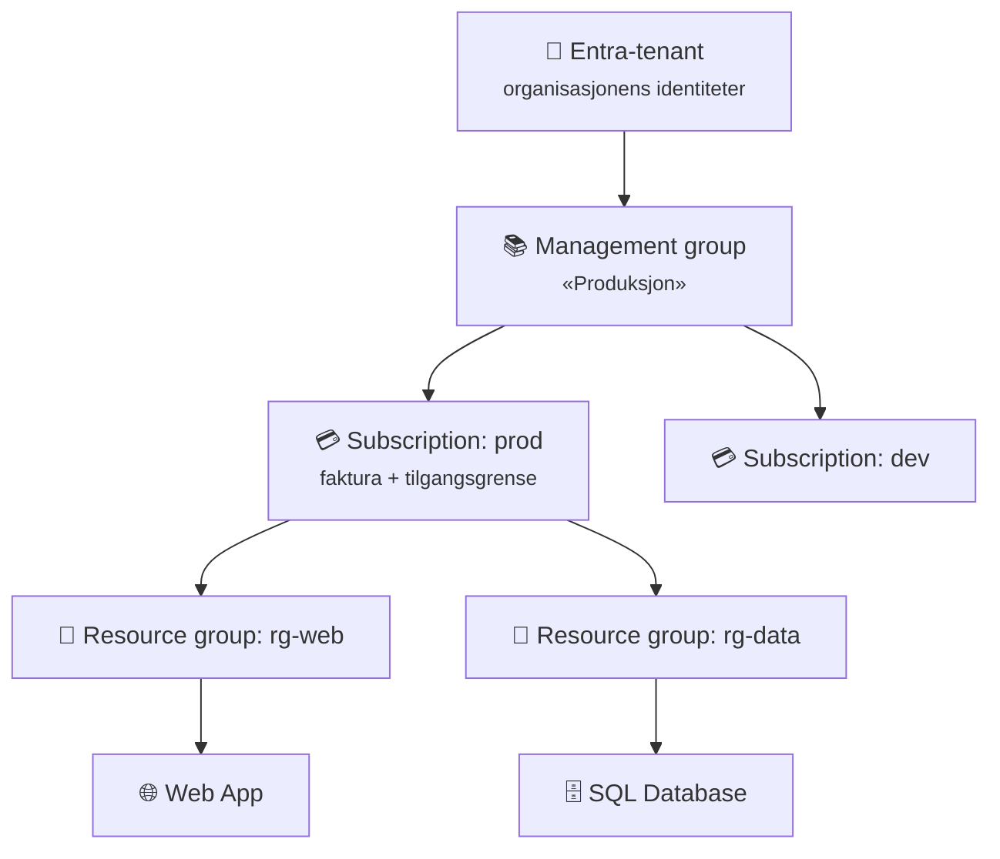
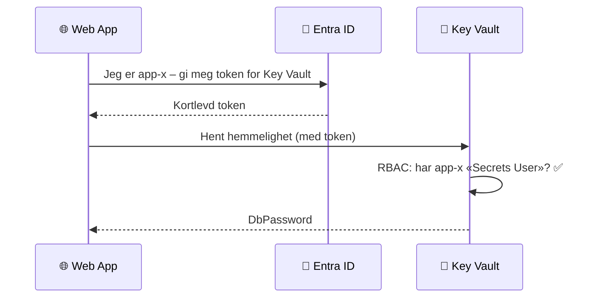

# 7 · Microsoft Azure

```vis
type: cards
title: Azure-delen på én side
cols: 4
items:
  - {icon: "🏛️", title: "7.1 Grunnmur", text: "Hierarki · Entra ID · RBAC · Policy · kostnader", color: navy}
  - {icon: "🌐", title: "7.2 Nettverk og compute", text: "VNet · NSG · VM · lastbalansering · App Service · AKS", color: blue}
  - {icon: "🗄️", title: "7.3 Data og drift", text: "Storage · SQL · Key Vault · Monitor · Backup", color: teal}
  - {icon: "🚀", title: "7.4 DevOps og Bicep", text: "Azure DevOps · Pipelines · infrastruktur som kode", color: purple}
```

> 💰 **Før du lager noe i Azure:** 1) Bruk Azure for Students eller gratiskonto. 2) Lag **budsjettvarsel**. 3) Én ressursgruppe per øvelse – **slett den etterpå**.

## 7.1 Grunnmur, identitet og styring

### Verktøyene

```vis
type: cards
cols: 4
items:
  - {icon: "🖱️", title: "Azure Portal", text: "portal.azure.com – utforsk og lær", color: blue}
  - {icon: ">_", title: "Cloud Shell", text: "Terminal i nettleseren, ferdig innlogget", color: teal}
  - {icon: "⌨️", title: "Azure CLI (az)", text: "Kommandoer og skript", color: purple}
  - {icon: "📜", title: "Bicep / Terraform", text: "Infrastruktur som kode", color: orange}
```

```bash
$ az login
$ az account show -o table
$ az group create -n rg-lab-01 -l norwayeast --tags miljø=lab eier=student
$ az vm list --query "[].name" -o tsv          # filtrer utdata
```

### Azure Resource Manager – alt går gjennom samme dør



### Hierarkiet



```vis
type: cards
cols: 3
items:
  - {icon: "📚", title: "Management group", text: "Styr policy og tilgang for MANGE abonnementer samtidig", color: purple}
  - {icon: "💳", title: "Subscription", text: "Fakturering, tilgangsgrense og kvoter", color: blue}
  - {icon: "📁", title: "Resource group", text: "Mappe for ressurser med samme livssyklus. Slett gruppen = slett alt i den", color: teal}
```

> 💡 **Husk:** En ressurs ligger i **nøyaktig én** ressursgruppe. Ressursgrupper kan **ikke** nøstes. Navngi konsekvent: `rg-`, `vnet-`, `vm-`, `kv-`, `st…`.

### Microsoft Entra ID – hvem er du?

```vis
type: analogy
left: {icon: "🪪", title: "Resepsjon og adgangskort", text: "Sjekker hvem du er og gir deg et kort dørene kan lese", color: orange}
right: {icon: "🔐", title: "Microsoft Entra ID", text: "Logger deg inn og gir et token som Azure og M365 stoler på", color: blue}
```

```vis
type: cards
cols: 4
items:
  - {icon: "👤", title: "Bruker", text: "En person (eller gjest)", color: blue}
  - {icon: "👥", title: "Gruppe", text: "Gi tilgang til grupper – ikke enkeltpersoner", color: teal}
  - {icon: "🤖", title: "Service principal", text: "Identiteten til en app eller pipeline", color: purple}
  - {icon: "🪄", title: "Managed identity", text: "App-identitet Azure styrer selv – uten passord", color: green}
  - {icon: "📱", title: "MFA", text: "Passord + app/nøkkel. Påkrevd for admin i Azure", color: orange}
  - {icon: "🚦", title: "Conditional Access", text: "«Krev MFA utenfor kontoret»", color: red}
  - {icon: "⏳", title: "PIM", text: "Admin-rolle bare når du trenger den", color: navy}
  - {icon: "🔁", title: "Entra Connect", text: "Synk fra lokal Active Directory", color: gray}
```

### Azure RBAC – hva får du gjøre?

```vis
type: flow
title: "En rolletildeling = HVEM + HVA + HVOR"
arrow: "+"
steps:
  - {icon: "👥", title: "Hvem", text: "bruker · gruppe · service principal · managed identity", color: blue}
  - {icon: "🎭", title: "Hva (rolle)", text: "Reader · Contributor · Owner · Key Vault Secrets User …", color: purple}
  - {icon: "🎯", title: "Hvor (scope)", text: "management group · subscription · resource group · ressurs", color: teal}
```

```vis
type: layers
title: De viktigste rollene
items:
  - {icon: "👑", title: "Owner", text: "Alt – også gi andre tilgang. Nesten aldri.", color: red}
  - {icon: "🛠️", title: "Contributor", text: "Lage og endre alt – men ikke gi tilgang", color: orange}
  - {icon: "👀", title: "Reader", text: "Se alt, endre ingenting – trygg standard", color: green}
  - {icon: "🎯", title: "Tjenesteroller", text: "AcrPull · Storage Blob Data Reader · Key Vault Secrets User", color: blue}
```

```bash
$ az role assignment create --assignee-object-id <gruppe-id> --assignee-principal-type Group \
    --role "Reader" --scope $(az group show -n rg-lab-01 --query id -o tsv)
```

> ⚠️ **Vanlig feil:** Entra-roller (Global Administrator – styrer brukere) ≠ Azure RBAC-roller (Owner – styrer ressurser). To ulike systemer.

### Managed identities – ingen passord



```vis
type: compare
columns:
  - icon: "🔗"
    title: "System-assigned"
    color: teal
    points: ["Lages med ressursen", "Slettes med ressursen", "Én ressurs"]
  - icon: "🧷"
    title: "User-assigned"
    color: purple
    points: ["Egen ressurs", "Kan deles av mange", "Lever uavhengig"]
```

> 💡 **Husk:** «Hvordan skal appen logge inn på en annen Azure-tjeneste?» → nesten alltid **managed identity**.

### Azure Policy – hva er lov å lage?

```vis
type: compare
vs: true
columns:
  - icon: "🎭"
    title: "RBAC"
    sub: "HVEM får gjøre noe"
    color: blue
    points: ["«Kari får lage VM-er»"]
  - icon: "📏"
    title: "Policy"
    sub: "HVA er tillatt"
    color: orange
    points: ["«Ingen – heller ikke Kari – får lage VM-er utenfor Norway East»"]
```

```vis
type: cards
title: Policy-effekter
cols: 4
items:
  - {icon: "⛔", title: "Deny", text: "Stopper opprettelsen", color: red}
  - {icon: "📝", title: "Audit", text: "Tillater, men markerer avvik", color: orange}
  - {icon: "✏️", title: "Modify / Append", text: "Legger til f.eks. en tag", color: blue}
  - {icon: "🏗️", title: "DeployIfNotExists", text: "Lager det som mangler", color: green}
```

### Tags og låser

```vis
type: cards
cols: 3
items:
  - {icon: "🏷️", title: "Tags", text: "miljø=prod · eier=team-x · kostnadssted=4410. Arves IKKE automatisk.", color: teal}
  - {icon: "🔒", title: "CanNotDelete", text: "Kan endres, ikke slettes – også for Owner", color: orange}
  - {icon: "🧊", title: "ReadOnly", text: "Kan verken endres eller slettes", color: red}
```

### Kostnadsstyring

```vis
type: vflow
title: Gjør dette første dag – budsjett med varsel
steps:
  - {icon: "🔎", title: "Cost Management → Budgets → Add", text: "Scope: abonnementet ditt", color: blue}
  - {icon: "💵", title: "Månedlig beløp", text: "f.eks. 20 i din valuta", color: teal}
  - {icon: "🔔", title: "Varsler", text: "50 % og 90 % faktisk · 100 % prognose", color: orange}
  - {icon: "📧", title: "E-post", text: "Din adresse → Create", color: green}
```

> ⚠️ **Vanlig feil:** Et budsjett **varsler** – det **stopper ikke** forbruket. Rydd opp selv.

```vis
type: cards
cols: 3
items:
  - {icon: "🧮", title: "Pricing Calculator", text: "Estimer FØR du bygger", color: blue}
  - {icon: "📊", title: "Cost analysis", text: "Se faktisk forbruk per gruppe, tjeneste eller tag", color: teal}
  - {icon: "💡", title: "Azure Advisor", text: "Anbefalinger: «denne VM-en er nesten ubrukt»", color: green}
```
