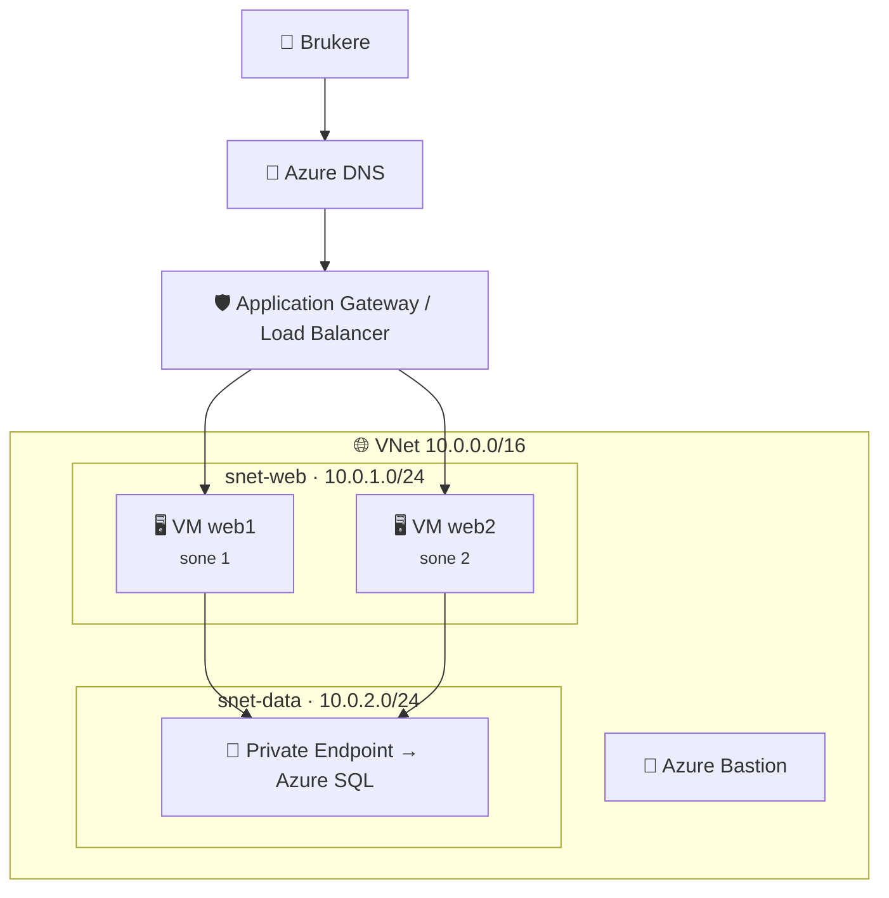
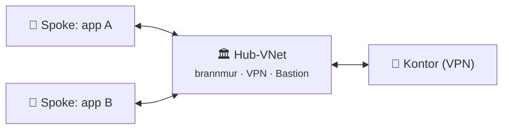
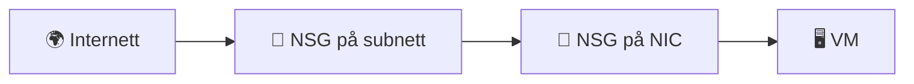
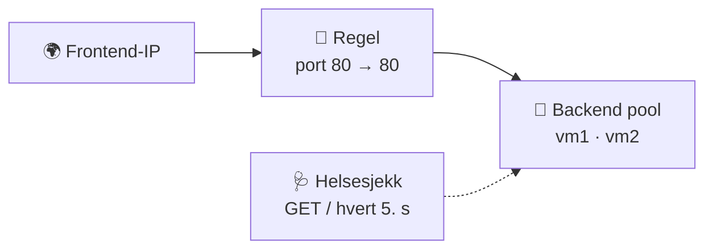
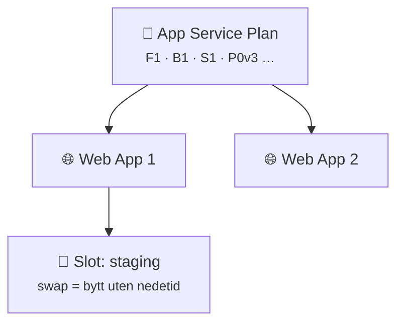
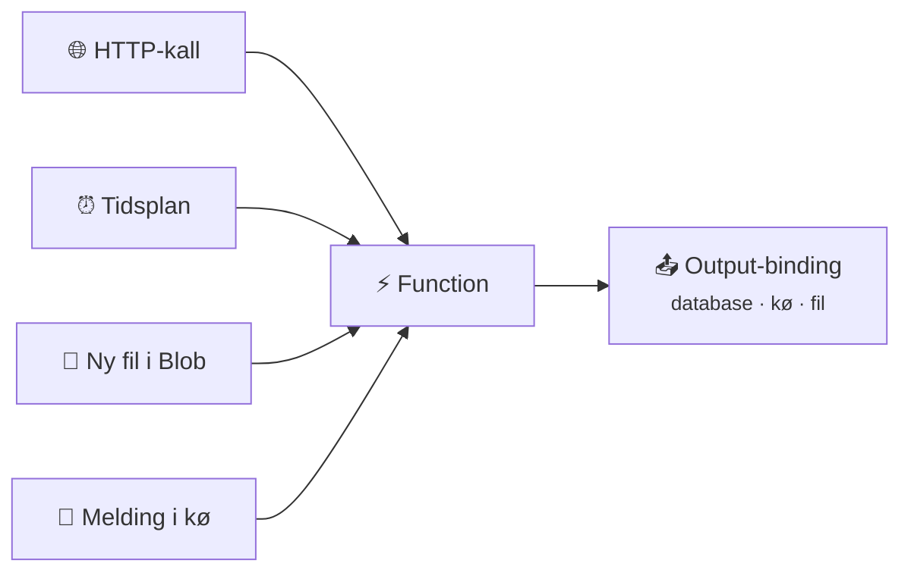
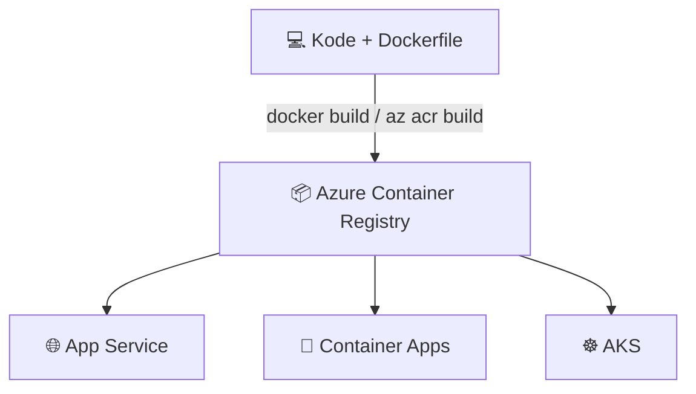

## 7.2 Nettverk og compute



### Virtual Network og subnett

```vis
type: cards
cols: 3
items:
  - {icon: "🌐", title: "VNet", text: "Ditt private nettverk i én region. Gratis i seg selv.", color: blue}
  - {icon: "🧱", title: "Subnett", text: "Del av VNet-et. 5 adresser reservert. Noen tjenester krever eget subnett.", color: teal}
  - {icon: "🔗", title: "Peering", text: "Kobler VNets. Ingen overlapp! Ikke transitivt (A–B–C ≠ A–C).", color: purple}
```



```bash
az network vnet create -g $RG -n vnet-lab --address-prefix 10.0.0.0/16 \
  --subnet-name snet-web --subnet-prefixes 10.0.1.0/24
```

### Network Security Groups (NSG)

```vis
type: layers
title: "NSG-regler: lavest tall først – første treff vinner"
items:
  - {icon: "✅", title: "100 · Tillat 80, 443", text: "fra Internet", color: green}
  - {icon: "✅", title: "110 · Tillat 22", text: "bare fra din IP /32", color: green}
  - {icon: "🏠", title: "65000 · AllowVnetInBound", text: "standard: trafikk innen VNet", color: blue}
  - {icon: "⚖️", title: "65001 · AllowAzureLoadBalancer", text: "standard: helsesjekker", color: blue}
  - {icon: "⛔", title: "65500 · DenyAllInBound", text: "standard: alt annet avvises", color: red}
```



```bash
az network nsg rule create -g $RG --nsg-name nsg-web -n allow-web --priority 100 \
  --direction Inbound --access Allow --protocol Tcp \
  --source-address-prefixes Internet --destination-port-ranges 80 443
```

> 🔍 **Feilsøk:** *Network Watcher → IP flow verify* forteller hvilken regel som tillot eller blokkerte.

### Virtual Machines

```vis
type: hub
title: En VM består av
center: {icon: "🖥️", title: "Azure VM", text: "IaaS – du drifter OS-et", color: navy}
items:
  - {icon: "📏", title: "Størrelse", text: "vCPU og RAM, f.eks. Standard_B2s"}
  - {icon: "💿", title: "Image", text: "Ubuntu 24.04, Windows Server"}
  - {icon: "💽", title: "Managed disk", text: "OS-disk + datadisker"}
  - {icon: "🔌", title: "Nettverkskort", text: "privat IP i et subnett"}
  - {icon: "🌍", title: "Offentlig IP", text: "valgfritt – helst ikke"}
  - {icon: "🪄", title: "Identitet", text: "managed identity"}
```

```vis
type: cards
title: VM-familier
cols: 5
items:
  - {icon: "💤", title: "B", text: "Burstable – billig, lab og små servere", color: green}
  - {icon: "⚖️", title: "D", text: "Generell bruk – det meste", color: blue}
  - {icon: "🧠", title: "E", text: "Mye minne – databaser", color: purple}
  - {icon: "⚡", title: "F", text: "Mye CPU – beregning", color: orange}
  - {icon: "🎮", title: "N", text: "GPU – AI og grafikk", color: red}
```

```vis
type: layers
title: Tilgjengelighet for VM-er
widen: true
items:
  - {icon: "1️⃣", title: "Én VM", text: "lavest SLA", color: gray}
  - {icon: "🗄️", title: "Availability set", text: "tåler rack-/vertsfeil i ett datasenter", color: blue}
  - {icon: "🏭", title: "Availability zones", text: "tåler at et helt datasenter faller ut", color: teal}
  - {icon: "📈", title: "VM Scale Sets", text: "mange like VM-er, autoskalert over soner", color: green}
```

```bash
az vm create -g $RG -n vm-web01 --image Ubuntu2404 --size Standard_B1s \
  --vnet-name vnet-lab --subnet snet-web --admin-username azureuser \
  --generate-ssh-keys --public-ip-sku Standard --custom-data cloud-init.yaml
az vm deallocate -g $RG -n vm-web01        # stopp OG slutt å betale for compute
az vm auto-shutdown -g $RG -n vm-web01 --time 1900
```

```vis
type: compare
vs: true
columns:
  - icon: "⏸️"
    title: "Stopped"
    sub: "shutdown fra innsiden av OS"
    color: red
    mark: "💸"
    points: ["Maskinvaren er fortsatt reservert", "Du BETALER fortsatt for compute"]
  - icon: "⏹️"
    title: "Stopped (deallocated)"
    sub: "Stop i portalen / az vm deallocate"
    color: green
    points: ["Maskinvaren frigjøres", "Ingen compute-kostnad (disk koster fortsatt)"]
```

> 🔑 **Sikker innlogging:** Azure **Bastion** gir SSH/RDP uten offentlig IP på VM-en.

### Lastbalansering

```vis
type: compare
columns:
  - icon: "⚖️"
    title: "Load Balancer"
    sub: "lag 4 · regional"
    color: teal
    points: ["TCP/UDP til VM-er", "Helsesjekker", "Bruk Standard-SKU (Basic er pensjonert)"]
  - icon: "🛡️"
    title: "Application Gateway"
    sub: "lag 7 · regional"
    color: orange
    points: ["Ruting på /sti og vertsnavn", "TLS-terminering", "WAF mot angrep"]
  - icon: "🌍"
    title: "Front Door"
    sub: "lag 7 · global"
    color: purple
    points: ["Verdensomspennende inngang", "CDN og WAF", "Failover mellom regioner"]
```



> ⚠️ **502 fra Application Gateway** = backend er usunn: appen kjører ikke, NSG blokkerer, feil port eller feil helsesjekk-sti.

### Azure DNS

```vis
type: compare
columns:
  - icon: "🌍"
    title: "Offentlige soner"
    sub: "firma.no på internett"
    color: blue
    points: ["A, CNAME, MX, TXT", "Alias-poster til Azure-ressurser", "Pek NS hos registraren til Azure"]
  - icon: "🏠"
    title: "Private soner"
    sub: "navn inne i VNets"
    color: teal
    points: ["Automatisk registrering av VM-er", "Nødvendig for Private Endpoints", "privatelink.database.windows.net"]
```

### App Service

```vis
type: analogy
left: {icon: "🏨", title: "Hotell", text: "Du tar med kofferten – hotellet ordner strøm, rengjøring og vakthold", color: orange}
right: {icon: "🌐", title: "App Service", text: "Du gir koden – Azure ordner servere, OS, patching og skalering", color: blue}
```



```bash
az webapp up --name app-lab-<unik> -g $RG --runtime "PYTHON:3.12" --sku F1
az webapp log tail -g $RG -n app-lab-<unik>
```

```vis
type: cards
cols: 4
items:
  - {icon: "🆓", title: "F1 Free", text: "Læring – begrenset, ingen slots", color: green}
  - {icon: "🧪", title: "Basic", text: "Små apper og test", color: blue}
  - {icon: "🏭", title: "Standard+", text: "Produksjon – autoskalering og slots", color: purple}
  - {icon: "🔐", title: "Key Vault-referanser", text: "@Microsoft.KeyVault(...) i app settings", color: red}
```

### Azure Functions – serverless



```python
@app.route(route="hei")                                    # HTTP-trigger
def hei(req: func.HttpRequest) -> func.HttpResponse:
    return func.HttpResponse(f"Hei, {req.params.get('navn', 'verden')}!")
```

> ⚠️ Timer-triggere har **6 felt** (sekunder først): `0 */5 * * * *` = hvert 5. minutt. Anbefalt plan for nye apper: **Flex Consumption**.

### Container Registry (ACR) og AKS



```vis
type: compare
columns:
  - icon: "🧊"
    title: "Container Apps"
    sub: "enkelt"
    color: teal
    points: ["Serverless containere", "Skalerer til null", "Ingen Kubernetes å drifte"]
  - icon: "☸️"
    title: "AKS"
    sub: "full kontroll"
    color: navy
    points: ["Administrert Kubernetes", "Microsoft drifter kontrollplanet", "Du betaler for nodene (VM-er)"]
```

> 💰 **Kostnad:** AKS-noder er vanlige VM-er. `az aks stop` når du ikke bruker clusteret – og slett det samme dag.

```bash
az acr create -g $RG -n acrlab<unik> --sku Basic
az aks create -g $RG -n aks-lab --tier free --node-count 1 --node-vm-size Standard_B2s \
  --attach-acr acrlab<unik> --generate-ssh-keys
az aks get-credentials -g $RG -n aks-lab && kubectl get nodes
```
