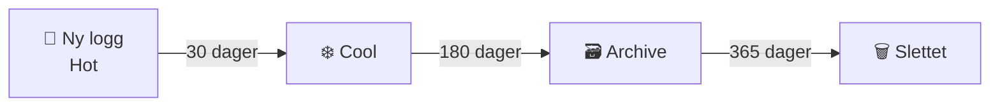
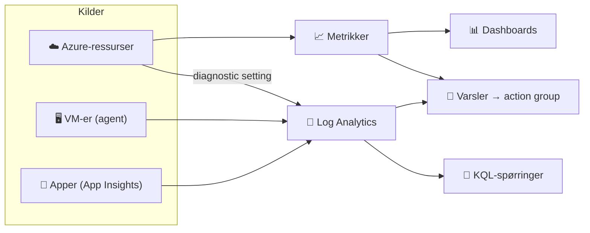

## 7.3 Lagring, data, sikkerhet og drift

### Storage Account

```vis
type: hub
title: Én lagringskonto – fire tjenester
height: 440
center: {icon: "🗄️", title: "Storage Account", text: "navn: 3–24 små bokstaver/tall, globalt unikt", color: teal}
items:
  - {icon: "🫙", title: "Blob", text: "filer og objekter"}
  - {icon: "📁", title: "Files", text: "delte mapper (SMB/NFS)"}
  - {icon: "📨", title: "Queue", text: "enkle meldingskøer"}
  - {icon: "📋", title: "Table", text: "enkel nøkkel–verdi"}
```

```vis
type: layers
title: Redundans – hvor mange kopier, og hvor?
widen: true
items:
  - {icon: "🏠", title: "LRS", text: "3 kopier i ett datasenter – billigst", color: gray}
  - {icon: "🏭", title: "ZRS", text: "3 kopier i 3 soner – tåler at et datasenter faller ut", color: blue}
  - {icon: "🌍", title: "GRS", text: "+ kopi i en annen region – tåler at regionen faller ut", color: teal}
  - {icon: "🛡️", title: "GZRS", text: "soner + annen region – best beskyttelse", color: green}
```

```vis
type: layers
title: Tilgang til data – fra best til verst
items:
  - {icon: "🥇", title: "Entra ID + RBAC", text: "managed identity med «Storage Blob Data Reader» – anbefalt", color: green}
  - {icon: "⏱️", title: "SAS-token", text: "tidsbegrenset lenke – bra for midlertidig deling", color: blue}
  - {icon: "🗝️", title: "Kontonøkler", text: "full tilgang til alt – unngå, kan slås av", color: orange}
  - {icon: "🌍", title: "Anonym offentlig", text: "alle kan lese – av som standard", color: red}
```

### Blob Storage

```vis
type: layers
title: Tilgangsnivåer – billig lagring eller billig lesing?
items:
  - {icon: "🔥", title: "Hot", text: "brukes ofte · dyr lagring · billig lesing", color: red}
  - {icon: "❄️", title: "Cool", text: "sjelden · min. 30 dager", color: blue}
  - {icon: "🧊", title: "Cold", text: "svært sjelden · min. 90 dager", color: teal}
  - {icon: "🗃️", title: "Archive", text: "nesten aldri · billigst · må hentes frem (timer)", color: gray}
```



```bash
az storage account create -n st$RANDOM -g $RG -l norwayeast --sku Standard_LRS \
  --min-tls-version TLS1_2 --allow-blob-public-access false
az storage blob upload --account-name <konto> -c bilder -f bilde.png --auth-mode login
```

> 💡 **Ekstra beskyttelse:** soft delete, versjonering og *immutable storage* (kan ikke endres eller slettes i en periode – vern mot løsepengevirus).

### Azure SQL Database

```vis
type: compare
columns:
  - icon: "🧰"
    title: "Azure SQL Database"
    sub: "PaaS"
    color: blue
    points: ["Nye skyapper", "Microsoft patcher og tar backup", "Serverless kan pause"]
  - icon: "🏢"
    title: "SQL Managed Instance"
    sub: "PaaS"
    color: teal
    points: ["Flytte eksisterende SQL Server", "Nesten 100 % kompatibel"]
  - icon: "🖥️"
    title: "SQL Server på VM"
    sub: "IaaS"
    color: gray
    points: ["Full kontroll", "Du drifter alt"]
```

```vis
type: cards
title: Innebygd robusthet og sikkerhet
cols: 4
items:
  - {icon: "⏪", title: "Point-in-time restore", text: "Tilbake til et hvilket som helst tidspunkt (7–35 dager)", color: green}
  - {icon: "🌍", title: "Geo-replikering", text: "Failover til annen region", color: teal}
  - {icon: "🔐", title: "Entra-autentisering", text: "Appen logger inn med managed identity", color: blue}
  - {icon: "🔌", title: "Private Endpoint", text: "Ikke eksponert mot internett", color: purple}
```

> ⚠️ **Vanlig feil:** «Allow Azure services to access this server» slipper inn **alle** Azure-kunders ressurser, ikke bare dine.

### Key Vault

```vis
type: cards
title: Hvelvet for hemmeligheter
cols: 3
items:
  - {icon: "🔑", title: "Secrets", text: "Passord, tilkoblingsstrenger, API-nøkler", color: blue}
  - {icon: "🗝️", title: "Keys", text: "Krypteringsnøkler – også i HSM", color: purple}
  - {icon: "📜", title: "Certificates", text: "TLS-sertifikater med automatisk fornyelse", color: green}
```

```vis
type: cards
cols: 4
items:
  - {icon: "👑", title: "Key Vault Administrator", text: "Alt", color: red}
  - {icon: "✍️", title: "Secrets Officer", text: "Lage og endre hemmeligheter", color: orange}
  - {icon: "👀", title: "Secrets User", text: "Lese – det appen trenger", color: green}
  - {icon: "🗑️", title: "Soft delete + purge protection", text: "Slettet ≠ borte", color: navy}
```

```bash
az keyvault create -n kv-lab-$RANDOM -g $RG -l norwayeast --enable-rbac-authorization true
az keyvault secret set --vault-name <kv> -n DbPassword --value '<verdi>'
```

### Azure Monitor og Log Analytics



> ⚠️ **Vanlig feil:** Ressurslogger samles **ikke** inn før du lager en *diagnostic setting*.

```kusto
AzureActivity                                   // hvem gjorde hva siste døgn?
| where TimeGenerated > ago(1d)
| summarize antall = count() by Caller, OperationNameValue
| order by antall desc
```

```vis
type: cards
title: KQL på 30 sekunder
cols: 4
items:
  - {icon: "🔽", title: "where", text: "filtrer rader", color: blue}
  - {icon: "📐", title: "project", text: "velg kolonner", color: teal}
  - {icon: "🧮", title: "summarize … by", text: "tell og grupper", color: purple}
  - {icon: "📈", title: "render", text: "lag diagram", color: orange}
```

> 💰 **Kostnad:** Logger koster per GB. Samle det du faktisk bruker.

### Azure Backup

```vis
type: compare
columns:
  - icon: "💾"
    title: "Azure Backup"
    sub: "kopier til et hvelv"
    color: blue
    points: ["VM-er, filer, databaser", "Policy: hvor ofte og hvor lenge", "Soft delete og immutable vault"]
  - icon: "🔁"
    title: "Azure Site Recovery"
    sub: "replikering for katastrofer"
    color: purple
    points: ["Hele VM-er kopieres løpende til annen region", "Failover på minutter", "Lav RPO og RTO"]
```
