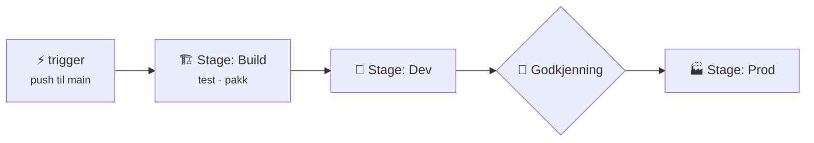
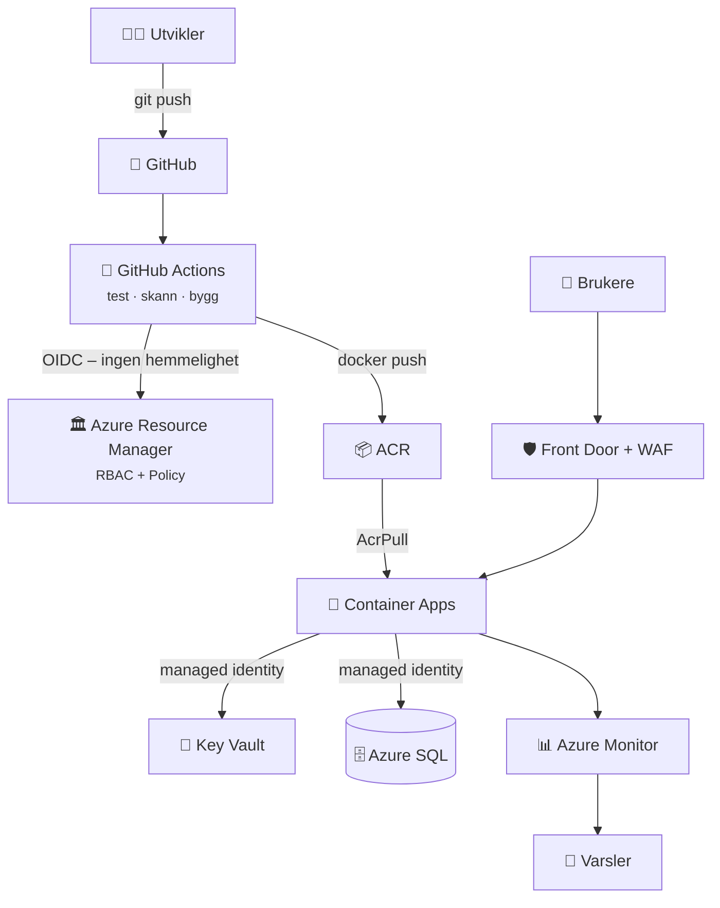

## 7.4 Azure DevOps og Bicep

### Azure DevOps

```vis
type: cards
title: Fem tjenester i én pakke
cols: 5
items:
  - {icon: "📋", title: "Boards", text: "Backlog, sprinter, kanban", color: blue}
  - {icon: "📚", title: "Repos", text: "Git med pull requests", color: teal}
  - {icon: "🚀", title: "Pipelines", text: "CI/CD", color: purple}
  - {icon: "🧪", title: "Test Plans", text: "Manuell testing", color: orange}
  - {icon: "📦", title: "Artifacts", text: "Pakkefeeder", color: green}
```



```vis
type: cards
cols: 3
items:
  - {icon: "🔗", title: "Service connection", text: "Pipelinens tilgang til Azure – bruk workload identity federation (ingen hemmelighet)", color: blue}
  - {icon: "🏁", title: "Environments", text: "dev/prod med godkjenninger og sjekker", color: green}
  - {icon: "📚", title: "Variable groups", text: "Hemmeligheter, gjerne koblet til Key Vault", color: purple}
```

> 💡 **Azure DevOps vs. GitHub:** Samme prinsipper, ulik YAML. Du vil møte begge i norske bedrifter.

### Bicep – infrastruktur som kode for Azure

```vis
type: compare
vs: true
columns:
  - icon: "🧾"
    title: "ARM JSON"
    color: gray
    points: ["~25 linjer for en lagringskonto", "Mange klammer og [parameters(...)]"]
  - icon: "💪"
    title: "Bicep"
    color: blue
    points: ["~8 linjer for det samme", "Lesbart, autofullføring i VS Code", "Ingen state-fil – Azure er sannheten"]
```

```bicep
param location string = resourceGroup().location
param miljo string = 'dev'

resource st 'Microsoft.Storage/storageAccounts@2023-05-01' = {
  name: 'st${uniqueString(resourceGroup().id)}'
  location: location
  sku: { name: miljo == 'prod' ? 'Standard_ZRS' : 'Standard_LRS' }
  kind: 'StorageV2'
  properties: { minimumTlsVersion: 'TLS1_2', allowBlobPublicAccess: false }
}
```

```vis
type: flow
title: Slik deployer du Bicep
steps:
  - {icon: "✍️", title: "Skriv", text: "main.bicep"}
  - {icon: "🔮", title: "what-if", text: "se hva som VIL skje"}
  - {icon: "🚀", title: "create", text: "az deployment group create"}
  - {icon: "📤", title: "outputs", text: "URL-er og ID-er"}
```

```bash
az deployment group what-if -g rg-bicep -f main.bicep -p miljo=dev
az deployment group create  -g rg-bicep -f main.bicep -p miljo=dev
```

### Referansearkitektur – alt sammen



## Del 7 – test deg selv

1. Subscription vs. resource group? → *Faktura/tilgangsgrense vs. mappe for ressurser.*
2. Stoppe ressurser utenfor Norway East? → *Azure Policy (Deny).*
3. Hvordan logger en app inn i Key Vault? → *Managed identity + «Key Vault Secrets User».*
4. NSG: tillat 22 på 200, avvis 22 på 150? → *Avvist – 150 kommer først.*
5. URL-ruting og WAF? → *Application Gateway (eller Front Door).*
6. Stopped vs. deallocated? → *Bare deallocated slutter å koste compute.*
7. Tåle sonefeil, bli i regionen? → *ZRS.*
8. Hvorfor ingen logger i Log Analytics? → *Mangler diagnostic setting.*
