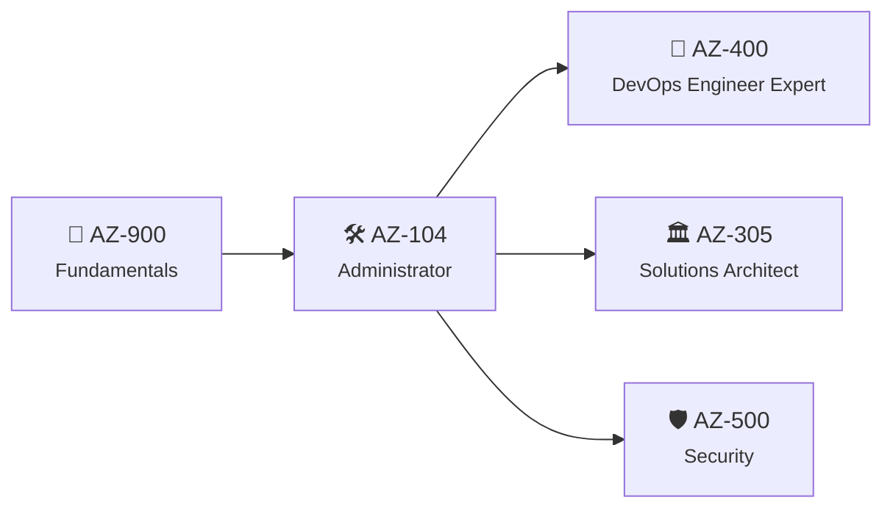

## 7.5 AZ-900 og AZ-104



### AZ-900 – Azure Fundamentals

```vis
type: stats
title: "AZ-900: hva testes? (omtrentlig vekting – sjekk study guide)"
cols: 3
items:
  - {value: "25–30 %", label: "☁️ Sky-konsepter → kap. 6", color: teal}
  - {value: "35–40 %", label: "🏗️ Azure-arkitektur og tjenester → kap. 6–7", color: blue}
  - {value: "30–35 %", label: "📏 Styring og administrasjon → kap. 7", color: purple}
note: "Bestått: 700 av 1000 · ingen kommandoer – men mange begreper · utløper ikke"
```

```vis
type: timeline
title: Studieplan – 4 uker × 5 timer
items:
  - {when: "Uke 1", icon: "☁️", title: "Sky-konsepter", text: "Kapittel 6 + Learn: «Describe cloud concepts»", color: teal}
  - {when: "Uke 2", icon: "🏗️", title: "Arkitektur og compute/nettverk", text: "Kapittel 7.1–7.2 + lag og slett en VM", color: blue}
  - {when: "Uke 3", icon: "📏", title: "Lagring, identitet, styring", text: "Kapittel 7.3–7.4 + budsjett, policy, lås", color: purple}
  - {when: "Uke 4", icon: "🎯", title: "Prøveeksamen", text: "Under + Microsofts gratis Practice Assessment til 80 %+", color: green}
```

**Prøveeksamen AZ-900 (15 spørsmål)**

1. Du betaler bare for det du bruker – hvilken egenskap? (a) elastisitet (b) forbruksbasert (c) HA
2. Flytte app med full OS-kontroll: (a) SaaS (b) PaaS (c) IaaS
3. Minst ansvar for kunden: (a) IaaS (b) PaaS (c) SaaS
4. Beskytte mot at et helt datasenter faller ut: (a) availability set (b) soner (c) større VM
5. Gruppere mange abonnementer for policy: (a) ressursgrupper (b) management groups (c) tags
6. Privat linje til Azure, ikke via internett: (a) VPN Gateway (b) ExpressRoute (c) peering
7. Billigst lagring, må hentes frem før lesing: (a) Cool (b) Cold (c) Archive
8. Krev MFA bare fra ukjent sted: (a) Policy (b) Conditional Access (c) RBAC
9. «Stol aldri, verifiser alltid»: (a) Defense in depth (b) Zero Trust
10. Hindre både endring og sletting: (a) CanNotDelete (b) ReadOnly
11. Estimer pris før du bygger: (a) Cost Management (b) Pricing Calculator
12. Personlige spare- og sikkerhetsråd: (a) Advisor (b) Monitor (c) Arc
13. Hendelser i Azure som rammer DINE ressurser: (a) Azure Status (b) Service Health
14. Styre servere utenfor Azure fra Azure: (a) Arc (b) Migrate
15. Alltid kundens ansvar: (a) fysisk sikkerhet (b) hypervisor (c) data og identiteter

**Fasit:** 1b · 2c · 3c · 4b · 5b · 6b · 7c · 8b · 9b · 10b · 11b · 12a · 13b · 14a · 15c

### AZ-104 – Azure Administrator

```vis
type: stats
title: "AZ-104: hva testes? (omtrentlig vekting)"
cols: 5
items:
  - {value: "20–25 %", label: "🔐 Identitet og styring", color: navy}
  - {value: "15–20 %", label: "🗄️ Lagring", color: teal}
  - {value: "20–25 %", label: "🖥️ Compute", color: blue}
  - {value: "15–20 %", label: "🌐 Nettverk", color: purple}
  - {value: "10–15 %", label: "📊 Overvåking og backup", color: green}
note: "Praktisk og krevende · ca. 100 minutter · fornyes årlig gratis på Microsoft Learn"
```

```vis
type: cards
title: Åtte laber å gjøre før eksamen (detaljer i fullversjonen)
cols: 4
items:
  - {icon: "👥", title: "1 · Identitet", text: "Grupper, brukere, RBAC – test som annen bruker", color: navy}
  - {icon: "📏", title: "2 · Styring", text: "Policy med Deny, tag-arv, lås", color: purple}
  - {icon: "🗄️", title: "3 · Lagring", text: "SAS, soft delete, livssyklus, filshare", color: teal}
  - {icon: "🖥️", title: "4 · VM-er", text: "Soner, datadisk, scale set, Bicep", color: blue}
  - {icon: "🌐", title: "5 · App Service", text: "Slots, swap, autoskalering, containere", color: orange}
  - {icon: "🔗", title: "6 · Nettverk", text: "Peering, NSG, UDR, privat DNS, private endpoint", color: pink}
  - {icon: "⚖️", title: "7 · Lastbalansering", text: "Helsesjekker, Network Watcher", color: green}
  - {icon: "📊", title: "8 · Monitor og backup", text: "Varsler, KQL, backup og restore", color: red}
```

```vis
type: cards
title: Typiske eksamensfeller
cols: 3
items:
  - {icon: "🔢", title: "5 reserverte IP-er", text: "/28 = 11 brukbare", color: blue}
  - {icon: "🔗", title: "Peering er ikke transitiv", text: "A–B + B–C ≠ A–C", color: purple}
  - {icon: "🧱", title: "NSG på subnett OG NIC", text: "Begge må tillate trafikken", color: red}
  - {icon: "🏷️", title: "Tags arves ikke", text: "Bruk Policy (Modify)", color: teal}
  - {icon: "🔒", title: "Låser gjelder også Owner", text: "Fjern låsen først", color: orange}
  - {icon: "🧭", title: "Les «minimize cost/effort»", text: "Ordene avgjør riktig svar", color: green}
```

**Prøveeksamen AZ-104 (15 spørsmål)**

1. Gi en gruppe rett til å administrere VM-er i én ressursgruppe – rolle og scope?
2. Sikre at ressurser uten taggen `kostnadssted` ikke kan lages?
3. Ekstern partner skal lese én blob i 24 timer – sikreste metode?
4. Lagring som tåler sonefeil, data skal bli i regionen?
5. Hva beskytter et availability set mot?
6. Teste ny versjon i prod-miljøet og bytte uten nedetid – funksjon og minste nivå?
7. App Service må nå en database i VNet via privat IP – hva konfigurerer du?
8. Kan `10.0.0.0/16` og `10.0.0.0/16` peeres?
9. Hvor mange VM-adresser i `10.1.5.0/28`?
10. Tving all trafikk ut via en brannmur-VM – hva lager du?
11. SSH til VM-er uten offentlig IP og uten VPN?
12. Helsesjekkene feiler, nginx kjører, NSG har DenyAll på 100 – årsak?
13. Hvilken regel tillot/blokkerte en pakke – verktøy?
14. E-post og SMS når en VM har vært nede i 5 min – to komponenter?
15. Gjenopprette flere VM-er i annen region med RPO på minutter?

**Fasit:** 1 *Virtual Machine Contributor på ressursgruppen* · 2 *Azure Policy med Deny* · 3 *User delegation SAS, bare lese, 24 t* · 4 *ZRS* · 5 *Rack-/vertsfeil og vedlikehold i ett datasenter* · 6 *Deployment slots + swap, Standard* · 7 *VNet integration (+ private endpoint og privat DNS)* · 8 *Nei, overlapp* · 9 *11* · 10 *Route table med UDR 0.0.0.0/0 → virtual appliance* · 11 *Azure Bastion* · 12 *Regelen blokkerer AzureLoadBalancer-helsesjekkene* · 13 *Network Watcher IP flow verify* · 14 *Alert rule + action group* · 15 *Azure Site Recovery*
