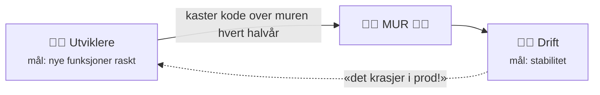
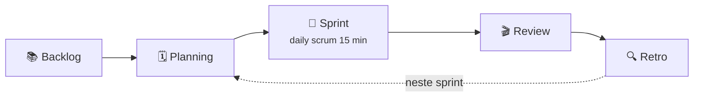
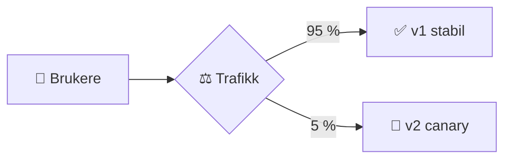
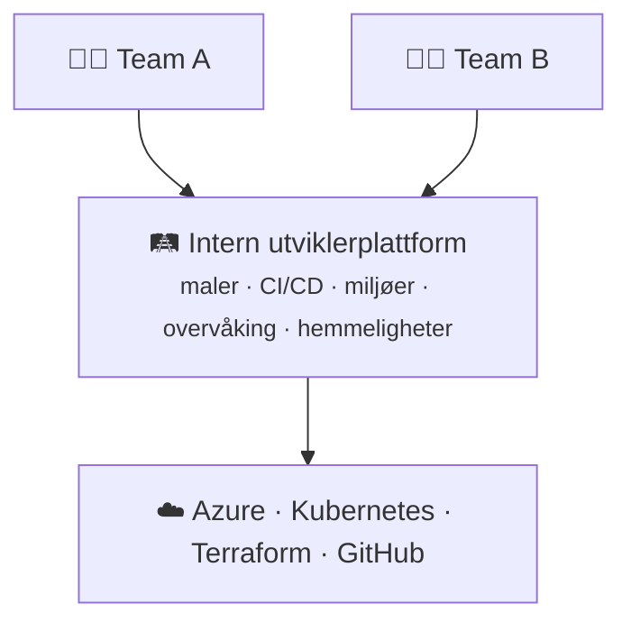

# 8 · DevOps Engineering

```vis
type: cards
title: Kapittelet på én side
cols: 4
items:
  - {icon: "🤝", title: "Hva er DevOps?", text: "Kultur + automatisering + rask tilbakemelding", color: blue}
  - {icon: "🧱", title: "Muren", text: "Hvorfor Dev og Ops måtte samarbeide", color: red}
  - {icon: "🏃", title: "Agile og Scrum", text: "Små leveranser i korte sprinter", color: teal}
  - {icon: "♾️", title: "Livssyklusen", text: "Plan → kode → bygg → test → deploy → overvåk", color: purple}
  - {icon: "🚀", title: "CI/CD", text: "Integrasjon, levering og utrulling", color: orange}
  - {icon: "🐤", title: "Deploy-strategier", text: "Rolling, blue-green, canary", color: green}
  - {icon: "🚨", title: "Hendelser og SRE", text: "SLO, error budget, postmortem", color: pink}
  - {icon: "🛡️", title: "DevSecOps og plattform", text: "Sikkerhet tidlig, golden paths", color: navy}
```

## Muren som DevOps rev



```vis
type: analogy
left: {icon: "🍳", title: "Restaurant med vegg", text: "Kokkene kaster rettene over veggen – servitørene får skylden når gjestene klager", color: red}
right: {icon: "🤝", title: "DevOps-restaurant", text: "Kokker og servitører planlegger sammen, smaker underveis og får rask tilbakemelding", color: green}
```

> 💡 **Viktigste innsikt:** Fart og stabilitet er **ikke** motsetninger. Små, hyppige endringer er lettere å teste, forstå og rulle tilbake.

## DevOps-kultur – CALMS

```vis
type: cards
cols: 5
items:
  - {icon: "🤝", title: "Culture", text: "Felles ansvar – «you build it, you run it»", color: blue}
  - {icon: "🤖", title: "Automation", text: "Automatiser alt som gjentas", color: teal}
  - {icon: "🪶", title: "Lean", text: "Små leveranser, fjern sløsing", color: green}
  - {icon: "📏", title: "Measurement", text: "Mål for å forbedre", color: orange}
  - {icon: "📣", title: "Sharing", text: "Del kunnskap og lærdom", color: purple}
```

```vis
type: stats
title: "DORA-metrikkene – slik måler du DevOps"
cols: 4
items:
  - {value: "🚀", label: "Deploy-frekvens – hvor ofte til prod?", color: blue}
  - {value: "⏱️", label: "Ledetid – commit til prod", color: teal}
  - {value: "💥", label: "Feilrate ved endringer", color: orange}
  - {value: "🩹", label: "Tid til gjenoppretting", color: green}
note: "To måler fart, to måler stabilitet – de beste teamene er gode på begge"
```

> 🙅 **Blameless:** Spør «hvordan lot systemet dette skje?», ikke «hvem gjorde feil?».

## Agile og Scrum

```vis
type: compare
vs: true
columns:
  - icon: "🌊"
    title: "Fossefall"
    color: gray
    points: ["Krav → design → kode → test → drift", "Måneder før kunden ser noe", "Endringer er dyre"]
  - icon: "🔁"
    title: "Agile"
    color: green
    points: ["Små fungerende biter hver 2. uke", "Kunden ser fremdrift hele tiden", "Tilpass underveis"]
```



```vis
type: cards
title: Rollene i Scrum
cols: 3
items:
  - {icon: "🎯", title: "Product Owner", text: "HVA skal bygges – prioriterer backloggen", color: orange}
  - {icon: "🧭", title: "Scrum Master", text: "Hjelper med prosessen, fjerner hindringer", color: purple}
  - {icon: "👩‍💻", title: "Developers", text: "Alle som bygger – også DevOps og test", color: blue}
```

> 📋 **Kanban:** kontinuerlig flyt uten sprinter, med grense for pågående arbeid – populært i drifts- og plattformteam.

## DevOps-livssyklusen

```vis
type: flow
title: "♾️ Uendelighetssløyfen"
steps:
  - {icon: "🗺️", title: "Plan", text: "Boards, Jira", color: blue}
  - {icon: "💻", title: "Code", text: "Git, PR", color: teal}
  - {icon: "🏗️", title: "Build", text: "Actions, Docker", color: purple}
  - {icon: "🧪", title: "Test", text: "pytest, skanning", color: orange}
  - {icon: "🚀", title: "Deploy", text: "Pipelines, Helm", color: green}
  - {icon: "⚙️", title: "Operate", text: "Kubernetes, IaC", color: navy}
  - {icon: "📊", title: "Monitor", text: "Grafana, Azure Monitor", color: red}
loop: "tilbakemelding fra drift går inn i neste plan"
```

## CI, Continuous Delivery og Continuous Deployment

```vis
type: layers
title: Hvor langt går automatikken?
items:
  - {icon: "🔁", title: "Continuous Integration", text: "kode → bygg → test automatisk ved hver push", color: blue}
  - {icon: "📦", title: "Continuous Delivery", text: "… → staging automatisk · prod med ett klikk / godkjenning", color: teal}
  - {icon: "🚀", title: "Continuous Deployment", text: "… → prod helt automatisk hvis alle tester er grønne", color: green}
```

> ⚠️ **Vanlig feil:** «CD» betyr ikke alltid automatisk til prod. Banker har ofte Continuous **Delivery** med manuell godkjenning – helt legitimt.

## Infrastruktur som buskap

```vis
type: compare
vs: true
columns:
  - icon: "🐶"
    title: "Kjæledyr (pets)"
    sub: "gammel måte"
    color: orange
    points: ["Servere med navn: «zeus»", "Pleies og repareres for hånd", "Unike «snøfnugg»"]
  - icon: "🐄"
    title: "Buskap (cattle)"
    sub: "moderne"
    color: green
    points: ["Like og nummererte", "Bygges fra kode (IaC)", "Feiler en, erstattes den automatisk"]
```

## Deploy-strategier

```vis
type: cards
cols: 4
items:
  - {icon: "🔄", title: "Rolling", text: "Bytt instanser én og én. Standard i Kubernetes.", color: blue}
  - {icon: "🔵🟢", title: "Blue-green", text: "Ny versjon ved siden av – bytt all trafikk på én gang", color: teal}
  - {icon: "🐤", title: "Canary", text: "5 % → 25 % → 100 % – stopp hvis tallene blir dårlige", color: orange}
  - {icon: "🚩", title: "Feature flags", text: "Deploy «av», slå på for utvalgte – uten ny deploy", color: purple}
```



## Monitoring og observability

```vis
type: cards
title: Observability – tre søyler
cols: 3
items:
  - {icon: "📈", title: "Metrikker", text: "Tall over tid: forespørsler/s, feilrate, CPU", color: blue}
  - {icon: "📜", title: "Logger", text: "Hendelser med detaljer: «betaling feilet ordre=123»", color: teal}
  - {icon: "🧵", title: "Traces", text: "Én forespørsels reise gjennom mange tjenester", color: purple}
```

```vis
type: cards
title: De fire gylne signalene
cols: 4
items:
  - {icon: "⏱️", title: "Latency", text: "responstid", color: orange}
  - {icon: "🚗", title: "Traffic", text: "trafikk", color: blue}
  - {icon: "❌", title: "Errors", text: "feil", color: red}
  - {icon: "🫙", title: "Saturation", text: "hvor fullt er det?", color: green}
```

## Hendelser og SRE

```vis
type: flow
title: Hendelseshåndtering
steps:
  - {icon: "🚨", title: "Oppdag", text: "varsel", color: red}
  - {icon: "📟", title: "Varsle", text: "vakt", color: orange}
  - {icon: "🩺", title: "Triager", text: "alvorlighet", color: yellow}
  - {icon: "🩹", title: "Stopp blødningen", text: "rollback / failover", color: blue}
  - {icon: "✅", title: "Verifiser", text: "tilbake til normal", color: green}
  - {icon: "📝", title: "Postmortem", text: "lær – uten skyld", color: purple}
```

```vis
type: cards
title: SRE-begrepene
cols: 4
items:
  - {icon: "📏", title: "SLI", text: "Det du måler: andel vellykkede forespørsler", color: blue}
  - {icon: "🎯", title: "SLO", text: "Internt mål: 99,9 % over 30 dager", color: teal}
  - {icon: "📜", title: "SLA", text: "Avtale med kunden – med konsekvenser", color: orange}
  - {icon: "💸", title: "Error budget", text: "100 % − 99,9 % ≈ 43 min per 30 dager", color: green}
```

> 💡 **Husk:** SLA ≤ SLO ≤ det systemet faktisk leverer. Er error budget brukt opp → prioriter stabilitet foran nye funksjoner.

## Platform Engineering og DevSecOps



```vis
type: flow
title: "DevSecOps – «shift left»: sikkerhet i hvert steg"
steps:
  - {icon: "🗺️", title: "Plan", text: "trusselmodell", color: blue}
  - {icon: "💻", title: "Code", text: "secret scanning", color: teal}
  - {icon: "📦", title: "Build", text: "avhengighets-skanning", color: purple}
  - {icon: "🧪", title: "Test", text: "SAST · image-skanning", color: orange}
  - {icon: "🚀", title: "Deploy", text: "policy-sjekk", color: green}
  - {icon: "👀", title: "Run", text: "overvåking · Defender", color: red}
```

## En dag som DevOps Engineer

```vis
type: timeline
items:
  - {when: "08:30", icon: "☕", title: "Sjekk dashbord og varsler", text: "Rydd et diskvarsel, lag oppgave for å automatisere", color: blue}
  - {when: "09:00", icon: "🧍", title: "Daily standup", text: "15 minutter med teamet", color: teal}
  - {when: "09:15", icon: "👀", title: "Kodegjennomgang", text: "Foreslår Key Vault i stedet for hemmelighet i YAML", color: purple}
  - {when: "10:00", icon: "🧱", title: "Terraform", text: "Nytt testmiljø – plan i pipelinen", color: orange}
  - {when: "11:30", icon: "🔍", title: "Feilsøking med utvikler", text: "Privat DNS-sone manglet kobling til VNet", color: red}
  - {when: "13:30", icon: "🛡️", title: "Pipeline", text: "Legger inn container-skanning", color: navy}
  - {when: "15:00", icon: "🐤", title: "Canary-deploy til prod", text: "10 % → 100 %, følger med på feilraten", color: green}
  - {when: "16:00", icon: "💰", title: "Kostnadsrydding", text: "Gammelt testmiljø slettes, policy for utløpstag", color: yellow}
```

## Test deg selv

1. Hva står CALMS for? → *Culture, Automation, Lean, Measurement, Sharing.*
2. De fire DORA-metrikkene? → *Frekvens, ledetid, feilrate, gjenopprettingstid.*
3. Product Owner vs. Scrum Master? → *Hva vs. prosess.*
4. Delivery vs. Deployment? → *Manuell vs. automatisk til prod.*
5. SLO vs. SLA? → *Internt mål vs. kundeavtale.*
6. «Shift left»? → *Sikkerhet og testing tidligere.*
