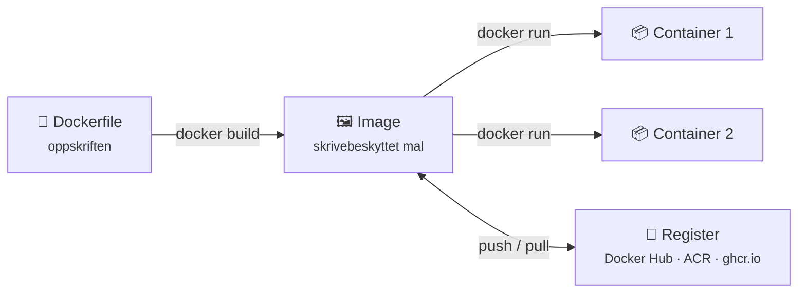
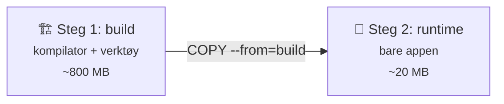
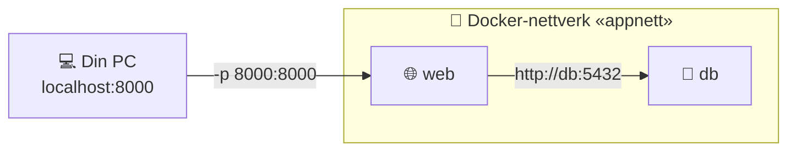

# 9 · Docker og containere

```vis
type: cards
title: Kapittelet på én side
cols: 4
items:
  - {icon: "📦", title: "Container", text: "Appen + alt den trenger, i én pakke", color: blue}
  - {icon: "🖼️", title: "Image", text: "Oppskriften containere lages fra", color: teal}
  - {icon: "📄", title: "Dockerfile", text: "Slik bygger du et image", color: purple}
  - {icon: "🧅", title: "Lag og cache", text: "Raske bygg med riktig rekkefølge", color: orange}
  - {icon: "💾", title: "Volumes", text: "Data som overlever containeren", color: green}
  - {icon: "🔌", title: "Nettverk", text: "Containere finner hverandre på navn", color: pink}
  - {icon: "🎼", title: "Compose", text: "Flere containere med én kommando", color: navy}
  - {icon: "🛡️", title: "Sikkerhet", text: "Ikke-root, skanning, ingen hemmeligheter", color: red}
```

## Hvorfor containere?

```vis
type: compare
vs: true
columns:
  - icon: "😩"
    title: "«Det virker på min PC!»"
    color: red
    mark: "❌"
    points: ["Kollegaen har annen Python-versjon", "Mangler et bibliotek", "Prod er satt opp litt annerledes"]
  - icon: "📦"
    title: "Med container"
    color: green
    points: ["Appen pakket med alt den trenger", "Kjører likt på laptop, test og prod", "Starter på sekunder"]
```

```vis
type: analogy
left: {icon: "🚢", title: "Skipscontaineren", text: "Samme mål og festepunkter – passer på alle skip, kraner og tog, uansett innhold", color: orange}
right: {icon: "📦", title: "Docker-containeren", text: "Samme format – kjører på alle maskiner med Docker, uansett hva appen er skrevet i", color: blue}
map: [["Varene", "Appen og avhengighetene"], ["Skipet", "Serveren"], ["Havnekranen", "Docker Engine"], ["Lastemanifestet", "Dockerfile"]]
```

## Container vs. virtuell maskin

```vis
type: compare
columns:
  - icon: "🏠"
    title: "Virtuell maskin"
    sub: "hvert hus har egen grunnmur"
    color: blue
    points: ["Eget operativsystem og kjerne", "Gigabyte stor", "Starter på minutter", "+ Sterk isolasjon"]
  - icon: "🏢"
    title: "Container"
    sub: "leiligheter deler grunnmuren"
    color: teal
    points: ["Deler vertens Linux-kjerne", "Megabyte liten", "Starter på sekunder", "- Svakere isolasjon"]
```

```vis
type: layers
title: Containere på en server
items:
  - {icon: "📦", title: "App A · App B · App C", text: "hver med sine biblioteker", color: teal}
  - {icon: "🐳", title: "Container-runtime", text: "Docker / containerd", color: blue}
  - {icon: "🐧", title: "Verts-OS (Linux-kjerne)", text: "namespaces isolerer · cgroups begrenser CPU og minne", color: navy}
  - {icon: "🔩", title: "Maskinvare (ofte en VM i skyen)", text: "", color: gray}
```

## Image og container



```vis
type: analogy
left: {icon: "🍰", title: "Kakeform", text: "Én form – mange kaker. Spiser du en kake, er formen hel.", color: orange}
right: {icon: "🖼️", title: "Image", text: "Ett image – mange containere. Slettes en container, er imaget uendret.", color: blue}
```

```bash
$ docker run -d -p 8080:80 --name web nginx:1.27     # -p VERT:CONTAINER
$ docker ps · docker logs -f web · docker exec -it web sh
$ docker stop web && docker rm web
```

> ⚠️ **Vanlig feil:** `:latest` i produksjon. Bruk faste versjoner – f.eks. commit-SHA som tag.

## Dockerfile og lag

```vis
type: layers
title: "Lagene i et image – det som endres SJELDEST øverst i fila"
items:
  - {icon: "📝", title: "COPY . .", text: "din kode – endres hele tiden", color: red}
  - {icon: "📦", title: "RUN pip install", text: "endres når requirements.txt endres", color: orange}
  - {icon: "📄", title: "COPY requirements.txt", text: "", color: yellow}
  - {icon: "🐍", title: "FROM python:3.12-slim", text: "base-image – endres sjelden, gjenbrukes fra cache", color: green}
```

```dockerfile
FROM python:3.12-slim                 # fast, slank base
WORKDIR /app
COPY requirements.txt .               # avhengigheter først → cache
RUN pip install --no-cache-dir -r requirements.txt
COPY . .                              # så koden
RUN useradd --uid 10001 appuser
USER appuser                          # ikke root!
EXPOSE 8000                           # dokumentasjon – åpner ingenting
CMD ["gunicorn", "--bind", "0.0.0.0:8000", "app:app"]   # 0.0.0.0, ikke 127.0.0.1
```

```vis
type: compare
vs: true
columns:
  - icon: "🏗️"
    title: "RUN"
    sub: "når imaget BYGGES"
    color: orange
    points: ["Installere pakker", "Lage brukere og mapper"]
  - icon: "▶️"
    title: "CMD"
    sub: "når containeren STARTER"
    color: green
    points: ["Starte appen", "Kan overstyres ved docker run"]
```



## Volumes og nettverk

```vis
type: cards
title: Hvor lagres data?
cols: 3
items:
  - {icon: "💨", title: "I containeren", text: "Forsvinner når containeren slettes", color: red}
  - {icon: "💾", title: "Named volume", text: "Docker-administrert – databaser og varige data", color: green}
  - {icon: "📂", title: "Bind mount", text: "Mappe fra PC-en din – lokal utvikling", color: blue}
```



> ⚠️ **Vanlig feil:** Inne i en container betyr `localhost` containeren selv. Bruk tjenestenavnet (`db`).

## Docker Compose

```yaml
services:
  web:
    build: .
    ports: ["8000:8000"]
    environment:
      DATABASE_URL: postgresql://app:${DB_PASSWORD}@db:5432/appdb
    depends_on:
      db: { condition: service_healthy }
  db:
    image: postgres:16
    environment: { POSTGRES_USER: app, POSTGRES_PASSWORD: "${DB_PASSWORD}", POSTGRES_DB: appdb }
    volumes: [pgdata:/var/lib/postgresql/data]
    healthcheck: { test: ["CMD-SHELL", "pg_isready -U app"], interval: 5s }
volumes:
  pgdata:
```

```vis
type: cards
cols: 4
items:
  - {icon: "▶️", title: "docker compose up -d", text: "Start alt", color: green}
  - {icon: "📜", title: "docker compose logs -f", text: "Følg loggene", color: blue}
  - {icon: "🔨", title: "up -d --build", text: "Bygg på nytt etter endringer", color: orange}
  - {icon: "🧹", title: "down -v", text: "Stopp og slett (også data!)", color: red}
```

## Sikkerhet

```vis
type: cards
cols: 4
items:
  - {icon: "🙅", title: "Ikke root", text: "USER appuser", color: blue}
  - {icon: "🪶", title: "Lite base-image", text: "slim · alpine · distroless", color: teal}
  - {icon: "📌", title: "Faste versjoner", text: "tag eller digest", color: purple}
  - {icon: "🔍", title: "Skann", text: "Trivy · Docker Scout · Defender", color: orange}
  - {icon: "🚫", title: "Ingen hemmeligheter", text: "Ikke ENV PASSORD eller COPY .env", color: red}
  - {icon: "🙈", title: ".dockerignore", text: ".git · .env · .venv", color: navy}
  - {icon: "📏", title: "Begrens ressurser", text: "--memory · --cpus", color: green}
  - {icon: "🔄", title: "Oppdater base", text: "Sikkerhetsfikser", color: pink}
```

## Feilsøking

```vis
type: cards
title: Symptom → årsak
cols: 3
items:
  - {icon: "🚪", title: "Exited (0) med en gang", text: "Hovedprosessen ble ferdig – må kjøre i forgrunnen", color: gray}
  - {icon: "💥", title: "Exited (1)", text: "Appen krasjet → docker logs", color: red}
  - {icon: "🧠", title: "Exited (137)", text: "OOMKilled – tom for minne", color: orange}
  - {icon: "🔌", title: "Ingen svar på localhost", text: "Mangler -p, eller lytter på 127.0.0.1", color: blue}
  - {icon: "🧩", title: "exec format error", text: "Feil CPU-arkitektur (ARM vs. AMD64)", color: purple}
  - {icon: "🔐", title: "permission denied", text: "Filer eies av root – bruk COPY --chown", color: teal}
```

## Prosjekt i korte trekk

```vis
type: flow
title: Bygg, kjør og publiser
steps:
  - {icon: "🐍", title: "Flask-app", text: "+ PostgreSQL"}
  - {icon: "📄", title: "Dockerfile", text: "slank, ikke-root"}
  - {icon: "🎼", title: "Compose", text: "app + database"}
  - {icon: "🔍", title: "Trivy", text: "skann imaget"}
  - {icon: "🤖", title: "GitHub Actions", text: "bygg ved push"}
  - {icon: "🏪", title: "ghcr.io / ACR", text: "publisert image"}
```

## Test deg selv

1. Image vs. container? → *Mal vs. kjørende instans.*
2. Hva deler containere? → *Vertens kjerne.*
3. Hvorfor `requirements.txt` før koden? → *Lag-cache.*
4. Åpner `EXPOSE` porten? → *Nei – bruk `-p`.*
5. Hva betyr exit 137? → *Drept, ofte OOMKilled.*
6. Passord slettet i senere lag – borte? → *Nei, ligger i tidligere lag.*
