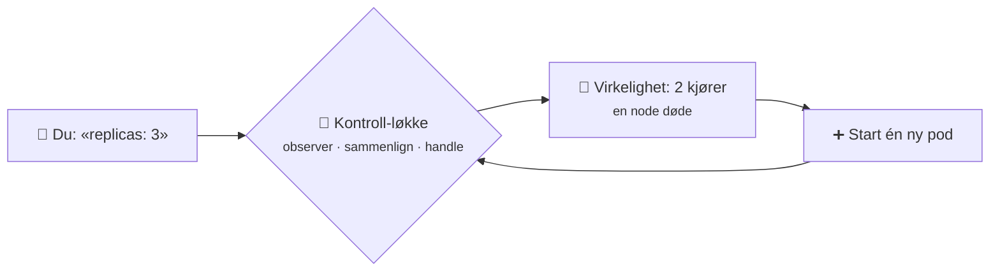
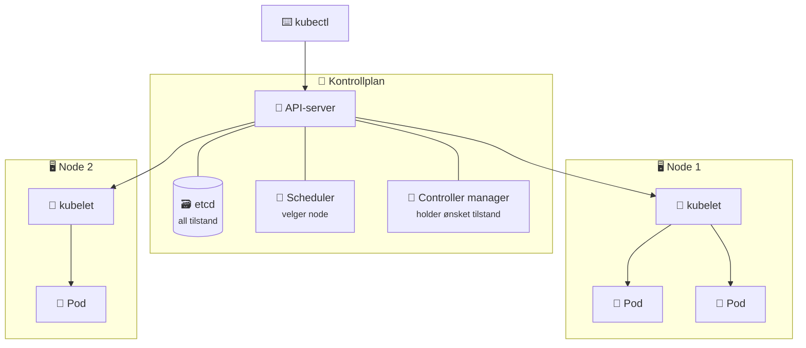
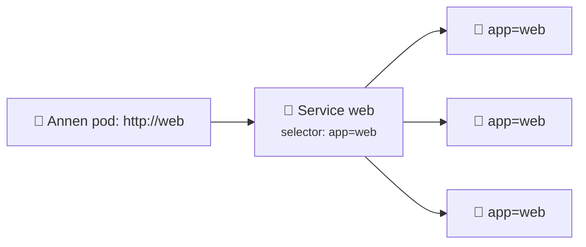
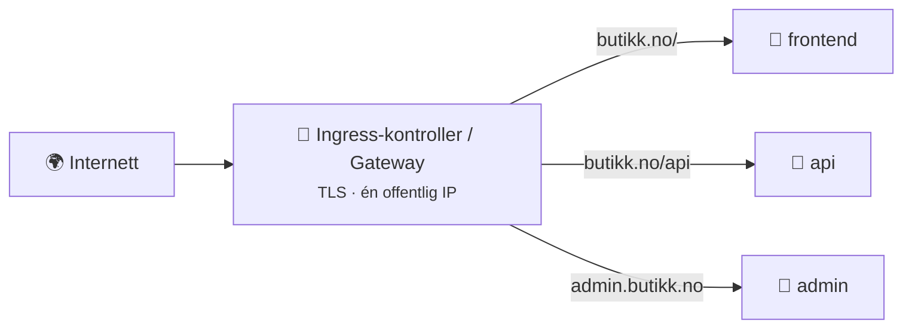
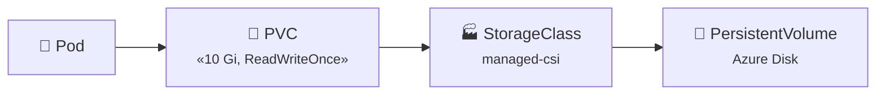

# 10 · Kubernetes

```vis
type: cards
title: Kapittelet på én side
cols: 4
items:
  - {icon: "🎼", title: "Hvorfor?", text: "Orkestrerer mange containere på mange maskiner", color: blue}
  - {icon: "🏛️", title: "Arkitektur", text: "Kontrollplan + noder", color: navy}
  - {icon: "🫛", title: "Pod og Deployment", text: "Kjør og hold riktig antall", color: teal}
  - {icon: "🔗", title: "Service og Ingress", text: "Stabil adresse og HTTP-ruting", color: purple}
  - {icon: "⚙️", title: "ConfigMap og Secret", text: "Konfigurasjon utenfra", color: orange}
  - {icon: "💾", title: "Lagring", text: "PVC og StorageClass", color: green}
  - {icon: "📈", title: "Autoskalering og Helm", text: "HPA og pakker", color: pink}
  - {icon: "🛡️", title: "Sikkerhet og AKS", text: "RBAC, nettverkspolicy, Azure", color: red}
```

## Hvorfor Kubernetes?

```vis
type: analogy
left: {icon: "🎻", title: "Dirigenten", text: "Du gir noten. Dirigenten plasserer musikerne – besvimer en fiolinist, hentes en ny fra reservebenken.", color: orange}
right: {icon: "☸️", title: "Kubernetes", text: "Du sier «3 kopier av web:v2». Kubernetes plasserer dem – dør en, startes en ny automatisk.", color: blue}
```



## Arkitekturen



## Pod, Deployment og Service

```vis
type: layers
title: Byggeklossene – fra innerst til ytterst
items:
  - {icon: "📦", title: "Container", text: "appen din", color: gray}
  - {icon: "🫛", title: "Pod", text: "1+ containere med felles IP – minste enhet, dødelig", color: green}
  - {icon: "📋", title: "ReplicaSet", text: "sørger for riktig antall pods", color: teal}
  - {icon: "🚀", title: "Deployment", text: "ønsket tilstand + rullerende oppdateringer + rollback", color: blue}
  - {icon: "🔗", title: "Service", text: "stabil IP/DNS-navn foran podene", color: purple}
```

```yaml
apiVersion: apps/v1
kind: Deployment
metadata: { name: web }
spec:
  replicas: 3
  selector: { matchLabels: { app: web } }
  template:
    metadata: { labels: { app: web } }          # MÅ matche selector
    spec:
      containers:
        - name: web
          image: nginx:1.27
          resources:
            requests: { cpu: 100m, memory: 128Mi }   # garantert
            limits: { memory: 256Mi }                 # over dette → OOMKilled
          readinessProbe: { httpGet: { path: /, port: 80 } }
```

```vis
type: compare
vs: true
columns:
  - icon: "🚦"
    title: "readinessProbe"
    sub: "er du klar for trafikk?"
    color: blue
    points: ["Feiler → tas ut av Service", "Ingen omstart"]
  - icon: "💓"
    title: "livenessProbe"
    sub: "lever du?"
    color: red
    points: ["Feiler → containeren restartes", "Ikke sjekk databasen her!"]
```



```vis
type: cards
title: Service-typer
cols: 3
items:
  - {icon: "🏠", title: "ClusterIP", text: "Bare inne i clusteret (standard)", color: blue}
  - {icon: "🚪", title: "NodePort", text: "Port på hver node – testing", color: gray}
  - {icon: "🌍", title: "LoadBalancer", text: "Ekstern IP fra skyens lastbalanserer", color: orange}
```

## Ingress og Gateway API



> 🆕 **Utvikling:** ingress-nginx-prosjektet er kunngjort pensjonert; **Gateway API** er etterfølgeren til Ingress. Lær begge – du møter Ingress i eksisterende clustere.

## ConfigMap, Secret og Namespace

```vis
type: cards
cols: 3
items:
  - {icon: "⚙️", title: "ConfigMap", text: "Ikke-sensitiv konfig: LOG_LEVEL, URL-er", color: orange}
  - {icon: "🤫", title: "Secret", text: "Passord og tokens – bare base64, IKKE kryptert! Beskytt med RBAC og Key Vault", color: red}
  - {icon: "🗂️", title: "Namespace", text: "Logiske rom: team, apper, miljøer – med kvoter og RBAC", color: blue}
```

## Lagring



## Autoskalering

```vis
type: flow
title: Når trafikken øker
steps:
  - {icon: "📈", title: "Trafikk ↑", text: "", color: orange}
  - {icon: "🔥", title: "CPU ↑", text: "over 70 % av request", color: red}
  - {icon: "🫛", title: "HPA", text: "flere pods", color: blue}
  - {icon: "⏳", title: "Pending", text: "ikke plass", color: yellow}
  - {icon: "🖥️", title: "Cluster Autoscaler", text: "ny node", color: teal}
  - {icon: "✅", title: "Stabilt", text: "", color: green}
```

## Helm

```vis
type: analogy
left: {icon: "📝", title: "Utfyllingsskjema", text: "Samme skjema – ulike svar for hver person", color: orange}
right: {icon: "⛵", title: "Helm chart", text: "Samme maler – ulike values.yaml for dev og prod", color: blue}
map: [["Skjemaet", "templates/"], ["Svarene", "values.yaml"], ["Utfylt skjema", "Release"]]
```

```bash
$ helm upgrade --install web ./minapp -f values-prod.yaml -n butikk
$ helm rollback web 1 -n butikk
```

## Sikkerhet

```vis
type: cards
cols: 4
items:
  - {icon: "🎭", title: "RBAC", text: "Role + RoleBinding – hvem får gjøre hva", color: blue}
  - {icon: "🪄", title: "Workload Identity", text: "Pods når Azure uten hemmeligheter", color: green}
  - {icon: "🙅", title: "securityContext", text: "runAsNonRoot · readOnlyRootFilesystem", color: orange}
  - {icon: "🧱", title: "NetworkPolicy", text: "Uten policy kan alle pods snakke med alle", color: red}
```

## AKS i praksis

```vis
type: flow
title: Fra image til offentlig app i AKS
steps:
  - {icon: "📦", title: "az acr build", text: "image i ACR"}
  - {icon: "☸️", title: "az aks create", text: "--attach-acr --enable-app-routing"}
  - {icon: "🔑", title: "get-credentials", text: "kubectl kobles til"}
  - {icon: "📄", title: "kubectl apply", text: "deployment · service · ingress"}
  - {icon: "🌍", title: "Offentlig IP", text: "kubectl get ingress"}
```

> 💰 **Kostnad:** Nodene er VM-er. `az aks stop` – og slett clusteret samme dag.

## Feilsøking

```vis
type: cards
title: "Gullregelen: kubectl describe pod → les Events nederst"
cols: 3
items:
  - {icon: "⏳", title: "Pending", text: "Ikke nok CPU/minne på nodene, eller PVC binder ikke", color: yellow}
  - {icon: "📥", title: "ImagePullBackOff", text: "Feil navn/tag, eller mangler AcrPull", color: orange}
  - {icon: "🔁", title: "CrashLoopBackOff", text: "Appen krasjer → kubectl logs --previous", color: red}
  - {icon: "🧠", title: "OOMKilled", text: "Over minne-limit", color: purple}
  - {icon: "🚦", title: "0/1 READY", text: "readinessProbe feiler", color: blue}
  - {icon: "🔗", title: "Service svarer ikke", text: "selector matcher ikke labels", color: teal}
```

## Test deg selv

1. Hva betyr deklarativt? → *Du beskriver ønsket tilstand, Kubernetes ordner resten.*
2. Hva lagres i etcd? → *Hele clusterets tilstand.*
3. Pod vs. Deployment? → *Én instans vs. ønsket antall + oppdateringer.*
4. Minne- vs. CPU-limit overskredet? → *Drept vs. strupet.*
5. Er Secrets kryptert? → *Nei, bare base64.*
6. Hva krever HPA? → *metrics-server og resource requests.*
