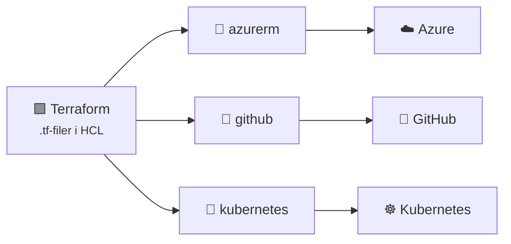
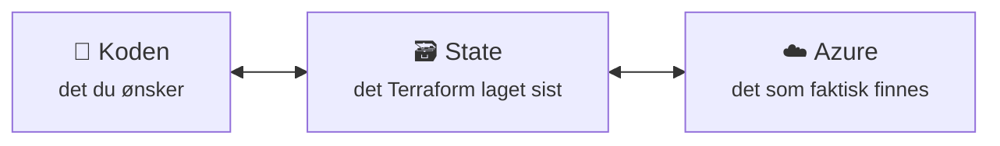
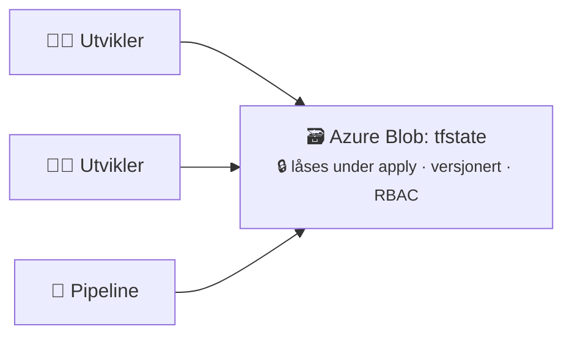
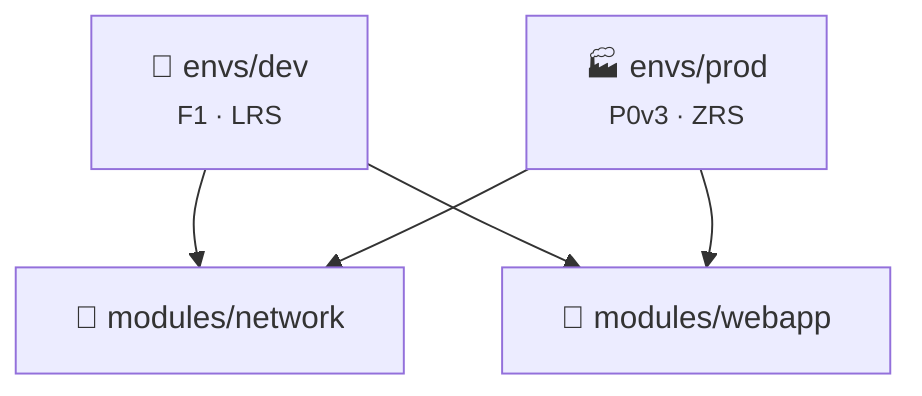
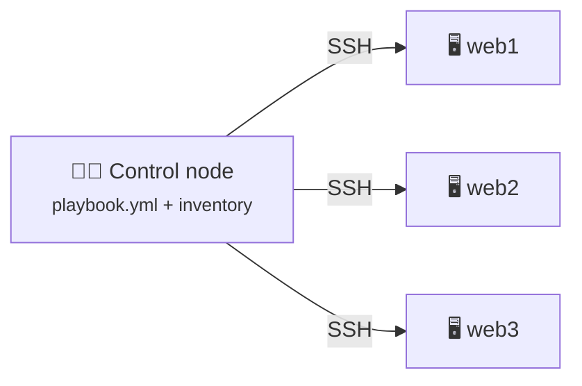
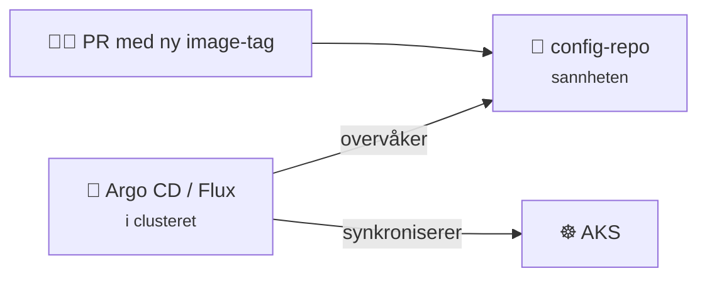

# 11 · Infrastructure as Code

```vis
type: cards
title: Kapittelet på én side
cols: 4
items:
  - {icon: "📜", title: "Hva er IaC?", text: "Infrastruktur beskrevet i kode", color: blue}
  - {icon: "🎯", title: "Deklarativt", text: "Beskriv sluttresultatet – idempotent", color: teal}
  - {icon: "🟪", title: "Terraform", text: "init → plan → apply", color: purple}
  - {icon: "🗃️", title: "State", text: "Kobling mellom kode og virkelighet", color: orange}
  - {icon: "🧱", title: "Moduler", text: "Gjenbrukbare byggeklosser", color: green}
  - {icon: "💪", title: "Bicep", text: "Azures eget språk – uten state", color: navy}
  - {icon: "🅰️", title: "Ansible", text: "Konfigurer innsiden av servere", color: red}
  - {icon: "🔁", title: "GitOps", text: "Git er sannheten", color: pink}
```

## Hvorfor IaC?

```vis
type: compare
vs: true
columns:
  - icon: "🖱️"
    title: "Klikk i portalen"
    color: red
    mark: "❌"
    points: ["Husker ingen alle innstillingene", "Testmiljøet blir aldri helt likt", "Ingen historikk eller gjennomgang", "Vanskelig å bygge opp igjen"]
  - icon: "📜"
    title: "Infrastruktur som kode"
    color: green
    points: ["Samme kode = samme resultat", "Git: hvem, hva, hvorfor", "Pull request før endring", "Gjenoppbygg alt på minutter"]
```

```vis
type: analogy
left: {icon: "🍲", title: "Matlaging uten oppskrift", text: "Kan bli godt – men aldri likt to ganger, og ingen andre kan gjenta det", color: orange}
right: {icon: "📖", title: "Oppskrift", text: "Presis, delbar og forbedrebar – det er IaC", color: blue}
```

```vis
type: compare
columns:
  - icon: "🎯"
    title: "Deklarativt"
    sub: "HVA du vil ha"
    color: green
    points: ["«Det skal finnes et VNet med 3 subnett»", "Kjør to ganger → ingen endring (idempotent)", "Terraform · Bicep · Kubernetes YAML"]
  - icon: "🪜"
    title: "Imperativt"
    sub: "HVORDAN – stegene"
    color: orange
    points: ["«Kjør az network vnet create, så …»", "Kjør to ganger → feil eller duplikater", "Bash-/Python-skript"]
```

```vis
type: compare
columns:
  - icon: "🏗️"
    title: "Provisionering"
    sub: "lage infrastrukturen"
    color: purple
    points: ["Terraform · Bicep · Pulumi", "VNet, VM, database, Key Vault"]
  - icon: "🔧"
    title: "Konfigurasjonsstyring"
    sub: "konfigurere innsiden"
    color: red
    points: ["Ansible · cloud-init", "Pakker, filer, brukere, tjenester"]
```

## Terraform

```vis
type: flow
title: Terraform-arbeidsflyten
steps:
  - {icon: "✍️", title: "Skriv .tf", text: "providers, resources", color: blue}
  - {icon: "📥", title: "init", text: "last ned providers, koble state", color: teal}
  - {icon: "🔮", title: "plan", text: "+ lages · ~ endres · − slettes", color: orange}
  - {icon: "🚀", title: "apply", text: "gjør endringene", color: green}
  - {icon: "🧹", title: "destroy", text: "slett alt", color: red}
```



```hcl
terraform {
  required_providers {
    azurerm = { source = "hashicorp/azurerm", version = "~> 4.0" }
  }
}
provider "azurerm" {
  features {}
  subscription_id = var.subscription_id
}

resource "azurerm_resource_group" "main" {        # type + lokalt navn
  name     = "rg-${var.miljo}"
  location = var.location
}

resource "azurerm_virtual_network" "main" {
  name                = "vnet-${var.miljo}"
  resource_group_name = azurerm_resource_group.main.name   # referanse = avhengighet
  location            = azurerm_resource_group.main.location
  address_space       = ["10.0.0.0/16"]
}

output "vnet_id" { value = azurerm_virtual_network.main.id }
```

```vis
type: cards
title: Byggeklossene i Terraform
cols: 4
items:
  - {icon: "🔌", title: "provider", text: "Hvilket API (azurerm)", color: blue}
  - {icon: "🧱", title: "resource", text: "Noe Terraform skal lage", color: green}
  - {icon: "🔎", title: "data", text: "Les noe som finnes fra før", color: teal}
  - {icon: "📥", title: "variable", text: "Input – dev og prod med samme kode", color: orange}
  - {icon: "🧮", title: "locals", text: "Hjelpeverdier i koden", color: gray}
  - {icon: "📤", title: "output", text: "Verdier ut: URL-er, ID-er", color: purple}
  - {icon: "🔁", title: "for_each", text: "Mange like ressurser med nøkler", color: pink}
  - {icon: "🧩", title: "module", text: "Gjenbrukbar pakke", color: navy}
```

### State



```vis
type: cards
title: Regler for state-filen
cols: 4
items:
  - {icon: "🤫", title: "Kan inneholde hemmeligheter", text: "Behandle den som sensitiv", color: red}
  - {icon: "🚫", title: "Aldri i Git", text: "*.tfstate i .gitignore", color: orange}
  - {icon: "☁️", title: "Remote state", text: "Azure Blob med låsing og versjonering", color: blue}
  - {icon: "✋", title: "Ikke rediger for hånd", text: "Bruk terraform state / import / moved", color: gray}
```



> ⚠️ **Les planen!** `-/+` betyr **slett og lag på nytt** – på en database kan det bety datatap.

### Moduler



## Bicep vs. Terraform

```vis
type: compare
columns:
  - icon: "💪"
    title: "Bicep"
    color: blue
    points: ["Bare Azure", "Ingen state-fil", "Nye Azure-funksjoner med en gang", "what-if"]
  - icon: "🟪"
    title: "Terraform"
    color: purple
    points: ["Mange plattformer", "State-fil som må beskyttes", "Svært vanlig i jobbannonser", "plan"]
```

## Ansible



```yaml
- name: Konfigurer webservere
  hosts: web
  become: true
  tasks:
    - name: Installer nginx
      ansible.builtin.apt: { name: nginx, state: present, update_cache: true }
    - name: Sørg for at nginx kjører
      ansible.builtin.service: { name: nginx, state: started, enabled: true }
```

> 💡 Kjør playbooken to ganger: andre gang står det `changed=0` – det er idempotens.

## GitOps

```vis
type: compare
columns:
  - icon: "📤"
    title: "Push (klassisk CI/CD)"
    color: orange
    points: ["Pipeline sender endringer inn", "Pipelinen trenger tilgang til clusteret"]
  - icon: "📥"
    title: "Pull (GitOps)"
    color: green
    points: ["Agent i clusteret henter fra Git", "Retter manuelle avvik automatisk", "Rollback = git revert"]
```



## Test deg selv

1. Hva er idempotens? → *Samme kode flere ganger = samme resultat.*
2. Hva gjør `terraform plan`? → *Viser hva som vil skje, uten å gjøre det.*
3. Hvorfor ikke state i Git? → *Hemmeligheter og ingen låsing.*
4. Hva betyr `-/+`? → *Slett og lag på nytt.*
5. Hvorfor trenger ikke Bicep state? → *Azure er sannheten.*
6. Push vs. pull i GitOps? → *Pipeline sender inn vs. agent henter selv.*
