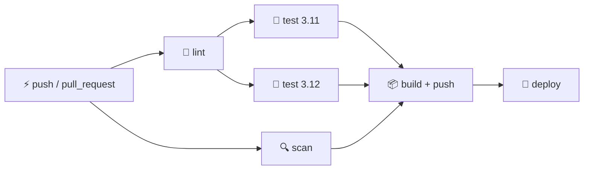
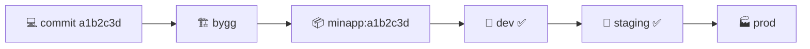
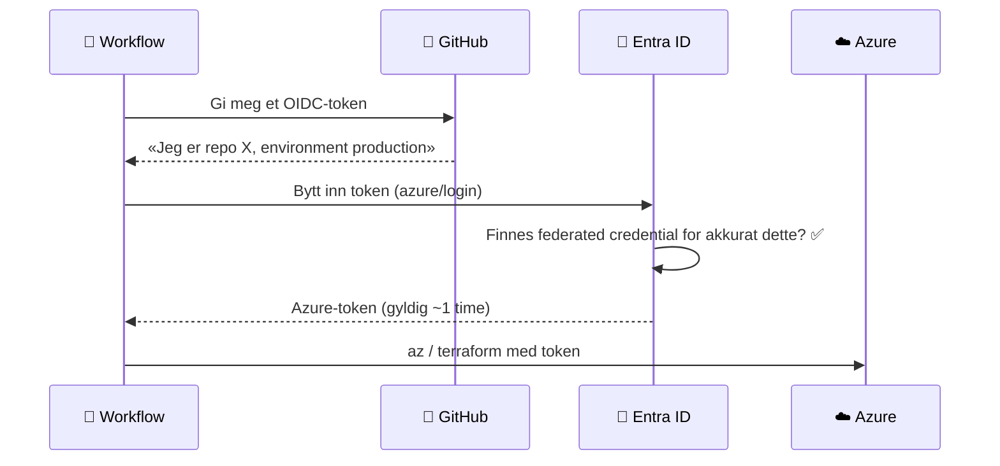
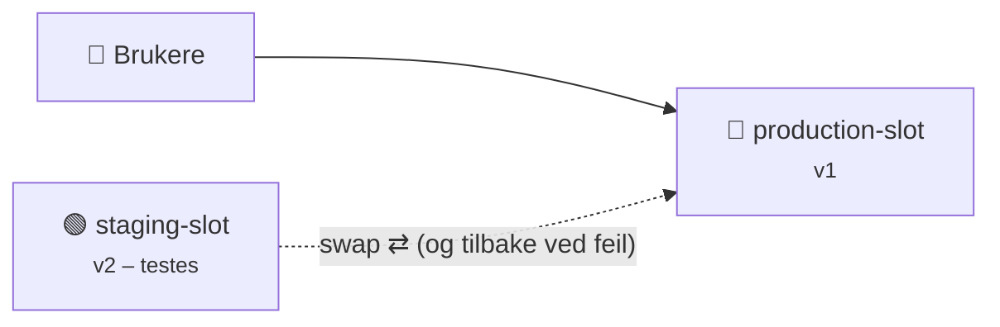
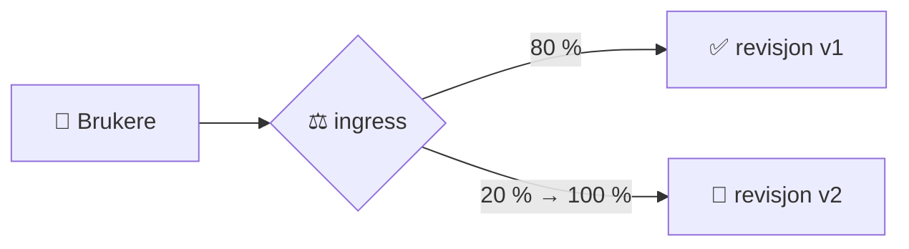

# 12 · CI/CD og automatisering

```vis
type: cards
title: Kapittelet på én side
cols: 4
items:
  - {icon: "🏭", title: "Pipeline", text: "Samlebåndet fra commit til drift", color: blue}
  - {icon: "🧪", title: "Testing", text: "Testpyramiden", color: green}
  - {icon: "⚙️", title: "GitHub Actions", text: "Workflows, jobs, steps", color: purple}
  - {icon: "🧰", title: "Azure Pipelines og Jenkins", text: "Samme prinsipper", color: gray}
  - {icon: "📦", title: "Artefakter", text: "Bygg én gang, deploy mange ganger", color: orange}
  - {icon: "🔐", title: "OIDC", text: "Til Azure uten hemmeligheter", color: red}
  - {icon: "⏪", title: "Rollback", text: "Planlagt og testet", color: teal}
  - {icon: "🐤", title: "Blue-green og canary", text: "Trygg utrulling", color: pink}
```

## Pipelinen

```vis
type: analogy
left: {icon: "🚗", title: "Samlebånd i bilfabrikk", text: "Hver stasjon gjør én ting. Feiler kvalitetskontrollen, stopper båndet før bilen når kunden.", color: orange}
right: {icon: "🏭", title: "CI/CD-pipeline", text: "Hvert steg sjekker noe. Feiler en test, stopper pipelinen før koden når produksjon.", color: blue}
```

```vis
type: flow
title: Fra commit til produksjon
steps:
  - {icon: "💻", title: "Push", text: "", color: gray}
  - {icon: "🏗️", title: "Bygg", text: "", color: blue}
  - {icon: "🧪", title: "Test", text: "", color: green}
  - {icon: "🔍", title: "Skann", text: "", color: orange}
  - {icon: "📦", title: "Artefakt", text: "image:SHA", color: purple}
  - {icon: "🧪", title: "Staging", text: "smoke test", color: teal}
  - {icon: "🏭", title: "Prod", text: "canary", color: red}
loop: "feiler et steg → stopp og varsle utvikleren med en gang"
```

```vis
type: cards
title: En god pipeline er …
cols: 3
items:
  - {icon: "⚡", title: "Rask", text: "Svar på minutter", color: blue}
  - {icon: "🎯", title: "Pålitelig", text: "Ingen tilfeldige feil", color: green}
  - {icon: "📦", title: "Bygg én gang", text: "Samme artefakt i alle miljøer", color: orange}
  - {icon: "📄", title: "Kode", text: "YAML i repoet, gjennomgått", color: purple}
  - {icon: "🔐", title: "Sikker", text: "Minste privilegium, ingen hemmeligheter i klartekst", color: red}
  - {icon: "🔎", title: "Sporbar", text: "Hvilken commit kjører i prod?", color: teal}
```

## Testpyramiden

```vis
type: pyramid
items:
  - {icon: "🖱️", title: "E2E / UI", text: "få · trege · dyre", color: red}
  - {icon: "🔗", title: "Integrasjonstester", text: "app + database", color: orange}
  - {icon: "🧪", title: "Enhetstester", text: "mange · raske · billige", color: green}
note: "I tillegg: linting først, sikkerhetsskanning i CI, smoke test etter hver deploy"
```

## GitHub Actions



```vis
type: cards
title: Verktøyene i en moden workflow
cols: 4
items:
  - {icon: "🔗", title: "needs", text: "Rekkefølge mellom jobber", color: blue}
  - {icon: "🧮", title: "matrix", text: "Samme jobb, ulike versjoner", color: teal}
  - {icon: "🐘", title: "services", text: "Database under testene", color: purple}
  - {icon: "⚡", title: "cache", text: "Raskere kjøringer", color: green}
  - {icon: "🔐", title: "permissions", text: "Minst mulig for tokenet", color: red}
  - {icon: "🏁", title: "environment", text: "Godkjenning før prod", color: orange}
  - {icon: "♻️", title: "reusable workflows", text: "Felles maler for mange repoer", color: navy}
  - {icon: "📌", title: "SHA-låste actions", text: "Beskytt mot forsyningskjedeangrep", color: pink}
```

```vis
type: compare
columns:
  - icon: "🐙"
    title: "GitHub Actions"
    color: navy
    points: ["workflow → jobs → steps", "Marketplace-actions", "azure/login med OIDC"]
  - icon: "🔷"
    title: "Azure Pipelines"
    color: blue
    points: ["stages → jobs → steps", "Tasks og templates", "Service connection"]
  - icon: "🤵"
    title: "Jenkins"
    color: gray
    points: ["Selvhostet server", "Jenkinsfile (Groovy)", "Mange plugins – du drifter alt"]
```

## Artefakter



## Hemmeligheter og OIDC

```vis
type: layers
title: Hemmeligheter i pipelines – fra OK til best
items:
  - {icon: "🥉", title: "Pipeline-hemmeligheter", text: "GitHub Secrets / secret variables", color: orange}
  - {icon: "🥈", title: "Key Vault", text: "hentes ved kjøring", color: blue}
  - {icon: "🥇", title: "Ingen hemmelighet", text: "OIDC til Azure + managed identity for appen", color: green}
```



```yaml
permissions:
  id-token: write          # nødvendig for OIDC
  contents: read
jobs:
  deploy:
    environment: production
    runs-on: ubuntu-latest
    steps:
      - uses: azure/login@v2
        with:
          client-id: ${{ vars.AZURE_CLIENT_ID }}
          tenant-id: ${{ vars.AZURE_TENANT_ID }}
          subscription-id: ${{ vars.AZURE_SUBSCRIPTION_ID }}
```

> ⚠️ `AADSTS70021` = subject i federated credential matcher ikke (f.eks. `repo:eier/repo:environment:production`).

## Rollback, blue-green og canary

```vis
type: cards
title: Måter å rulle tilbake på
cols: 3
items:
  - {icon: "📦", title: "Redeploy forrige artefakt", text: "Minutter", color: blue}
  - {icon: "🔁", title: "Bytt tilbake (slot / trafikk)", text: "Sekunder", color: green}
  - {icon: "☸️", title: "rollout undo / helm rollback", text: "Sekunder–minutter", color: teal}
  - {icon: "🚩", title: "Feature flag av", text: "Sekunder", color: purple}
  - {icon: "🩹", title: "Roll forward", text: "Rett raskt og deploy ny versjon", color: orange}
  - {icon: "↩️", title: "git revert (GitOps)", text: "Minutter", color: navy}
```





## Hele pipelinen – kode til produksjon

```vis
type: vflow
title: Den komplette pipelinen (full YAML i fullversjonen)
steps:
  - {icon: "🧪", title: "PR: test + scan", text: "ruff · pytest · Trivy – må være grønt før merge", color: green}
  - {icon: "📦", title: "Build", text: "OIDC-innlogging · docker build · push minapp:SHA til ACR", color: purple}
  - {icon: "🧪", title: "Deploy staging", text: "ny revisjon i Container Apps · smoke test /health", color: teal}
  - {icon: "👤", title: "Godkjenning", text: "environment «production» krever reviewer", color: yellow}
  - {icon: "🐤", title: "Canary i prod", text: "20 % trafikk → verifiser → 100 %", color: orange}
  - {icon: "⏪", title: "Automatisk rollback", text: "feiler noe → trafikk tilbake til forrige revisjon", color: red}
```

## Test deg selv

1. «Bygg én gang»? → *Samme artefakt i alle miljøer.*
2. `needs` og `matrix`? → *Rekkefølge og varianter.*
3. Hvorfor SHA-låste actions? → *Tagger kan flyttes.*
4. Hvilken permission krever OIDC? → *`id-token: write`.*
5. Blue-green vs. canary? → *Alt på én gang vs. gradvis.*
6. Hva er en smoke test? → *Rask sjekk at tjenesten lever etter deploy.*
