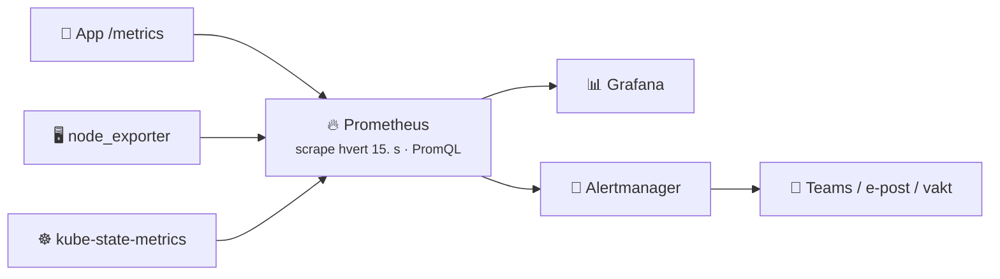
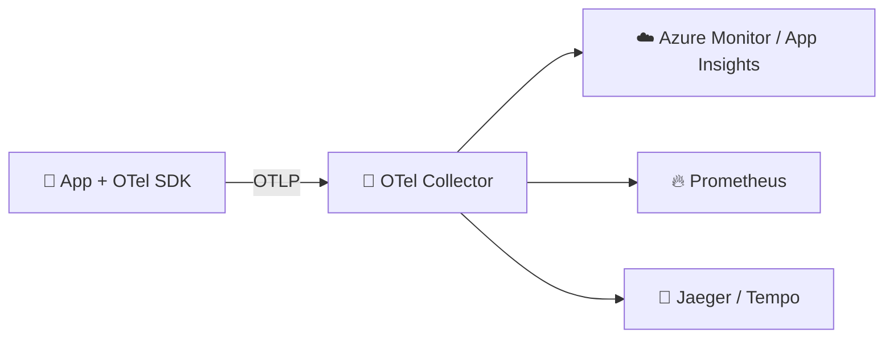

# 13 · Sikkerhet og monitoring

```vis
type: cards
title: Kapittelet på én side
cols: 4
items:
  - {icon: "🔺", title: "CIA", text: "Konfidensialitet · integritet · tilgjengelighet", color: blue}
  - {icon: "🪪", title: "IAM", text: "Hvem er du – hva får du?", color: navy}
  - {icon: "🤏", title: "Minste privilegium", text: "Akkurat nok, kortest mulig", color: green}
  - {icon: "🔐", title: "Hemmeligheter og kryptering", text: "Helst ingen hemmeligheter", color: red}
  - {icon: "🧅", title: "Defense in depth og Zero Trust", text: "Lag på lag – stol aldri blindt", color: purple}
  - {icon: "🔍", title: "Skanning og backup", text: "Finn sårbarheter, test gjenoppretting", color: orange}
  - {icon: "📊", title: "Observability", text: "Logger, metrikker, traces", color: teal}
  - {icon: "🚨", title: "Hendelser", text: "Strukturert respons og feilsøking", color: pink}
```

> 🏢 **Viktig innsikt:** De fleste alvorlige hendelser i skyen skyldes grunnleggende feil – lekkede nøkler, for brede tilganger, åpen lagring, manglende MFA. God grunnhygiene stopper det meste.

## Del A – Sikkerhet

```vis
type: cards
title: CIA-triaden
cols: 3
items:
  - {icon: "🙈", title: "Konfidensialitet", text: "Bare de som skal, kan lese · tilgangskontroll, kryptering", color: blue}
  - {icon: "🧾", title: "Integritet", text: "Data endres ikke uautorisert · signering, hashing, logging", color: teal}
  - {icon: "🟢", title: "Tilgjengelighet", text: "Systemet er oppe når det trengs · redundans, backup, DDoS-vern", color: green}
```

### IAM og minste privilegium

```vis
type: compare
vs: true
columns:
  - icon: "🪪"
    title: "Autentisering"
    sub: "hvem er du?"
    color: blue
    points: ["Passord + MFA", "Managed identity", "OIDC-token"]
  - icon: "🎟️"
    title: "Autorisasjon"
    sub: "hva får du gjøre?"
    color: green
    points: ["RBAC-roller", "Policyer", "Betingelser (Conditional Access)"]
```

```vis
type: analogy
left: {icon: "🏨", title: "Hotellnøkkelkortet", text: "Ditt rom, dine netter – ikke universalnøkkel for alltid", color: orange}
right: {icon: "🤏", title: "Minste privilegium", text: "Akkurat den tilgangen som trengs, på minst mulig scope, i kortest mulig tid", color: blue}
```

```vis
type: cards
cols: 4
items:
  - {icon: "👀", title: "Reader som standard", text: "Contributor bare der det trengs", color: green}
  - {icon: "👥", title: "Gi til grupper", text: "Ikke enkeltpersoner", color: blue}
  - {icon: "⏳", title: "Just-in-time", text: "PIM for admin-roller", color: purple}
  - {icon: "🤖", title: "Endringer via pipeline", text: "Ingen mennesker skriver i prod daglig", color: orange}
```

### Hemmeligheter og kryptering

```vis
type: layers
title: Hemmeligheter – fra verst til best
items:
  - {icon: "💀", title: "Hardkodet i koden / Git", text: "lekker garantert før eller siden", color: red}
  - {icon: "📄", title: "Konfigfil på disk", text: "", color: orange}
  - {icon: "🌱", title: "Miljøvariabel", text: "bedre – men må komme fra et sted og roteres", color: yellow}
  - {icon: "🔑", title: "Key Vault", text: "sentralt, revisjonslogg, rotasjon", color: blue}
  - {icon: "🏆", title: "Ingen hemmelighet", text: "managed identity og OIDC", color: green}
```

```vis
type: cards
cols: 3
items:
  - {icon: "💽", title: "I ro (at rest)", text: "Data på disk krypteres – på som standard i Azure", color: blue}
  - {icon: "🚚", title: "Under overføring", text: "TLS 1.2+ overalt, også internt", color: teal}
  - {icon: "🧠", title: "I bruk", text: "Confidential computing – avansert", color: purple}
```

> ⚠️ **Base64 er ikke kryptering.** Alle kan dekode det.

### Defense in depth og Zero Trust

```vis
type: layers
title: Sikkerhet i lag – én svikt gir ikke full tilgang
widen: true
items:
  - {icon: "💎", title: "Data", text: "kryptering, klassifisering", color: red}
  - {icon: "📱", title: "Applikasjon", text: "sikker kode, skanning", color: orange}
  - {icon: "🖥️", title: "Compute", text: "patching, herding", color: yellow}
  - {icon: "🌐", title: "Nettverk", text: "NSG, private endpoints", color: green}
  - {icon: "🚧", title: "Perimeter", text: "WAF, Azure Firewall, DDoS", color: teal}
  - {icon: "🪪", title: "Identitet", text: "MFA, RBAC, Conditional Access", color: blue}
  - {icon: "🏭", title: "Fysisk", text: "datasenteret – leverandørens ansvar", color: gray}
```

```vis
type: cards
title: "Zero Trust – «stol aldri, verifiser alltid»"
cols: 3
items:
  - {icon: "🔎", title: "Verifiser eksplisitt", text: "Identitet, enhet, lokasjon, risiko – hver gang", color: blue}
  - {icon: "🤏", title: "Minste privilegium", text: "Just-in-time og just-enough", color: green}
  - {icon: "💥", title: "Anta brudd", text: "Segmenter, krypter, overvåk", color: red}
```

```vis
type: analogy
left: {icon: "🏰", title: "Borg med vollgrav", text: "Stol på alt innenfor muren – er angriperen inne, er alt åpent", color: gray}
right: {icon: "✈️", title: "Flyplass", text: "Pass, sikkerhetskontroll, boardingkort – og du kommer aldri inn i cockpiten", color: blue}
```

### Skanning og backup

```vis
type: cards
title: Hva skannes – og når
cols: 4
items:
  - {icon: "🤫", title: "Hemmeligheter", text: "gitleaks · secret scanning – hver push", color: red}
  - {icon: "🧑‍💻", title: "Egen kode (SAST)", text: "CodeQL · Semgrep – hver PR", color: blue}
  - {icon: "📚", title: "Avhengigheter", text: "Dependabot · pip-audit – daglig", color: teal}
  - {icon: "📦", title: "Images", text: "Trivy · Defender – ved bygg", color: purple}
  - {icon: "📜", title: "IaC", text: "Checkov · Trivy – hver PR", color: orange}
  - {icon: "🌐", title: "Kjørende app (DAST)", text: "OWASP ZAP – mot staging", color: pink}
  - {icon: "☁️", title: "Sky-oppsett", text: "Defender for Cloud – alltid", color: navy}
  - {icon: "📋", title: "OWASP Top 10", text: "Les den – kommer i intervjuer", color: green}
```

```vis
type: stats
title: "Backup-regelen 3-2-1 (+1+0)"
cols: 5
items:
  - {value: "3", label: "kopier av dataene", color: blue}
  - {value: "2", label: "ulike lagringstyper", color: teal}
  - {value: "1", label: "utenfor hovedlokasjonen", color: purple}
  - {value: "1", label: "uforanderlig / frakoblet", color: orange}
  - {value: "0", label: "feil ved test av gjenoppretting", color: green}
```

## Del B – Monitoring og observability

```vis
type: cards
cols: 3
items:
  - {icon: "📜", title: "Logger", text: "Strukturert JSON med trace_id. Ingen hemmeligheter eller unødvendige personopplysninger.", color: teal}
  - {icon: "📈", title: "Metrikker", text: "Counter · gauge · histogram. Mål persentiler (p95, p99) – ikke bare snitt.", color: blue}
  - {icon: "🧵", title: "Traces", text: "En forespørsels reise – finn flaskehalsen", color: purple}
```

```vis
type: layers
title: "Én trace: GET /kasse (820 ms) – hvor brukes tiden?"
items:
  - {icon: "🖼️", title: "frontend · 820 ms", text: "████████████████████", color: blue}
  - {icon: "⚙️", title: "api · 700 ms", text: "█████████████████", color: teal}
  - {icon: "🗄️", title: "database · 60 ms", text: "██", color: green}
  - {icon: "💳", title: "betaling · 580 ms", text: "██████████████  ← flaskehalsen", color: red}
```

```vis
type: compare
columns:
  - icon: "🔴"
    title: "RED – for tjenester"
    color: red
    points: ["Rate – forespørsler/s", "Errors – feil/s", "Duration – responstid"]
  - icon: "🟣"
    title: "USE – for ressurser"
    color: purple
    points: ["Utilization – utnyttelse", "Saturation – kø", "Errors – feil"]
```

### Prometheus og Grafana



```promql
sum(rate(http_requests_total{status=~"5.."}[5m])) / sum(rate(http_requests_total[5m]))   # feilrate
```

### OpenTelemetry og Azure Monitor



```vis
type: cards
title: Gode varsler
cols: 4
items:
  - {icon: "🤕", title: "Symptomer", text: "Varsle på det brukerne merker", color: red}
  - {icon: "🛠️", title: "Handlingsbart", text: "Hvert varsel har en runbook", color: blue}
  - {icon: "📟", title: "Page vs. ticket", text: "Vekk noen bare når det haster", color: orange}
  - {icon: "🧹", title: "Rydd jevnlig", text: "For mange varsler = ingen reagerer", color: gray}
```

## Del C – Hendelser og feilsøking

```vis
type: flow
title: Hendelseshåndtering (NIST)
steps:
  - {icon: "📋", title: "Forbered", text: "planer, roller, øvelser", color: blue}
  - {icon: "🔎", title: "Oppdag og analyser", text: "varsler, logger", color: orange}
  - {icon: "🧯", title: "Begrens og gjenopprett", text: "isoler, fjern, gjenopprett", color: red}
  - {icon: "📝", title: "Lær", text: "postmortem, tiltak", color: green}
loop: "lærdommen går tilbake i forberedelsene"
```

```vis
type: vflow
title: "Eksempel: nøkkel lekket på GitHub"
steps:
  - {icon: "🚨", title: "Oppdag", text: "Secret scanning varsler", color: red}
  - {icon: "🔄", title: "Roter nøkkelen NÅ", text: "az storage account keys renew", color: orange}
  - {icon: "🔎", title: "Undersøk", text: "Ble nøkkelen brukt? Les loggene", color: blue}
  - {icon: "🧹", title: "Fjern og gjenopprett", text: "Rydd koden, gjenopprett data fra versjoner", color: teal}
  - {icon: "📣", title: "Varsle ved personopplysninger", text: "Datatilsynet innen 72 timer (GDPR)", color: purple}
  - {icon: "🛡️", title: "Forebygg", text: "Push protection · managed identity · Policy", color: green}
```

```vis
type: vflow
title: Feilsøking som en forsker
steps:
  - {icon: "🎯", title: "Definer problemet presist", text: "«/kasse gir 502 for 30 % siden 14:05»"}
  - {icon: "📊", title: "Samle data", text: "dashboards, logger, traces – og hva er ENDRET?"}
  - {icon: "💭", title: "Lag hypoteser", text: "«én pod har feil konfig etter deploy»"}
  - {icon: "🧪", title: "Test én om gangen", text: "én endring – noter alt"}
  - {icon: "🩹", title: "Mitiger først", text: "rollback → feilen borte"}
  - {icon: "📝", title: "Grunnårsak og postmortem", text: "oppdater runbook"}
```

## Test deg selv

1. Tre prinsipper i Zero Trust? → *Verifiser eksplisitt, minste privilegium, anta brudd.*
2. Autentisering vs. autorisasjon? → *Hvem du er vs. hva du får.*
3. Hvorfor managed identity? → *Ingen hemmelighet å lekke.*
4. Hva er 3-2-1? → *3 kopier, 2 medier, 1 utenfor.*
5. Push eller pull i Prometheus? → *Pull.*
6. Første steg ved lekket hemmelighet? → *Roter den.*
