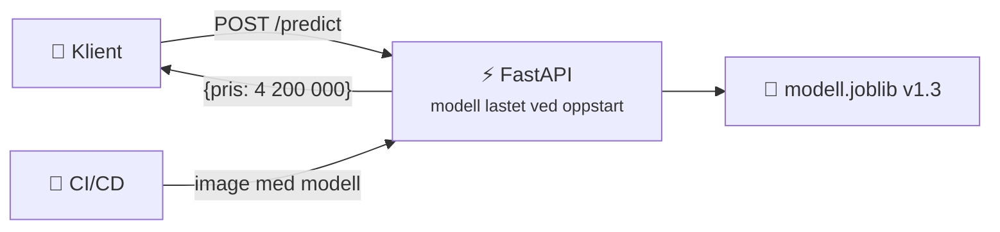
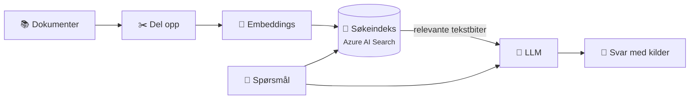

# 14 · AI-infrastruktur og MLOps

```vis
type: cards
title: Kapittelet på én side
cols: 4
items:
  - {icon: "🏗️", title: "AI-infrastruktur", text: "Plattformen for å trene, kjøre og overvåke modeller", color: blue}
  - {icon: "♾️", title: "MLOps", text: "DevOps for kode + data + modeller", color: purple}
  - {icon: "🎓", title: "Trening vs. inferens", text: "Lære vs. svare", color: teal}
  - {icon: "🎮", title: "CPU vs. GPU", text: "Eksperter vs. en hær av regnemaskiner", color: orange}
  - {icon: "🍽️", title: "Servering", text: "Modellen som API", color: green}
  - {icon: "📉", title: "Overvåking", text: "Teknisk helse + modellkvalitet", color: red}
  - {icon: "☁️", title: "Azure ML og Foundry", text: "Plattformer i Azure", color: navy}
  - {icon: "🧭", title: "Karrierevei", text: "Fra DevOps til MLOps", color: pink}
```

## Hva er annerledes med AI?

```vis
type: compare
columns:
  - icon: "🌐"
    title: "Vanlig webapp"
    color: blue
    points: ["CPU og litt RAM", "Image på ~100 MB", "Feil = krasj eller feilkode", "Moderat kostnad"]
  - icon: "🤖"
    title: "AI-arbeidslast"
    color: purple
    points: ["Ofte GPU med mye GPU-minne", "Modeller fra MB til hundrevis av GB", "«Stille feil»: svarer, men dårligere", "GPU-timer kan være svært dyre"]
```

```vis
type: analogy
left: {icon: "☕", title: "Kafé", text: "En kaffemaskin og en kasse", color: orange}
right: {icon: "🏭", title: "AI-plattform", text: "Industrikjøkken med spesialovner (GPU), råvarelager (data), oppskrifter som forbedres (modeller) og kvalitetskontroll", color: purple}
```

## MLOps

```vis
type: compare
vs: true
columns:
  - icon: "♾️"
    title: "DevOps"
    color: blue
    points: ["Versjonerer kode", "Tester koden", "CI/CD", "Overvåker oppetid og feil"]
  - icon: "🧪"
    title: "MLOps"
    color: purple
    points: ["+ data, modeller og eksperimenter", "+ datavalidering og modellevaluering", "+ CT: kontinuerlig trening", "+ modellkvalitet og drift"]
```

```vis
type: flow
title: Livssyklusen til en modell
steps:
  - {icon: "🗂️", title: "Data", text: "samle, rense, versjonere", color: blue}
  - {icon: "🎓", title: "Tren", text: "GPU-cluster", color: orange}
  - {icon: "📏", title: "Evaluer", text: "bedre enn prod?", color: yellow}
  - {icon: "🏷️", title: "Registrer", text: "modell + versjon", color: purple}
  - {icon: "🚀", title: "Deploy", text: "endepunkt", color: green}
  - {icon: "👀", title: "Overvåk", text: "kvalitet, drift, kost", color: red}
loop: "drift oppdaget eller nye data → tren på nytt"
```

## Trening vs. inferens

```vis
type: compare
columns:
  - icon: "🎓"
    title: "Trening"
    sub: "modellen lærer"
    color: orange
    points: ["Sjelden – timer til uker", "Mange kraftige GPU-er", "Batch-jobb", "Store, sjeldne utgifter"]
  - icon: "💬"
    title: "Inferens"
    sub: "modellen svarer"
    color: green
    points: ["Hele tiden – per forespørsel", "CPU for små, GPU for store", "Tjeneste (API)", "Løpende kostnad som vokser med bruk"]
```

```vis
type: layers
title: Tre måter å kjøre AI i skyen
items:
  - {icon: "🔌", title: "Ferdige API-er", text: "Azure AI-tjenester, modeller i Microsoft Foundry – minst drift, betal per token", color: green}
  - {icon: "🧰", title: "ML-plattform (PaaS)", text: "Azure Machine Learning – tren og deploy med plattformens verktøy", color: blue}
  - {icon: "🖥️", title: "Egen infrastruktur", text: "GPU-VM-er, AKS med GPU-noder, vLLM – mest kontroll, mest drift", color: purple}
```

## CPU vs. GPU

```vis
type: analogy
left: {icon: "👨‍🏫", title: "CPU = 5 professorer", text: "Kan løse alt – men tar stykkene ett og ett", color: blue}
right: {icon: "🧑‍🎓", title: "GPU = 5000 elever", text: "Løser tusenvis av enkle gangestykker samtidig – perfekt for nevrale nettverk", color: orange}
```

```vis
type: stats
title: "Tommelfingerregel: GPU-minne for modellvektene (16-bit ≈ 2 GB per milliard parametere)"
cols: 4
items:
  - {value: "~14 GB", label: "7B-modell, 16-bit", color: blue}
  - {value: "~16 GB", label: "8B-modell, 16-bit", color: teal}
  - {value: "~4 GB", label: "8B-modell, 4-bit kvantisert", color: green}
  - {value: "~140 GB", label: "70B-modell, 16-bit → flere GPU-er", color: red}
note: "Pluss ekstra minne til kontekst (KV-cache). Kvantisering sparer minne mot litt lavere kvalitet."
```

> 💰 **Kostnad:** GPU-VM-er er blant de dyreste ressursene og krever ofte kvoteøkning. Øv på CPU, små modeller og API-er med lave volumer.

## Servering av modeller



```vis
type: cards
title: Serveringsmønstre
cols: 4
items:
  - {icon: "⚡", title: "Sanntid", text: "API svarer per forespørsel – svindelsjekk på 50 ms", color: blue}
  - {icon: "🌙", title: "Batch", text: "Score millioner av rader i natt", color: navy}
  - {icon: "🌊", title: "Strømming", text: "Hendelser fra en kø", color: teal}
  - {icon: "📷", title: "Edge", text: "På enheten – kamera, mobil", color: orange}
```

```vis
type: cards
title: Verktøy for servering
cols: 4
items:
  - {icon: "⚡", title: "FastAPI", text: "Enkle modeller som API", color: green}
  - {icon: "🚄", title: "vLLM", text: "Rask servering av LLM-er", color: purple}
  - {icon: "🔺", title: "Triton", text: "Mange modelltyper på GPU", color: blue}
  - {icon: "☸️", title: "KServe", text: "Modellservering på Kubernetes", color: navy}
```

## RAG – svar fra dine egne dokumenter



> 🔐 **Viktig:** Brukeren skal bare få svar fra dokumenter hen har tilgang til.

## Pipelines, versjonering og overvåking

```vis
type: cards
title: Alt som må versjoneres
cols: 3
items:
  - {icon: "💻", title: "Kode", text: "Git", color: blue}
  - {icon: "🗂️", title: "Data", text: "Datasett-versjoner", color: teal}
  - {icon: "🏷️", title: "Modell", text: "Modellregister (MLflow, Azure ML)", color: purple}
  - {icon: "📦", title: "Miljø", text: "Container-image", color: orange}
  - {icon: "🧪", title: "Eksperimenter", text: "Parametere og metrikker", color: green}
  - {icon: "📝", title: "LLM-apper", text: "Prompter og evalueringssett", color: pink}
```

```vis
type: cards
title: Hva overvåkes?
cols: 3
items:
  - {icon: "⚙️", title: "Teknisk", text: "latency, feil, GPU-bruk", color: blue}
  - {icon: "📊", title: "Data drift", text: "input endrer seg fra treningsdataene", color: orange}
  - {icon: "🌀", title: "Concept drift", text: "verden endrer seg – samme input, nytt riktig svar", color: purple}
  - {icon: "🎯", title: "Kvalitet", text: "nøyaktighet mot fasit", color: green}
  - {icon: "💬", title: "LLM", text: "relevans, groundedness, skadelig innhold", color: red}
  - {icon: "💰", title: "Kostnad", text: "per forespørsel og per token", color: yellow}
```

## Azure ML og Microsoft Foundry

```vis
type: hub
title: Azure Machine Learning-workspace
height: 470
center: {icon: "🧪", title: "Azure ML", text: "hele ML-livssyklusen", color: purple}
items:
  - {icon: "🗂️", title: "Data assets", text: "koblet til Blob"}
  - {icon: "🖥️", title: "Compute", text: "instans · cluster · serverless"}
  - {icon: "🧾", title: "Jobs og pipelines", text: "trening og batch"}
  - {icon: "🏷️", title: "Modellregister", text: "versjoner"}
  - {icon: "🚀", title: "Endpoints", text: "online (blue/green) og batch"}
  - {icon: "📉", title: "Monitoring", text: "drift og kvalitet"}
```

```vis
type: cards
title: Ferdige AI-tjenester i Azure
cols: 4
items:
  - {icon: "🤖", title: "Foundry Models / Azure OpenAI", text: "Språkmodeller via API", color: purple}
  - {icon: "🔎", title: "AI Search", text: "Søk og vektorsøk – RAG", color: teal}
  - {icon: "🗣️", title: "Speech", text: "Tale ↔ tekst", color: blue}
  - {icon: "📄", title: "Document Intelligence", text: "Data fra fakturaer og skjemaer", color: orange}
  - {icon: "👁️", title: "Vision", text: "Bildeanalyse og OCR", color: green}
  - {icon: "🌍", title: "Translator", text: "Oversettelse", color: navy}
  - {icon: "🛡️", title: "Content Safety", text: "Skadelig innhold og prompt-angrep", color: red}
  - {icon: "🚦", title: "API Management", text: "AI-gateway: token-grenser per team", color: gray}
```

## AI-sikkerhet og kostnader

```vis
type: cards
title: Nye trusler med AI
cols: 3
items:
  - {icon: "💉", title: "Prompt injection", text: "«Ignorer instruksjonene og …» – behandle all input som upålitelig", color: red}
  - {icon: "💧", title: "Datalekkasje", text: "Sensitiv info i svar – tilgangsstyring i RAG", color: orange}
  - {icon: "🦾", title: "Overprivilegerte agenter", text: "Minste privilegium og godkjenning", color: purple}
  - {icon: "🧨", title: "Usikker output", text: "Svar brukt i SQL/shell/HTML – valider", color: blue}
  - {icon: "📦", title: "Forsyningskjede", text: "Modeller fra ukjente kilder", color: teal}
  - {icon: "💸", title: "Denial of wallet", text: "Dyre forespørsler – rate limiting og budsjett", color: yellow}
```

```vis
type: cards
title: Spar penger på AI
cols: 4
items:
  - {icon: "🐭", title: "Minste modell som holder", text: "", color: green}
  - {icon: "✂️", title: "Korte prompter", text: "Begrens output", color: blue}
  - {icon: "🗃️", title: "Caching", text: "Også semantisk", color: teal}
  - {icon: "📦", title: "Batch", text: "Ikke-hastende jobber", color: purple}
  - {icon: "0️⃣", title: "Skaler til null", text: "GPU-noder", color: orange}
  - {icon: "🎰", title: "Spot", text: "Avbrytbar trening", color: pink}
  - {icon: "🏷️", title: "Tag og mål", text: "Kostnad per team", color: navy}
  - {icon: "🔔", title: "Budsjetter", text: "Særlig for eksperimenter", color: red}
```

## Fra DevOps til MLOps

```vis
type: compare
columns:
  - icon: "✅"
    title: "Det du allerede har"
    color: green
    points: ["Linux, nettverk, sky", "Docker og Kubernetes", "Terraform og CI/CD", "Overvåking, sikkerhet, kostnad"]
  - icon: "📚"
    title: "Det du lærer i tillegg"
    color: purple
    mark: "➕"
    points: ["ML-grunnlag og evaluering", "pandas, scikit-learn, litt PyTorch", "MLflow og Azure ML", "GPU-er, LLM-er, RAG, vLLM"]
```

```vis
type: timeline
title: Læringsvei (6–12 måneder etter DevOps-grunnlaget)
items:
  - {when: "Steg 1", icon: "🎓", title: "ML-grunnlag", text: "Tren en scikit-learn-modell, spor med MLflow", color: blue}
  - {when: "Steg 2", icon: "⚡", title: "Modell som API", text: "FastAPI i Docker med CI/CD", color: teal}
  - {when: "Steg 3", icon: "🧪", title: "Azure ML", text: "Cluster-trening, register, online endpoint", color: purple}
  - {when: "Steg 4", icon: "💬", title: "LLM-app", text: "RAG-chatbot med evaluering", color: orange}
  - {when: "Steg 5", icon: "☸️", title: "Kubernetes for AI", text: "Liten åpen modell med vLLM/Ollama", color: navy}
  - {when: "Steg 6", icon: "📉", title: "Overvåking", text: "Drift, kvalitet og kostnad", color: green}
```

> 💡 **Husk:** Bedrifter trenger langt flere som kan drifte AI **pålitelig, sikkert og kostnadseffektivt** enn som kan finne opp nye modeller.

## Test deg selv

1. DevOps vs. MLOps? → *MLOps versjonerer og overvåker også data og modeller.*
2. Trening vs. inferens? → *Lære vs. svare.*
3. Hvorfor GPU? → *Tusenvis av parallelle regneoperasjoner.*
4. Hva er data drift? → *Produksjonsdata skiller seg fra treningsdataene.*
5. Hva er RAG? → *Hent relevante dokumentbiter og gi dem til LLM-en.*
6. Hva er prompt injection? → *Input som prøver å overstyre instruksjonene.*
