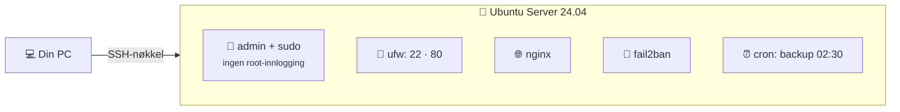
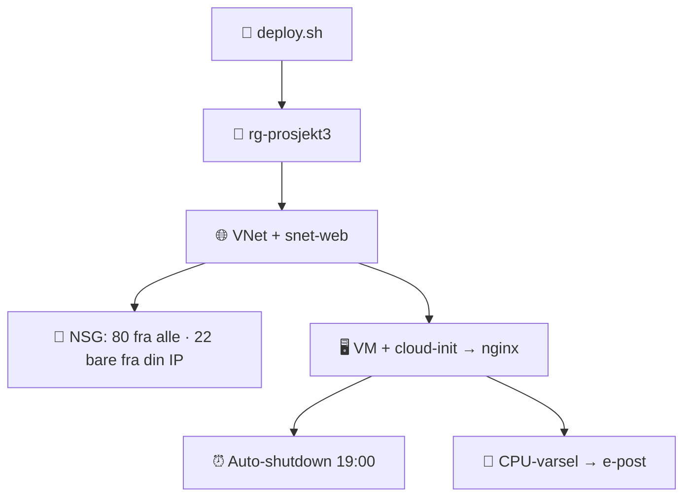
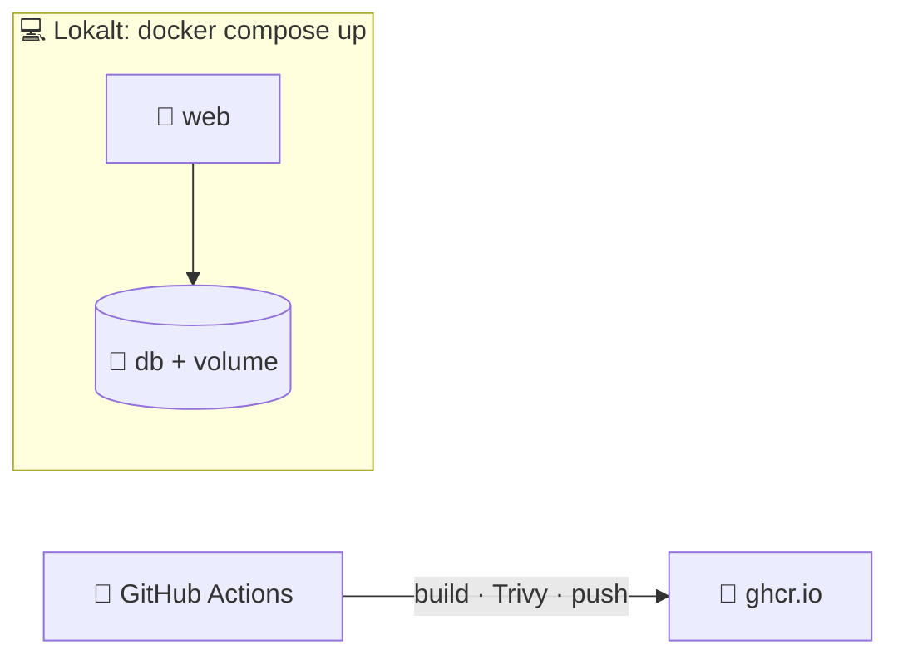
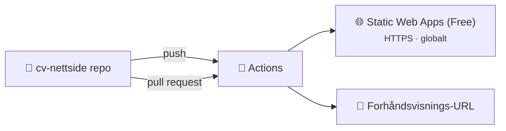
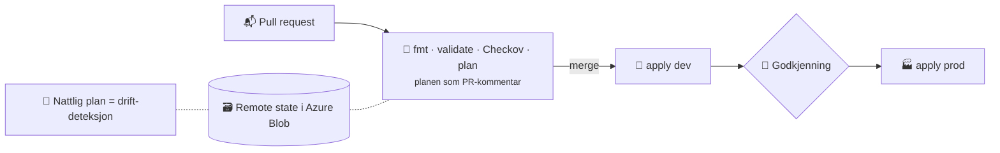
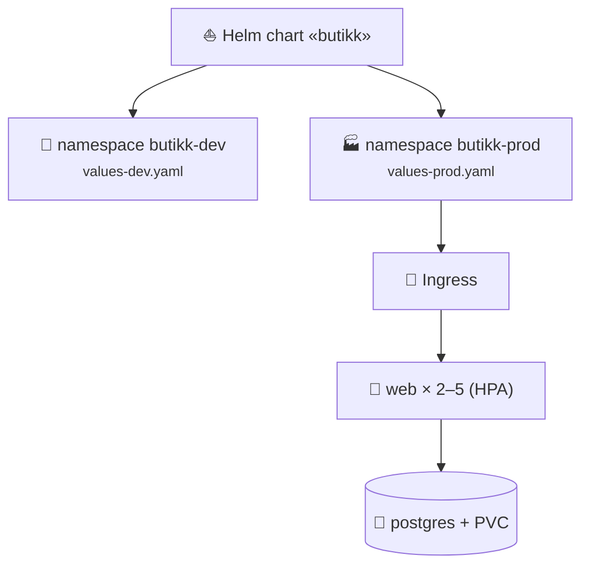
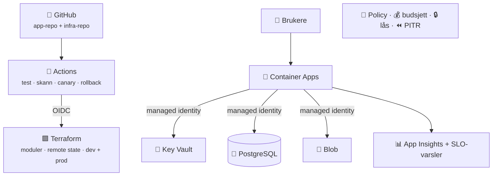
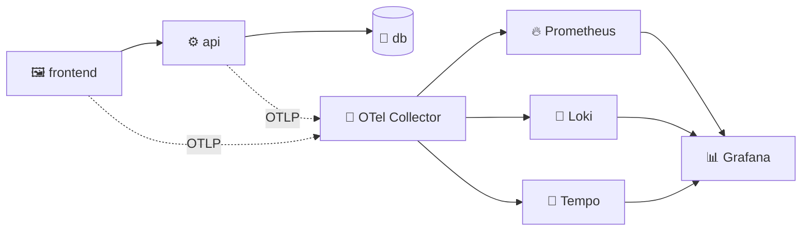

# 15 · Tolv prosjekter

Hvert prosjekt vises som et **prosjektkort** og en **arkitekturtegning**. Full steg-for-steg-oppskrift med all kode finnes i fullversjonen, kapittel 15.

```vis
type: cards
title: Prosjektkartet – fra enkel til avansert
cols: 4
items:
  - {icon: "🐧", title: "1 · Linux-server", text: "★☆☆☆☆ · 4–6 t · gratis", color: blue}
  - {icon: "🐍", title: "2 · Kostnadsjeger", text: "★★☆☆☆ · 4–6 t · gratis", color: blue}
  - {icon: "🖥️", title: "3 · Azure-VM med kode", text: "★★☆☆☆ · 3–4 t · øre", color: blue}
  - {icon: "🐙", title: "4 · GitHub-portefølje", text: "★★☆☆☆ · 3–4 t · gratis", color: blue}
  - {icon: "🐳", title: "5 · Docker-app", text: "★★★☆☆ · 4–6 t · gratis", color: teal}
  - {icon: "🌐", title: "6 · Nettside på Azure", text: "★★★☆☆ · 3–5 t · gratis", color: teal}
  - {icon: "🚀", title: "7 · CI/CD til App Service", text: "★★★☆☆ · 6–8 t · lav", color: teal}
  - {icon: "🟪", title: "8 · Terraform + pipeline", text: "★★★★☆ · 8–12 t · lav", color: purple}
  - {icon: "☸️", title: "9 · Kubernetes + Helm", text: "★★★★☆ · 8–12 t · gratis lokalt", color: purple}
  - {icon: "🏆", title: "10 · Komplett plattform", text: "★★★★★ · 25–40 t · lav–moderat", color: red}
  - {icon: "🤖", title: "11 · MLOps", text: "★★★★☆ · 10–15 t · lav", color: purple}
  - {icon: "🚨", title: "12 · Observability + game day", text: "★★★★☆ · 8–10 t · gratis", color: purple}
```

```vis
type: cards
title: Regler for alle sky-prosjekter
cols: 5
items:
  - {icon: "📁", title: "Én ressursgruppe", text: "per prosjekt", color: blue}
  - {icon: "🏷️", title: "Tags", text: "prosjekt · eier · utløper", color: teal}
  - {icon: "🔔", title: "Budsjettvarsel", text: "før du starter", color: orange}
  - {icon: "🧹", title: "Rydd samme dag", text: "az group delete", color: red}
  - {icon: "📝", title: "README underveis", text: "ikke etterpå", color: green}
```

## 1 · Linux-server



**Du lærer:** SSH-herding, brukere, brannmur, nginx, automatiske oppdateringer, backup med cron. **CV:** «Installerte og herdet Ubuntu Server med nøkkelbasert SSH, ufw, fail2ban og automatisert backup.»

## 2 · Kostnadsjeger i Python

```vis
type: flow
steps:
  - {icon: "🔐", title: "DefaultAzureCredential", text: "az login / managed identity"}
  - {icon: "📋", title: "List ressursgrupper", text: "Azure SDK"}
  - {icon: "🏷️", title: "Sjekk tags", text: "eier? utløper?"}
  - {icon: "📄", title: "Rapport", text: "JSON + logg + returkode"}
  - {icon: "🗑️", title: "--slett", text: "utløpte, etter bekreftelse"}
```

**Du lærer:** Azure SDK, argparse, logging, tester med pytest. **CV:** «Python-verktøy som finner ressurser uten eier- og utløpstagger for å redusere skykostnader.»

## 3 · Azure-VM med kode



## 4 · GitHub-portefølje

```vis
type: cards
cols: 4
items:
  - {icon: "🙋", title: "Profil-README", text: "Repo med samme navn som brukernavnet", color: blue}
  - {icon: "📋", title: "PR-mal og issues", text: "Jobb som et team", color: teal}
  - {icon: "🛡️", title: "Ruleset på main", text: "Krev PR og grønn CI", color: red}
  - {icon: "🤖", title: "Dependabot + secret scanning", text: "Automatisk sikkerhet", color: purple}
```

## 5 · Docker-app



## 6 · Nettside på Azure Static Web Apps



**Tips:** Bruk den som din egen CV-nettside – og lenk til den øverst i CV-en.

## 7 · CI/CD til App Service

```vis
type: flow
steps:
  - {icon: "🧪", title: "CI", text: "ruff · pytest · pip-audit", color: green}
  - {icon: "📦", title: "Build", text: "zip én gang", color: purple}
  - {icon: "🧪", title: "Staging", text: "deploy + smoke test", color: teal}
  - {icon: "👤", title: "Godkjenning", text: "environment", color: yellow}
  - {icon: "🏭", title: "Prod", text: "samme artefakt", color: blue}
note: "OIDC til Azure · managed identity → Key Vault · Application Insights"
```

## 8 · Terraform med pipeline



## 9 · Kubernetes med Helm



## 10 · Komplett plattform – sluttprosjektet



```vis
type: timeline
title: Sju faser
items:
  - {when: "Fase 1", icon: "📐", title: "Design", text: "ADR-er, SLO-er, arkitekturtegning", color: blue}
  - {when: "Fase 2", icon: "🟪", title: "IaC", text: "Moduler, remote state, policy, budsjett", color: purple}
  - {when: "Fase 3", icon: "🐍", title: "App", text: "Passordløs tilgang, OpenTelemetry", color: teal}
  - {when: "Fase 4", icon: "🚀", title: "CI/CD", text: "Canary, rollback, skanning", color: orange}
  - {when: "Fase 5", icon: "📊", title: "Drift", text: "Dashboard, varsler, runbooks", color: green}
  - {when: "Fase 6", icon: "⏪", title: "Robusthet", text: "Test PITR og full gjenoppbygging", color: red}
  - {when: "Fase 7", icon: "🎬", title: "Presentasjon", text: "README, demovideo, opprydding", color: navy}
```

## 11 · MLOps

```vis
type: flow
steps:
  - {icon: "🗂️", title: "Data v1", text: "", color: blue}
  - {icon: "🎓", title: "train.py", text: "MLflow", color: orange}
  - {icon: "🚦", title: "Kvalitetsport", text: "dårligere modell = rødt", color: red}
  - {icon: "📦", title: "Image", text: "serve.py + modell", color: purple}
  - {icon: "🐤", title: "Canary", text: "Container Apps", color: green}
  - {icon: "📉", title: "Drift-sjekk", text: "daglig", color: teal}
```

## 12 · Observability og game day



## Slik presenterer du prosjektene

```vis
type: cards
cols: 3
items:
  - {icon: "📌", title: "Fest 4–6 repoer", text: "De beste øverst på GitHub-profilen", color: blue}
  - {icon: "📝", title: "README-mal", text: "Problem · arkitektur · teknologier · kjør · hva jeg lærte", color: teal}
  - {icon: "🔢", title: "Tallfest", text: "«image fra 900 til 60 MB» · «gjenoppbygd på 18 min»", color: orange}
  - {icon: "⭐", title: "STAR i intervju", text: "Situasjon · oppgave · handling · resultat", color: purple}
  - {icon: "🕵️", title: "Vis feilsøkingen", text: "Ærlige problemer du løste imponerer mest", color: green}
  - {icon: "🚫", title: "Ingen hemmeligheter", text: "Ingen .env, state eller nøkler i repoet", color: red}
```
