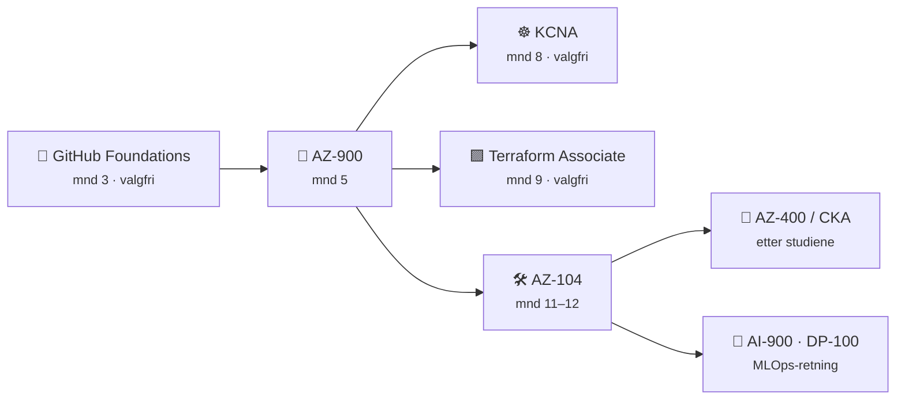

# Vedlegg · Hurtigreferanser, sertifiseringer og læringsplan

## A · De viktigste begrepene på ett oppslag

```vis
type: cards
cols: 4
items:
  - {icon: "🧠", title: "CPU / RAM / SSD", text: "regner / jobber / lagrer", color: blue}
  - {icon: "📖", title: "DNS", text: "navn → IP", color: blue}
  - {icon: "🏷️", title: "CIDR /24", text: "256 adresser (251 i Azure)", color: blue}
  - {icon: "🚪", title: "Port", text: "døren til en tjeneste: 22 · 80 · 443", color: blue}
  - {icon: "⚖️", title: "Lastbalanserer", text: "fordeler trafikk, sjekker helse", color: teal}
  - {icon: "🔒", title: "TLS", text: "kryptering + sertifikat", color: teal}
  - {icon: "🐧", title: "systemctl", text: "styrer tjenester på Linux", color: teal}
  - {icon: "📸", title: "Commit / PR", text: "øyeblikksbilde / gjennomgang før merge", color: teal}
  - {icon: "🍕", title: "IaaS · PaaS · SaaS", text: "hvor mye du drifter selv", color: purple}
  - {icon: "🎭", title: "RBAC", text: "hvem · hva · hvor", color: purple}
  - {icon: "📏", title: "Policy", text: "hva er lov å lage", color: purple}
  - {icon: "🪄", title: "Managed identity", text: "app-innlogging uten passord", color: purple}
  - {icon: "📦", title: "Image / container", text: "mal / kjørende instans", color: orange}
  - {icon: "🫛", title: "Pod / Deployment", text: "instans / ønsket antall", color: orange}
  - {icon: "🔗", title: "Service / Ingress", text: "stabil adresse / HTTP-ruting", color: orange}
  - {icon: "🗃️", title: "Terraform state", text: "kode ↔ virkelighet", color: orange}
  - {icon: "🔁", title: "CI / CD", text: "test ofte / lever ofte", color: green}
  - {icon: "🐤", title: "Canary", text: "litt trafikk først", color: green}
  - {icon: "🎯", title: "SLO / error budget", text: "mål / tillatt feil", color: green}
  - {icon: "🧵", title: "Trace", text: "en forespørsels reise", color: green}
```

## B · Hurtigreferanser

```vis
type: compare
columns:
  - icon: "🐧"
    title: "Linux"
    color: navy
    mark: "▸"
    points: ["pwd · ls -la · cd", "cp · mv · rm -r · mkdir -p", "cat · less · tail -f", "grep -rin · find", "chmod 640 · chown", "systemctl status/restart", "journalctl -u x -f", "df -h · free -h · top", "ss -tlnp · ip addr"]
  - icon: "🐙"
    title: "Git"
    color: orange
    mark: "▸"
    points: ["git status · diff", "git add -p · commit -m", "git switch -c branch", "git pull · push", "git merge · rebase", "git restore · revert", "git stash · reflog", "git log --oneline --graph"]
```

```vis
type: compare
columns:
  - icon: "🐳"
    title: "Docker"
    color: blue
    mark: "▸"
    points: ["docker build -t navn:tag .", "docker run -d -p 8080:80", "docker ps -a · logs -f", "docker exec -it x sh", "docker inspect · stats", "docker compose up -d --build", "docker compose down -v", "docker system prune"]
  - icon: "☸️"
    title: "kubectl"
    color: purple
    mark: "▸"
    points: ["kubectl get pods -A", "kubectl describe pod x", "kubectl logs x --previous", "kubectl apply -f fil.yaml", "kubectl rollout undo deploy/x", "kubectl port-forward svc/x 8080:80", "kubectl top pods", "helm upgrade --install"]
```

```vis
type: compare
columns:
  - icon: "☁️"
    title: "Azure CLI"
    color: teal
    mark: "▸"
    points: ["az login · az account show", "az group create / delete", "az vm create · deallocate", "az webapp up · log tail", "az keyvault secret set/show", "az role assignment create", "az deployment group what-if", "--query \"[].name\" -o tsv"]
  - icon: "🟪"
    title: "Terraform"
    color: purple
    mark: "▸"
    points: ["terraform init", "terraform fmt · validate", "terraform plan -out=tfplan", "terraform apply tfplan", "terraform output -raw x", "terraform state list", "terraform destroy"]
```

## C · Sertifiseringer



> 💡 Sertifiseringer åpner dører – men **prosjekter og forståelse** gir jobben. Kombiner dem.

## D · Kilder

Offisiell dokumentasjon slik den var kjent per **oktober 2026** – sjekk alltid den nyeste versjonen:

```vis
type: cards
cols: 4
items:
  - {icon: "☁️", title: "Microsoft Learn", text: "learn.microsoft.com/azure", color: blue}
  - {icon: "🎓", title: "Sertifiseringer", text: "learn.microsoft.com/credentials", color: blue}
  - {icon: "🐳", title: "Docker", text: "docs.docker.com", color: teal}
  - {icon: "☸️", title: "Kubernetes", text: "kubernetes.io/docs", color: teal}
  - {icon: "🟪", title: "Terraform", text: "developer.hashicorp.com/terraform", color: purple}
  - {icon: "🐙", title: "GitHub", text: "docs.github.com", color: purple}
  - {icon: "🔥", title: "Prometheus · Grafana", text: "prometheus.io · grafana.com/docs", color: orange}
  - {icon: "🧲", title: "OpenTelemetry", text: "opentelemetry.io", color: orange}
  - {icon: "📊", title: "DORA", text: "dora.dev", color: green}
  - {icon: "📕", title: "Google SRE", text: "sre.google/books (gratis)", color: green}
  - {icon: "🛡️", title: "OWASP", text: "owasp.org · genai.owasp.org", color: red}
  - {icon: "🗺️", title: "roadmap.sh", text: "veikart for DevOps", color: red}
```

```vis
type: cards
title: Bøker
cols: 4
items:
  - {icon: "📖", title: "The Phoenix Project", text: "DevOps som roman – start her", color: orange}
  - {icon: "📘", title: "The DevOps Handbook", text: "Praksisen bak", color: blue}
  - {icon: "📗", title: "Accelerate", text: "Forskningen bak DORA", color: green}
  - {icon: "📙", title: "Terraform: Up & Running", text: "IaC i dybden", color: purple}
```

## E · 12-måneders læringsplan

```vis
type: timeline
title: Ett år – fra nybegynner til jobbklar (ca. 8–12 timer i uken)
items:
  - {when: "Mnd 1", icon: "🌍", title: "IT og nettverk", text: "Kap 1–2 · subnetting · forklar «hva skjer når jeg åpner en nettside»", color: blue}
  - {when: "Mnd 2", icon: "🐧", title: "Linux", text: "Kap 3 · bare terminal i en uke · Prosjekt 1", color: blue}
  - {when: "Mnd 3", icon: "🐍", title: "Python og Git", text: "Kap 4–5 · Prosjekt 4 · GitHub-profil", color: blue}
  - {when: "Mnd 4", icon: "☁️", title: "Cloud og Azure-grunnmur", text: "Kap 6–7.1 · budsjettvarsel · Prosjekt 2", color: teal}
  - {when: "Mnd 5", icon: "🎓", title: "Azure-tjenester", text: "Kap 7.2–7.5 · Prosjekt 3 · TA AZ-900", color: teal}
  - {when: "Mnd 6", icon: "♾️", title: "DevOps og Bicep", text: "Kap 8 og 7.4 · Prosjekt 6 · oppdater CV", color: teal}
  - {when: "Mnd 7", icon: "🐳", title: "Docker", text: "Kap 9 · Prosjekt 5 · start å søke internship", color: orange}
  - {when: "Mnd 8", icon: "☸️", title: "Kubernetes", text: "Kap 10 · Prosjekt 9", color: orange}
  - {when: "Mnd 9", icon: "🟪", title: "Infrastructure as Code", text: "Kap 11 · Prosjekt 8 (start)", color: orange}
  - {when: "Mnd 10", icon: "🚀", title: "CI/CD + AZ-104-lab", text: "Kap 12 · Prosjekt 7 og 8 · søk aktivt", color: purple}
  - {when: "Mnd 11", icon: "🛡️", title: "Sikkerhet og monitoring", text: "Kap 13 · Prosjekt 12 · AZ-104-laber", color: purple}
  - {when: "Mnd 12", icon: "🏆", title: "AI + sluttprosjekt", text: "Kap 14 · Prosjekt 10 · TA AZ-104", color: purple}
```

```vis
type: cards
title: Ukerytme
cols: 4
items:
  - {icon: "📖", title: "Mandag · 1,5 t", text: "Les kapittelet", color: blue}
  - {icon: "⌨️", title: "Onsdag · 2 t", text: "Øvelser i terminal og Azure", color: teal}
  - {icon: "🛠️", title: "Lørdag · 3–4 t", text: "Prosjekt", color: orange}
  - {icon: "🔁", title: "Søndag · 1 t", text: "Quiz, notater, oppdater GitHub", color: green}
```

```vis
type: compare
columns:
  - icon: "☀️"
    title: "Sommerjobb / internship"
    sub: "søk fra måned 7–10"
    color: orange
    points: ["3–5 prosjekter på GitHub", "AZ-900", "Linux, Git, Docker, Azure-grunnlag"]
  - icon: "🧑‍🔧"
    title: "Deltidsjobb i drift/support"
    sub: "når som helst fra måned 3"
    color: teal
    points: ["Linux og nettverk", "Vilje til å lære", "Praktisk erfaring er gull"]
  - icon: "🎯"
    title: "Trainee / junior DevOps"
    sub: "siste studieår"
    color: purple
    points: ["Sluttprosjektet", "AZ-104", "6–10 prosjekter, gjerne praksis"]
```

```vis
type: cards
title: Sjekkliste hver måned
cols: 3
items:
  - {icon: "📖", title: "Lest og tatt quiz", text: "", color: blue}
  - {icon: "⌨️", title: "Gjort øvelsene selv", text: "ikke bare lest", color: teal}
  - {icon: "📂", title: "Prosjekt på GitHub", text: "med «hva jeg lærte»", color: purple}
  - {icon: "🧹", title: "Ryddet i Azure", text: "sjekket Cost Management", color: red}
  - {icon: "📄", title: "Oppdatert CV/LinkedIn", text: "", color: orange}
  - {icon: "🎯", title: "Hva var vanskeligst?", text: "plan for å styrke det", color: green}
```

```vis
type: cards
title: Tre ting å huske
cols: 3
items:
  - {icon: "🧱", title: "Grunnmuren betyr mest", text: "Linux, nettverk og «hvorfor» gjør alt annet lettere", color: blue}
  - {icon: "📂", title: "Bygg, dokumenter, del", text: "Ett ekte prosjekt slår ti kurs du bare har sett", color: green}
  - {icon: "🧹", title: "Rydd opp i skyen", text: "Hver gang", color: red}
```

**Lykke til med studiene – og velkommen til DevOps!** 🚀
